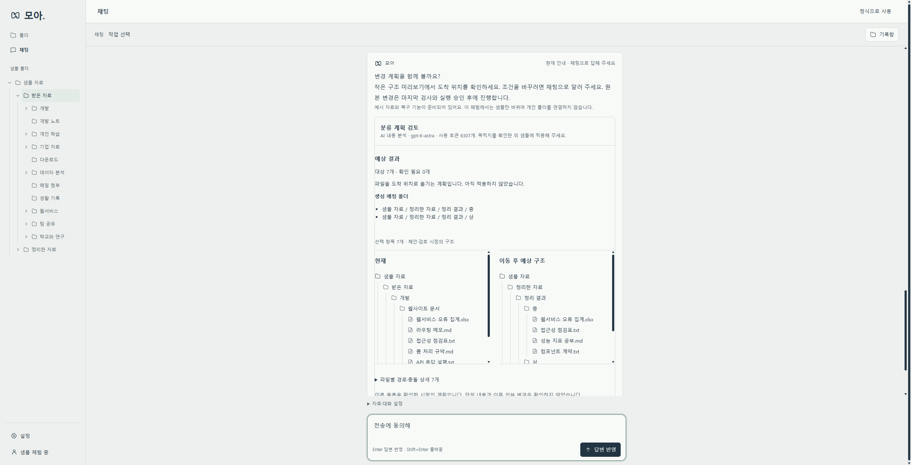
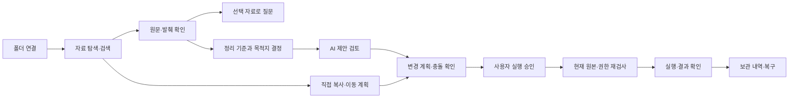
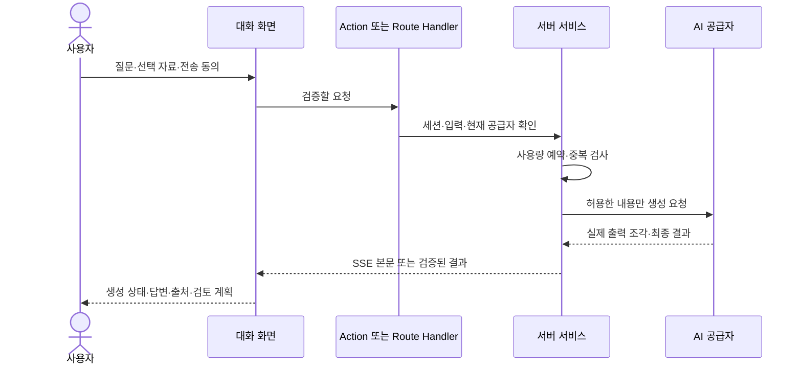

# 모아 · Moa

**내 폴더에서 자료를 찾고, 대화로 정리하고, 바뀔 내용을 확인한 뒤 실행하는 작업 공간입니다.**

파일 이름만으로 찾기 어려운 자료를 본문에서 검색하고, 선택한 자료로 AI에게 질문할 수 있습니다. 파일을 정리할 때는 이동 위치와 충돌을 먼저 확인합니다. 편집·복사·이동 이후에는 보관한 원본과 작업 내역을 살펴보고 복구할 수 있습니다.

개인 프로젝트 · 2026.09–2026.11 · Next.js / React / TypeScript

[서비스 화면](https://web-eight-rho-72.vercel.app/welcome) · [실행 방법](#로컬-실행) · [코드 구조](#프로젝트-구조) · [성능 측정](#성능을-확인한-방법)

> 데모는 별도로 공유한 초대 링크로 접속합니다. 초대 링크를 처음 열면 로그인 없이 소개 화면과 샘플 작업 공간을 이용할 수 있습니다. 일반 `/demo` 주소는 초대가 등록된 브라우저에서 열립니다.



*2026-11-18 운영 데모에서 실제 AI가 제안한 정리 계획입니다. 예시 자료를 사용했으며, 화면의 계획을 확인하고 적용하기 전에는 파일 위치가 바뀌지 않습니다.*

## 목차

- [어떤 문제를 풀었는가](#어떤-문제를-풀었는가)
- [주요 기능](#주요-기능)
- [사용 흐름](#사용-흐름)
- [정식 작업 공간과 데모](#정식-작업-공간과-데모)
- [기술 구성과 선택 이유](#기술-구성과-선택-이유)
- [코드 구성 기준](#코드-구성-기준)
- [핵심 처리 흐름](#핵심-처리-흐름)
- [프로젝트 구조](#프로젝트-구조)
- [성능을 확인한 방법](#성능을-확인한-방법)
- [트러블슈팅](#트러블슈팅)
- [테스트와 검증](#테스트와-검증)
- [로컬 실행](#로컬-실행)
- [현재 범위와 남은 작업](#현재-범위와-남은-작업)
- [더 읽을 문서](#더-읽을-문서)

## 어떤 문제를 풀었는가

자료가 쌓이면 파일 위치보다 그 안에 무엇이 들어 있는지 기억하는 일이 더 어려워집니다. 이름이 비슷한 문서를 열어 내용을 확인하고, 분류 기준을 정하고, 옮긴 뒤 잘못된 작업이 없는지 살펴봐야 합니다.

모아는 이 과정을 한 작업 공간에서 이어 갈 수 있게 만들었습니다. 검색 결과에서 원문을 확인하고, 필요한 파일만 질문 자료로 선택하고, 정리 제안을 변경 계획으로 넘깁니다. 사용자가 파일을 직접 다룰 때도 같은 목적지 탐색과 계획 검토 화면을 사용합니다.

개발 기준은 세 가지입니다.

1. **읽기와 전송, 쓰기를 구분합니다.** 폴더를 연결했다고 전체 자료를 AI로 보내지 않고, AI가 제안했다고 바로 파일을 옮기지 않습니다.
2. **작업 중인 내용을 유지합니다.** 추가 질문에 답하거나 패널을 오갈 때 자료 선택과 초안을 잃지 않도록 합니다.
3. **실행 시점의 원본을 확인합니다.** 계획을 만든 뒤 파일이 바뀌었거나 권한이 사라졌다면 이전 계획으로 실행하지 않습니다.

## 주요 기능

| 기능 | 할 수 있는 일 | 구현에서 다룬 부분 |
| --- | --- | --- |
| 폴더 연결·탐색 | 사용자가 고른 로컬 폴더 연결, 경로 이동, 다중 선택, 새 항목 생성 | 읽기 권한, 연결 소유자, 목록 갱신 중 선택 차단, 연결 재확인 |
| 자료 찾기 | 파일 이름·경로·본문·날짜·형식·제외 조건으로 검색 | 조건 확인, 본문 근거 표시, 본문을 읽지 못한 후보의 선택 제한 |
| 선택형 의미 검색 | 설치한 로컬 모델로 표현이 다른 자료 탐색을 보완 | Worker 추론, 모델 파일 검증, 기존 검색 조건과 근거 유지 |
| 자료로 질문 | 선택한 문서의 발췌를 확인하고 질문, 답변의 출처 다시 열기 | 전송 동의, 현재 문서 버전, 문서 ID와 인용문 검증 |
| 대화로 정리 | 범위·기준·목적지를 정하고 AI 분류 제안 검토 | 후속 답변, 보류 자료 확인, 새 동의, 변경 계획 연결 |
| 일반 대화 | 자료를 첨부하지 않고 질문, 생성 중 본문 확인, 응답 중지 | SSE, 요청 식별값·순서 검사, 늦은 응답 차단, 미완료 답변 보존 |
| 문서 편집 | TXT·Markdown을 미리보기 안에서 편집하고 수동·주기 저장 | 미저장 이탈 확인, 저장 실패 시 초안 유지, 외부 변경 검사 |
| 복사·이동·복구 | 목적지 선택, 충돌 검토, 명시 실행, 보관본 확인과 복원 | 실행 전 재검사, 원본 보존, 작업 기록, 부분 실패 처리 |
| AI 기록·위키 | 대화·기억·결과물·위키를 지정한 폴더에 보관 | 기록 종류·버전·본문 해시, 충돌 감지, 손상된 항목 분리 |
| 인증·작업 공간 | 이메일·소셜 인증 경로, 계정 설정과 계정 연결 | Better Auth 서버 세션, workspace 격리, 계정 변경 시 로컬 상태 분리 |

MD/TXT와 PDF 미리보기, 이미지형 PDF의 OCR 경로가 있습니다. 데모에 포함된 PDF/XLSX 자료는 준비한 자산과 검증된 발췌를 사용합니다. 사용자 XLSX 파일의 업로드·본문 파싱은 지원 범위 밖입니다.

## 사용 흐름



### 자료를 찾아 질문할 때

검색 요청을 조건으로 해석한 뒤 사용자가 범위를 확인합니다. 결과의 이름과 본문 근거를 살펴보고 질문에 쓸 자료를 고릅니다. 전송할 발췌와 공급자를 확인한 다음 AI 요청을 보냅니다. 답변에 표시한 출처를 열 때도 현재 연결과 파일 내용을 다시 확인합니다.

### 파일을 정리할 때

정리 대상, 분류 기준, 최종 목적지를 정합니다. AI는 파일별 상대 경로와 근거를 제안하고, 정보가 부족한 자료는 추가 질문으로 남깁니다. 제안을 받은 뒤에는 이동 전후 구조와 충돌을 검토합니다. 원본 변경은 실행 승인을 받은 뒤 브라우저에서 수행합니다.

## 정식 작업 공간과 데모

공통 대화 화면, 파일 목록, 목적지 선택과 변경 계획 UI를 사용합니다. 읽고 쓰는 대상과 저장 방식은 다릅니다.

| 구분 | 정식 작업 공간 | 초대 데모 |
| --- | --- | --- |
| 시작 | 로그인 후 사용자가 폴더 연결 | 초대 링크로 진입, 로그인 없이 샘플 사용 |
| 자료 | 사용자가 선택한 로컬 파일 | 준비된 예시 자료와 이 탭에서 바꾼 사본 |
| 파일 작업 | 브라우저 쓰기 권한과 실행 검사를 통과한 실제 작업 | 탭 안의 샘플 상태 변경 |
| 저장 | 폴더 핸들은 브라우저에, AI 기록은 지정한 별도 폴더에 보관 | `sessionStorage`에 임시 보관 |
| 현재 OpenAI 모델 | Luna, reasoning `none` | Astra, reasoning `medium` |
| AI 결과 | 선택 자료 질문·정리와 일반 대화 | 실제 응답을 점진 표시하고 검증 후 샘플 계획에 반영 |

데모에서 만든 파일, 편집한 내용, 복사·이동·휴지통·복구 결과는 검색과 AI 요청에도 반영됩니다. 정리는 기본적으로 `정리한 자료 / 정리 결과` 안에 모으고, 준비할 때 폴더 이름을 바꿀 수 있습니다. 계획을 적용하면 폴더와 파일 위치가 함께 바뀌며 이번 정리를 되돌릴 수 있습니다.

공개 데모에는 방문자별 일일 30회, 정식에는 사용자별 일일 100회, 각 사용 경로에는 전역 일일 300회의 비용 보호 한도가 있습니다. 한국 시간 날짜를 기준으로 계산하고 요청 식별값으로 중복 생성을 막습니다. 실패나 취소 뒤에 자동으로 유료 요청을 다시 보내지 않습니다. 설정 근거는 [일일 한도](apps/web/src/shared/ai-daily-limits.ts), [예약 규칙](apps/web/src/server/ai/ai-quota.ts), [모델 설정](apps/web/src/server/ai/ai-models.ts)에서 확인할 수 있습니다.

## 기술 구성과 선택 이유

| 구분 | 사용 기술 | 맡긴 역할과 선택 이유 |
| --- | --- | --- |
| 화면·라우팅 | Next.js 16.4.3, React 19.3.1 | 파일 기반 화면 진입점, 공통 layout, 인증 확인과 서버 요청을 한 저장소에서 관리 |
| 언어·계약 | TypeScript 5.9.3, Zod 4.6.7 | 컴파일 시 타입 확인과 실행 시 외부 입력 검사를 분리 |
| 화면 스타일 | CSS Modules, CSS 변수 | 기능 가까이에 스타일을 두고 간격·색상·공통 조작은 토큰으로 공유 |
| 인증 | Better Auth 1.7.17 | 서버 세션과 가입·복구·소셜·계정 연결 정책을 앱 코드에서 관리 |
| DB | PostgreSQL, Prisma 7.10.1 | 인증·workspace·운영 정보 저장, runtime과 migration 접속 역할 분리 |
| 로컬 파일 | File System Access API, IndexedDB | 브라우저에서 사용자가 선택한 폴더 접근, 핸들과 파생 본문 보관 |
| 문서 추출 | PDF.js 6.5.438, Tesseract.js 7.0.0 | PDF 본문 추출과 OCR을 Worker에서 처리 |
| 선택형 검색 모델 | Transformers.js 3.8.1 | 명시 설치 후 브라우저 Worker에서 의미 검색 보완 |
| 외부 AI | OpenAI Responses, Gemini REST | 서버 어댑터에서 공급자별 요청·응답을 공통 계약으로 변환 |
| 검증·배포 | Vitest 5.0.5, ESLint 9.39.5, Vercel | 규칙·실패 경로·모듈 경계 검사와 Next.js 배포 |

Next.js는 화면과 인증·DB·AI 전송 진입점을 함께 구성하기 위해 선택했습니다. 브라우저 파일 처리를 서버로 옮기지는 않았습니다. 폴더 읽기와 쓰기는 클라이언트 기능에 남기고, 비밀키와 DB 접근은 `server`로 제한했습니다.

상태 도구는 역할에 맞춰 사용했습니다. 경로 사이에 유지할 연결과 대화는 Provider가 소유하고, controller와 store가 기능 상태를 바꿉니다. React 화면은 상태를 구독하고 사용자 조작을 명령으로 전달합니다. 모든 상태를 하나의 전역 객체에 넣거나, 반대로 화면마다 같은 상태를 새로 만들지 않도록 했습니다.

## 코드 구성 기준

### 화면에서 시작해 처리 흐름을 따라갈 수 있게

폴더 연결·문서 편집·검색·정리·복구처럼 함께 바뀌는 코드를 기능별로 모았습니다. 그 안에서는 UI, 상태 전이, 순수 규칙, 브라우저 접근을 나눴습니다. 모든 기능에 같은 하위 폴더를 만드는 방식보다 실제 책임을 기준으로 파일을 배치했습니다.

| 위치 | 책임 | 예시 |
| --- | --- | --- |
| `app` | 페이지·layout·Action·Route Handler 조합 | 로그인 확인 후 Provider와 화면 연결 |
| `features` | 기능의 UI·상태·규칙·브라우저 작업 | 파일 선택, 검색 조건, 정리 준비, 편집 세션 |
| `server` | 인증·DB·외부 AI 접근 | workspace 확인, 사용량 예약, 공급자 호출 |
| `shared` | 브라우저와 서버가 공유하는 최소 계약 | 요청 스키마, SSE 이벤트, 인용·경로 규칙 |
| `components` | 여러 기능에서 같은 의미로 쓰는 UI | 대화 화면, Stepper, 대화상자, 상태 안내 |
| `packages/domain` | React·Next.js·DB SDK에 의존하지 않는 규칙 | 문서 한도와 도메인 검증 |

### 공통 UI에는 값과 행동을 전달

복사·이동·복구는 목적지를 탐색하고 경로를 입력하는 과정이 비슷합니다. 이 부분은 `DestinationFolderPicker`와 공통 폼을 조합하고, 덮어쓰기·원본 보존·복구 가능 여부는 각 작업에서 판단합니다.

`Stepper`는 현재 단계를 표시합니다. 다음 단계로 갈 수 있는지는 작업 상태가 판단합니다. 정리 대화에서는 부족한 조건을 한 번에 하나씩 묻고, 파일 실행에서는 검토·충돌 확인·실행 단계를 사용합니다. 같은 표시 부품을 쓰더라도 모든 화면을 같은 절차로 만들지는 않았습니다.

### 상태를 보관하는 위치와 수명을 구분

| 상태 | 보관·관리 위치 | 구분한 이유 |
| --- | --- | --- |
| 현재 작업 단계와 초안 참조 | URL과 workflow 처리 | 뒤로 가기·새로고침 후 현재 위치를 복원 |
| 작업 입력과 검토 계획 | 기능별 store·controller와 보관된 초안 | URL에 본문이나 실행 권한을 넣지 않음 |
| 최초 요청·후속 답변 | 정리 controller와 별도 입력 초안 | 질문에 답하는 입력이 자료 준비를 지우지 않게 함 |
| 현재 대화와 미저장 편집 | owner 범위 Provider·편집 세션 | 패널 이동 중 보존하고 계정 전환 시 분리 |
| 실제 폴더 핸들 | 브라우저 IndexedDB | 기기·origin·소유자에 맞춰 권한을 재확인 |
| 인증 상태 | 서버 세션·HttpOnly 쿠키 | 브라우저의 임의 상태를 인증 근거로 쓰지 않음 |

### 바깥에서 들어오는 값은 다시 검사

TypeScript 타입만으로 서버 입력이나 모델 출력을 신뢰하지 않습니다. Action과 Route Handler에서 세션·Origin·소유권·입력 크기·동의·한도를 검사합니다. 모델 출력은 문서 ID, 인용문, 상대 경로, 날짜 규칙을 통과해야 제안으로 사용합니다.

브라우저의 직접 서버 접근은 고정된 채팅·데모 SSE 전송 모듈로 제한했습니다. ESLint 경계 검사에는 다른 API 호출, `fetch` 별칭, redirect 허용 같은 우회 사례도 포함합니다. 서버 파일의 `server-only` 표시와 기능 간 import 방향은 별도 구조 검사로 확인합니다.

## 핵심 처리 흐름

### 1. 폴더를 열고 문서를 읽는 과정

`SourceFolderProvider`가 연결과 기능 controller의 수명을 관리합니다. `FolderConnectionSession`은 현재 owner와 연결 세대, 읽기 권한을 확인한 뒤 목록이나 본문 읽기를 요청합니다. 목록을 읽는 동안 이전 화면을 유지하고, 아직 확인하지 못한 목적지는 확정하지 못하게 합니다.

본문 추출·해시는 Worker에서 처리합니다. 캐시가 있더라도 현재 원본을 확인한 뒤 사용할 수 있는 본문인지 판단합니다. 폴더 핸들을 서버로 보내 원격에서 탐색하는 구조는 아닙니다.

읽을 코드: [Provider](apps/web/src/features/local-folders/SourceFolderProvider.tsx) → [연결 세션](apps/web/src/features/local-folders/connection-session.ts) → [목록 읽기](apps/web/src/features/local-folders/browsing/source-folder-listing.ts) → [자료 snapshot](apps/web/src/features/local-folders/organization/source-snapshot.ts).

### 2. 검색 결과를 답변 자료로 준비하는 과정

검색 조건을 확인한 뒤 파일 이름·경로·본문과 날짜 근거를 찾습니다. 의미 검색을 설치했다면 로컬 모델의 후보를 추가합니다. 같은 문서는 경로로 합치고 서로 다른 발췌와 점수를 보존합니다.

이름으로 발견했지만 본문을 읽지 못한 파일은 검색 결과로 알릴 수 있습니다. 다만 답변 근거로 선택할 수는 없습니다. 최종 자료 준비 단계에서도 같은 조건을 검사해 UI의 체크박스 제한만 우회할 수 없게 했습니다.

읽을 코드: [검색 규칙](apps/web/src/features/local-folders/search/documents/document-find.ts) → [결과·근거 병합](apps/web/src/features/local-folders/search/documents/document-find-ranking.ts) → [본문 색인](apps/web/src/features/local-folders/search/documents/local-text-index.ts).

### 3. AI 요청과 스트림을 화면으로 연결하는 과정



일반 채팅은 `POST /api/chat`, 데모의 질문·정리는 `POST /demo/stream`을 사용합니다. SSE를 읽는 코드는 네트워크 조각과 이벤트를 구분합니다. UTF-8 문자열을 버퍼에 누적하고 완성된 이벤트만 꺼낸 뒤 요청 ID와 순서를 검사합니다.

정식 일반 채팅에서는 수신한 본문과 화면에 공개한 길이를 나눠 화면 갱신 주기에 맞춰 표시합니다. 데모는 실제 생성 JSON의 `answer`·`summary` 문장만 점진 표시하고 계획은 완료 후 검증합니다. reasoning이나 원시 JSON을 그대로 화면에 노출하지 않습니다.

요청을 중지할 때는 `AbortController`로 전송을 끊고, 늦게 도착한 결과가 현재 요청인지 다시 확인합니다. 데모에서 생성이 끊기거나 최종 검증에 실패하면 이미 받은 문장을 검증 전 답변으로 남기고, 그 문장으로 파일 계획을 실행하지는 않습니다.

읽을 코드: [일반 채팅](apps/web/src/features/conversation-workspace/messaging/useGeneralChat.ts) · [SSE 파서](apps/web/src/shared/sse.ts) · [데모 전송](apps/web/src/features/sample-workspace/sample-stream.ts) · [데모 서버 경계](apps/web/src/server/demo/sample-stream-handler.ts).

### 4. 변경 계획을 실제 파일 작업으로 실행하는 과정

`buildFileChangePlan`은 선택한 원본과 목적지 목록으로 변경될 경로를 계산합니다. 같은 위치, 동명 항목, 중복 목적지, 불완전한 목록을 검사하고 결과를 UI에 전달합니다. 계획 계산 자체가 파일을 쓰지는 않습니다.

실행을 승인하면 현재 권한과 원본·목적지의 동일성을 다시 확인합니다. 크기와 수정 시각만으로 판단하지 않고 필요한 본문 해시도 대조합니다. 이동·덮어쓰기처럼 원본에 영향을 주는 작업은 보존본과 작업 진행 내역을 남기는 경로를 사용합니다. 복원도 대상 경로와 보관 기록을 검사한 뒤 실행합니다.

읽을 코드: [계획 규칙](apps/web/src/features/local-folders/operations/planning/file-change-plan.ts) → [실행·보존](apps/web/src/features/local-folders/operations/managed/managed-execution.ts) → [편집 저장 검증](apps/web/src/features/local-folders/documents/editing/verified-text-writer.ts) → [복구](apps/web/src/features/local-folders/recovery).

## 프로젝트 구조

```text
.
├─ apps/web/
│  ├─ src/
│  │  ├─ app/                         페이지·layout·Action·Route Handler
│  │  │  ├─ (workspace)/              인증된 채팅·파일·설정 진입
│  │  │  ├─ actions/                  서버 작업 진입점
│  │  │  ├─ api/                      인증·일반 채팅·health
│  │  │  └─ demo/                     초대·샘플 화면·데모 SSE
│  │  ├─ features/
│  │  │  ├─ local-folders/            로컬 폴더·문서·검색·파일 작업
│  │  │  ├─ conversation-workspace/   대화·자료 질문·작업 연결
│  │  │  ├─ sample-workspace/         데모 사본·파일·대화·정리
│  │  │  ├─ ai-records/               기록함·저장·편집·위키
│  │  │  ├─ auth/                     가입·로그인·세션·계정
│  │  │  └─ onboarding/               첫 사용 안내
│  │  ├─ server/                     인증·DB·설정·AI·정리 서비스
│  │  ├─ shared/                     요청·응답 스키마와 공유 규칙
│  │  ├─ components/                 공통 layout·폼·대화·단계 표시
│  │  └─ styles/                     전역 스타일과 공통 토큰
│  ├─ tests/                         웹 기능별 단위·통합 테스트
│  ├─ prisma/                        DB 스키마·migration·접속 역할 안내
│  └─ scripts/                       OCR·의미 검색 실행 자산 준비
├─ packages/domain/
│  ├─ src/                           프레임워크와 분리한 도메인 규칙
│  └─ tests/                         도메인 테스트
├─ tests/
│  ├─ architecture/                  서버·기능 import 경계 검사
│  ├─ browser/                       브라우저 회귀 도구
│  ├─ database/                      격리 PostgreSQL·인증 통합 검사
│  ├─ fixtures/                      합성 문서·폴더·평가 자료
│  └─ performance/                   경로·화면 성능 측정 도구
├─ docs/
│  ├─ specs/                         기능 계약과 실패 조건
│  ├─ verification/                  실행 조건·원자료·결과
│  └─ code-map.md                    진입점과 코드 읽는 순서
├─ DESIGN.md                         화면·공통 UI의 기준
└─ pnpm-workspace.yaml               웹·도메인 패키지 구성
```

파일 작업의 세부 코드는 다음처럼 묶었습니다.

| `local-folders` 하위 경로 | 담당 기능 |
| --- | --- |
| `connection` / `browsing` | 핸들 보관, 폴더 연결, 목록·선택·탐색 |
| `documents` / `content` | 미리보기·편집, Worker·PDF·OCR·추출 캐시 |
| `search` / `organization` | 검색 조건·근거·의미 검색, 자료 준비·질문·동의·제안 |
| `operations` / `recovery` | 계획·충돌·실행·휴지통, 보관함·덮어쓰기·복원 |
| `destination-picker` / `creation` | 공통 목적지 탐색, 새 파일·폴더 생성 |
| `workflow` / `history` | 진행 단계·URL 복원, 파일 작업 내역 |

처음 읽을 때는 [소스 폴더 안내](apps/web/src/README.md)와 [코드 지도](docs/code-map.md)를 함께 보면 화면에서 처리 함수까지 따라가기 쉽습니다.

## 성능을 확인한 방법

빠르게 느껴지는지와 실제 처리 비용을 나눠 봤습니다. 설정은 반복 방문 대기, PDF는 본문 재추출, 대화는 수신과 표시 시점을 각각 확인했습니다. 아래 수치는 기록 당시 조건의 결과입니다.

### 설정 재진입: 같은 표시 정보를 반복 조회하지 않도록

설정 화면을 다시 열 때 계정·연결 표시 정보를 매번 조회하던 방식을 바꿨습니다. 로그인 후 표시 정보를 미리 준비하고 같은 사용자·로그인 범위에서 재사용합니다. 현재 인증은 매 요청 확인하며, 표시 정보 캐시는 로그인 식별값의 해시와 사용자 ID로 구분하고 변경 시 갱신합니다.

| 측정 구간 | 이전 조회 방식 복원 | 캐시 적용 방식 |
| --- | ---: | ---: |
| 반복 설정 준비 중앙값 | 1.541초 | 0.675초 |
| 첫 작업 공간 + 첫 설정 합계 | 6.852초 | 6.927초 |

반복 설정 준비는 약 **56.2%**, **866ms** 줄었습니다. 첫 준비 비용 일부가 작업 공간 진입으로 이동했으므로 첫 진입 전체가 같은 비율로 빨라진 것은 아닙니다.

측정은 2026-11-08 같은 로컬 production·실제 인증/DB·한 사용자 브라우저에서 이전→현재→현재→이전 순서로 진행했습니다. 전체 화면 준비 80개 중 반복 설정은 방식별 18개입니다. 정확한 옛 빌드 대신 이전 조회 방식을 현재 UI에 복원했고, prefetch를 끈 고유 query 탐색을 사용했습니다. 운영 사용자 전체의 응답 시간이나 LCP·INP 측정값과는 구분합니다.

근거: [측정 보고서·원자료](docs/verification/settings-cache-timing/measurement-20261108-v2/report.md) · [설정 캐시 구현](apps/web/src/server/settings/settings-display.ts).

### PDF 반복 사용: 현재 원본 확인 후 추출한 본문 재사용

파일의 추출 본문은 질문이 바뀌어도 재사용할 수 있습니다. 원본 해시와 추출 조건이 같으면 IndexedDB의 본문을 사용하고, 질문에 맞는 발췌만 다시 준비합니다. 캐시가 적중한 본문을 다시 저장하지 않도록 조회·추출·저장 순서도 조정했습니다.

| 입력 | 무캐시 중앙값 | 본문 캐시 적중 중앙값 |
| --- | ---: | ---: |
| 짧은 Markdown | 0.30ms | 0.65ms |
| 긴 Markdown | 2.65ms | 3.35ms |
| 1쪽 PDF | 82.95ms | 1.05ms |
| 24쪽 PDF | 103.75ms | 1.25ms |

Worker 재사용·원본 미변경·초기 회차 제외 조건에서 각 6표본을 비교했습니다. PDF는 재추출 생략의 이득이 컸고, Markdown은 캐시 조회·복제 비용 때문에 오히려 시간이 늘었습니다.

배포 Worker와 합성 메모리 `File`로 추출·캐시 구간을 측정한 결과입니다. 실제 디스크 읽기, 폴더 탐색, 권한 재검사 전체의 시간이 아닙니다. 원본 바이트 읽기와 해시 확인까지 생략한 것으로 해석하지 않습니다.

근거: [조건을 맞춘 캐시 재측정](docs/verification/search-rag-followup-20261115/README.md) · [본문 캐시 검사](apps/web/src/features/local-folders/content/text-cache.ts).

### 설정 화면의 뒤늦은 안내로 생긴 밀림

폴더 연결 상태를 읽은 뒤 권한 안내가 삽입되면서 아래 설정 항목이 밀렸습니다. 안내를 처음부터 렌더링해 조회 결과에 따라 안내 영역이 뒤늦게 추가되는 흐름을 바꿨습니다.

| 설정 화면 폭 | 수정 전 최대 CLS | 수정 후 최대 CLS |
| --- | ---: | ---: |
| 1440px | 0.036688 | 0.007240 |
| 390px | 0.155152 | 0.046490 |

2026-11-04 로컬 production·Chrome156에서 6경로×2폭×3회씩 관측한 기록입니다. 390px의 최대 CLS는 약70.0% 줄었습니다. 두 폭의 측정기는 병렬 실행했고 CPU·네트워크 제한은 없었습니다. 모바일 폭의 브라우저 관측이며 실물 휴대폰이나 현재 운영 화면의 전체 안정성을 대표하지는 않습니다.

근거: [안내 렌더링과 CLS 관측](docs/verification/recovery-archive/performance.md).

### 생성 표시와 정적 자산 크기

2026-11-18 운영 데모에서 일반 대화와 자료 정리를 실제 Astra로 1회씩 확인했습니다. 일반 답변은 169개, 정리 요약은 112개의 본문 이벤트로 나뉘어 도착했습니다. 완성된 답변을 나중에 애니메이션으로 재생한 것이 아니라 생성 중 받은 문장을 표시했습니다.

당시 최종 빌드의 정적 JS/CSS 합계는 54개 파일·4,578,439bytes였습니다. 직전 기준보다 5,435bytes 늘었으며, 첫 방문의 실제 전송량이나 메모리 사용량과 같은 값은 아닙니다. 스트림 조각은 메모리에서 갱신하고 최종·중단 결과를 보관해 토큰마다 저장소에 쓰지 않도록 했습니다.

근거: [실제 스트림·화면·빌드 검증](docs/verification/demo-flow-stream-20261118/README.md). 경로별 로딩, CLS, Lighthouse의 과거 조건은 [성능 정책과 측정 기록](docs/performance-policy.md)에 따로 남겼습니다.

## 트러블슈팅

사용 흐름과 코드 구조에 영향을 준 문제를 추렸습니다. 표에서는 바뀐 기준을 정리하고, 아래에서는 입력 상태·스트림·원본 검증을 조금 더 설명합니다.

| 문제 | 원인과 수정 | 확인한 결과·관련 코드 |
| --- | --- | --- |
| 단계가 쌓일수록 다음 할 일을 찾기 어려움 | 현재 단계 표시와 다음 단계로 갈 수 있는 조건을 분리. 실행 화면에 공통 Stepper와 작업 상태 연결 | 검토·충돌·실행·복원 흐름에서 단계 이동과 복원 검사. [URL 처리](apps/web/src/features/local-folders/workflow/use-workflow-url.ts) |
| 목적지 이동 중 목록·입력창이 깜빡임 | 이전 목록을 유지한 채 새 경로를 읽고, 준비 전에는 확정·생성을 차단 | 기존 입력 DOM을 유지하고 요청 경로와 표시 경로를 구분. [목적지 선택](apps/web/src/features/local-folders/destination-picker) |
| 공통 폼에서 입력이 다른 역할로 연결됨 | 경로만 같던 React key에 경로 입력·새 항목 생성 역할을 포함 | 동일 폴더 안에서도 서로 다른 폼의 식별값 유지. [목적지 선택 구현](apps/web/src/features/local-folders/destination-picker/DestinationFolderPicker.tsx) |
| 연결 안내가 나중에 나타나 설정 화면이 밀림 | 안내를 처음부터 렌더링해 연결 조회 후 새 영역이 끼어드는 흐름 수정 | 두 폭에서 최대 CLS 관측. [설정 화면 측정](docs/verification/recovery-archive/performance.md) |
| 추가 답변을 쓰면 준비 자료가 초기화됨 | 최초 요청 수정과 후속 답변 초안을 분리하고 적용 시점에만 이전 계획·동의 해제 | 데모42자료의 초안·답변 반영·편집 취소 보존 확인. [정리 대화](apps/web/src/features/sample-workspace/conversation/SampleConversation.tsx) |
| 응답이 완성된 뒤 한꺼번에 나타남 | 데모에 실제 SSE 전송 연결. 정식 일반 채팅은 수신 본문과 공개 길이 분리 | 생성 표시·실제 조각·완료·중단 검사. [데모 검증](docs/verification/demo-flow-stream-20261118/README.md) |
| 취소한 요청의 결과가 현재 작업을 바꿈 | AbortSignal과 요청 식별값·세대를 함께 확인하고 저장·적용 직전 재검사 | 중단·만료·늦은 완료를 분리. [데모 store](apps/web/src/features/sample-workspace/sample-workspace-store.ts) |
| 검색어가 이름·경로·본문에 나뉘면 누락됨 | 검색 필드를 함께 평가하되 명시 조건과 제외 규칙 유지 | 필드 결합·구절·날짜·본문 근거 회귀. [검색 규칙](apps/web/src/features/local-folders/search/documents/document-find.ts) |
| 같은 검색 결과의 의미 근거가 사라짐 | 문서는 경로로 합치고 기본·의미 발췌는 함께 남기도록 상한 처리 수정 | 근거12개 경계와 실제 한 행 표시 확인. [병합 규칙](apps/web/src/features/local-folders/search/documents/document-find-ranking.ts) |
| 파일 크기·수정 시각만으로 외부 변경을 놓침 | 저장·실행 전에 원본 해시와 현재 대상을 대조 | 같은 metadata·다른 내용, 저장 뒤 재변경 등 실패 경로 검사. [저장 검증](apps/web/src/features/local-folders/documents/editing/verified-text-writer.ts) |

### 후속 답변은 원래 요청을 바꾸는 입력이 아니다

정리 조건을 묻는 화면에서 사용자는 질문에 답했는데, 앱이 최초 요청을 수정하는 처리로 들어가면 준비한 자료를 잃습니다. 입력창은 하나여도 작성 중인 값의 의미는 구분해야 했습니다.

데모의 공통 입력은 정리 중에 `replyDraft`를 사용합니다. 사용자가 `최초 정리 요청 수정`을 누른 경우에만 별도 요청 초안으로 전환합니다. 입력할 때 `update({ request })`를 부르지 않으므로 선택한 자료와 snapshot을 유지합니다.

`답변 반영`을 누르면 현재 질문에 대한 답변을 검증합니다. 적용할 수 있을 때 답변을 저장하고 이전 제안과 전송 동의를 해제합니다. 최초 요청 편집을 취소하면 작성 중이던 후속 답변으로 돌아옵니다. 입력 UI의 분리와 실제 상태 전이를 함께 바꾼 사례입니다.

관련 코드: [입력 연결](apps/web/src/features/sample-workspace/conversation/SampleConversation.tsx) · [답변 초안·검증](apps/web/src/features/local-folders/organization/organization-preparation-controller.ts).

### SSE 수신 완료와 화면 표시 완료를 나눴다

네트워크의 한 조각이 앱 이벤트 하나와 일치하지는 않습니다. 한 이벤트가 나뉘거나 여러 이벤트가 붙어 도착할 수 있어, `readSseData`가 이벤트 경계를 완성한 뒤 요청별 이벤트 스키마를 검사하도록 했습니다.

정식 일반 채팅의 `useGeneralChat`은 수신 길이와 공개 길이를 별도로 관리합니다. 완료 이벤트가 왔더라도 아직 표시하지 않은 본문이 있으면 화면 갱신 주기에 맞춰 이어서 보여 줍니다. 중지·오류·계정 변경에는 남은 공개 작업을 정리합니다.

데모는 별도 Server Action의 완성 JSON만 기다리던 경로를 `/demo/stream`으로 연결했습니다. 처음에는 새 경로를 `/api` 아래에 두어 `/demo` 범위의 세션 쿠키가 빠지는 문제를 운영에서 발견했습니다. 쿠키 범위를 넓히는 대신 전송 경로를 기존 범위 안으로 옮겼고, 재배포 후 실제 응답으로 확인했습니다.

관련 코드: [전송 프레임 파서](apps/web/src/shared/sse.ts) · [일반 채팅 표시](apps/web/src/features/conversation-workspace/messaging/useGeneralChat.ts) · [데모 서버 처리](apps/web/src/server/demo/sample-stream-handler.ts).

### 복원한 URL과 실행 가능한 계획을 구분했다

뒤로 가기와 새로고침으로 현재 단계를 복원하는 일과 파일을 다시 실행하는 일은 다릅니다. URL은 단계와 초안 참조를 복원하고, 실제 입력·계획은 별도 상태에서 읽습니다. 주소만으로 실행 승인을 얻거나 이전 쓰기를 재생하지 않습니다.

계획 검토 이후에도 사용자가 다른 앱에서 파일을 수정할 수 있습니다. 실행·저장 경로는 현재 연결과 권한, 원본의 metadata와 해시, 도착 위치를 다시 확인합니다. 실패하면 완료 상태를 먼저 표시하지 않고 초안·선택 또는 복구 기록을 남겨 사용자가 다음 행동을 결정할 수 있게 합니다.

관련 코드: [단계 복원](apps/web/src/features/local-folders/workflow/use-workflow-url.ts) · [계획 계산](apps/web/src/features/local-folders/operations/planning/file-change-plan.ts) · [실행 검사](apps/web/src/features/local-folders/operations/managed/managed-execution.ts).

## 테스트와 검증

명세에 사용자 결과, 실패 조건, 금지할 부작용을 적고 테스트와 연결했습니다. 상태 전이·경로 검증·파서·권한·파일 계획은 작은 재현 사례로 검사하고, 실제 화면이 연결된 흐름은 브라우저에서 따로 확인했습니다. 발견한 실패를 회귀 테스트에 추가했으며, 모든 코드를 같은 TDD 순서로 작성한 것은 아닙니다.

| 검사 층 | 다루는 내용 | 위치 |
| --- | --- | --- |
| 순수 규칙·상태 | 경로, 검색 조건, 인용, 계획, 초안 보존과 상태 전이 | `packages/domain/tests`, `apps/web/tests` |
| 통합·실패 주입 | 권한 철회, 원본 변경, 동명 충돌, 중단, 손상 기록, 늦은 응답 | 기능별 controller·저장소·서버 테스트 |
| 모듈 경계 | 서버 비밀키·DB의 클라이언트 유입과 import 방향 | `tests/architecture` |
| 실제 브라우저 | 입력·초점·패널 전환, 진행 상태, 적용·F5·복구 | 격리 fixture와 운영 샘플 검증 |
| DB·인증 | 격리 PostgreSQL의 schema·RLS·역할·계정 경계 | `tests/database` |
| 검색 평가 | 고정 합성 문서·질문, dev/holdout, 기대·금지 결과 | `tests/fixtures`, 기능별 평가 검사 |

2026-11-18 기능 변경 마감 기록은 **194개 테스트 파일·1,753개 테스트 통과**입니다. typecheck·lint·build, 서버 경계30개 검사와 구조 검사도 통과했습니다. lint에는 기존 사용하지 않는 변수 경고1개가 남아 있습니다. 이 숫자는 실제 AI 호출 횟수나 동시 사용자 수가 아닙니다.

같은 날짜 운영 데모에서 실제 AI를 2회 호출했습니다. 예시 자료 7개의 계획 적용·새로고침·되돌리기와 health200도 확인했습니다. 합성 응답 테스트, 실제 공급자 호출, 실제 디스크 어댑터, native 권한창·물리 키보드 검증을 구분해 기록합니다.

```powershell
# 웹·도메인 테스트
pnpm test -- apps/web/tests packages/domain/tests --maxWorkers=1

# 타입·정적 검사·빌드
pnpm typecheck
pnpm lint
pnpm test:boundaries
pnpm test:structure
pnpm build

# Docker의 일회용 PostgreSQL로 검사
pnpm test:database
```

`pnpm check`는 Prisma schema·타입·린트·기본 테스트·모듈 경계·빌드를 묶은 명령입니다. 실제 브라우저, DB 통합, 운영 공급자 호출은 별도 실행입니다. 한 명령의 통과를 이 검증들까지 실행한 것으로 세지 않습니다.

검증 방법: [테스트 전략](docs/testing-strategy.md) · [테스트 폴더 안내](tests/README.md) · [최근 데모 검증](docs/verification/demo-flow-stream-20261118/README.md).

## 로컬 실행

### 준비

- 프로젝트 기준 런타임: **Node.js 24.22.1**, **pnpm 12.15.0**
- 인증·workspace 기능을 실행할 PostgreSQL 접속과 서버 환경 변수
- 실제 폴더 연결에는 `showDirectoryPicker` 지원과 보안 컨텍스트 필요

런타임은 `package.json`의 `devEngines.runtime`과 lockfile에 고정했습니다. 프로젝트 스크립트와 도구는 `pnpm`·`pnpm exec`로 실행합니다. 실제 폴더 기능은 데스크톱 Chromium 환경을 기준으로 검증했습니다.

```powershell
pnpm install --frozen-lockfile
pnpm exec node --version

# 이미 환경 파일이 있다면 덮어쓰지 않습니다.
if (!(Test-Path apps/web/.env.local)) {
  Copy-Item apps/web/.env.example apps/web/.env.local
}
```

`apps/web/.env.local`에 필요한 값을 설정한 뒤 실행합니다.

```powershell
pnpm db:validate
pnpm db:generate
pnpm dev
```

기본 주소는 `http://127.0.0.1:3034`입니다. 인증 쿠키, 폴더 핸들, IndexedDB는 origin의 영향을 받으므로 `localhost`와 `127.0.0.1` 또는 포트를 섞어 사용하지 않는 편이 좋습니다. 환경 변수의 `BETTER_AUTH_URL`도 같은 주소로 맞춥니다.

### 서버 환경 변수

실제 값과 데모 초대 토큰은 Git에 넣지 않습니다. [.env.example](apps/web/.env.example)을 기준으로 필요한 기능의 설정만 준비합니다.

| 용도 | 변수 | 설명 |
| --- | --- | --- |
| 인증·workspace | `DATABASE_URL`, `BETTER_AUTH_URL`, `BETTER_AUTH_SECRET` | 제한된 runtime DB 접속, 서비스 origin, 인증 비밀값 |
| DB 변경 작업 | `MIGRATION_DATABASE_URL` | schema 적용용 별도 접속. 웹 runtime과 분리 |
| 메일 | `RESEND_API_KEY`, `EMAIL_FROM` | 가입 확인·비밀번호 복구의 메일 전송 |
| 소셜 인증 | 공급자별 `CLIENT_ID`, `CLIENT_SECRET` | 실제 redirect URL과 공급자 설정 필요 |
| AI 공급자 | `AI_PROVIDER`, `OPENAI_API_KEY` 또는 `GEMINI_API_KEY` | 서버에서 선택하며 실패 시 다른 공급자로 자동 교체하지 않음 |
| 초대 데모 | `DEMO_ACCESS_TOKEN`, `ENABLE_PUBLIC_SAMPLE_AI` | 데모 진입과 공개 AI 사용 여부를 별도로 설정 |
| 사용량 원장 | `AI_USAGE_LEDGER_ENABLED` | 관련 migration·운영 준비 뒤 활성화 |
| 선택적 원격 검색 해석 | `ENABLE_REMOTE_QUERY_PLAN` | 기본 로컬 검색과 별개. 질문 전송 동의와 조건 확인 필요 |

DB 역할과 migration 적용은 [Prisma 실행 안내](apps/web/prisma/README.md)를 따릅니다. `db:validate`와 `db:generate`의 통과는 실제 DB 적용이나 이메일·OAuth 설정 완료를 뜻하지 않습니다.

### 빌드와 배포

```powershell
pnpm build
pnpm start
```

Vercel의 Root Directory는 `apps/web`입니다. build 스크립트가 OCR·의미 검색 실행 자산과 Prisma Client를 준비한 뒤 Next.js를 빌드합니다. 의미 검색 모델 가중치는 빌드에 포함해 자동 설치하지 않고 사용자가 설치를 선택한 뒤 내려받습니다.

`/api/health`는 웹 프로세스의 상태를 확인하는 경로입니다. DB·메일·외부 AI의 준비 상태를 모두 검사하는 경로는 아닙니다.

## 현재 범위와 남은 작업

- **데스크톱 데모를 우선하고 있습니다.** 모바일 화면 마감은 보류 상태입니다.
- **파일 접근은 사용자가 고른 폴더에 한정됩니다.** native 폴더 권한창과 물리 Windows IME는 별도 수동 검증이 남아 있습니다.
- **가입·이메일·소셜은 구현과 실환경 확인을 구분합니다.** 최근에는 기존 로그인 계정과 모의 외부 인증을 검사했고, 새 이메일 수신·신규 가입은 수동 후속으로 남겼습니다.
- **의미 검색은 선택 설치 기능입니다.** 약150MiB의 모델·실행 자산 다운로드와 기기 자원이 필요합니다. 고정 합성셋의 결과를 모든 개인 문서의 검색 정확도로 확대하지 않습니다.
- **장기·대규모 운영 성능은 별도 과제입니다.** 데모의100문서·50,000자 경계 검사는 동시 사용자 부하나 모든 실제 폴더 크기를 검증한 결과가 아닙니다.
- **로컬 범위를 보존합니다.** 원본 폴더, AI 기록 폴더, 브라우저 파생 캐시, 서버 운영 정보를 나눠 관리합니다. 브라우저 내 대화 모델 추론·성장 기능과 과금 상품은 현재 범위에 포함하지 않습니다.

## 더 읽을 문서

| 읽고 싶은 내용 | 문서 |
| --- | --- |
| 화면에서 함수 호출까지 따라가기 | [코드 이해하기](docs/코드_이해하기.md) |
| 전체 기능의 입력·호출·반환 흐름 | [모아 전체 코드 흐름 설명서](docs/모아_전체_코드_흐름_설명서.md) |
| 진입점·리뷰 위치·pnpm 선택 근거 | [코드 지도](docs/code-map.md), [소스 안내](apps/web/src/README.md) |
| 브라우저·서버·저장소 경계 | [아키텍처](docs/architecture.md) |
| 제품 범위와 화면 기준 | [PRD](docs/PRD.md), [DESIGN](DESIGN.md) |
| 실패 조건과 수용 기준 | [작업 명세](docs/specs/workflows.md) |
| 로컬 기록과 복구 형식 | [저장 계약](docs/specs/local-ai-storage.md), [기록 버전](docs/specs/local-record-v1.md), [복구 계약](docs/specs/local-record-recovery.md) |
| 테스트·성능 원자료 | [테스트 전략](docs/testing-strategy.md), [성능 정책](docs/performance-policy.md) |
| 최근 데모의 실제 실행 결과 | [자료 연결](docs/verification/demo-material-sync-20261118/README.md), [실환경 검사](docs/verification/demo-full-qa-20261118/README.md), [생성 진행·답변 보존](docs/verification/demo-flow-stream-20261118/README.md) |
| 이전 화면의 설계 기록 | [시안 보관 안내](docs/prototype/ARCHIVE.md) |
