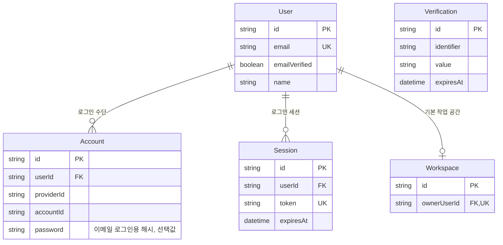

# 인증·개인 작업 공간 DB 설계 초안

2026-11-05. **사용자 지시로 실제 Supabase에 DB 기반 적용 완료**. 최소 스키마·역할·migration/RLS SQL의 격리 검증과 실환경 runtime 접속·RLS 검증을 마쳤다. 인증 API/앱 DB client 연결과 로컬 owner 교체·다중 폴더는 아직 구현 전이다. [실행 결과와 범위](../verification/auth-database/README.md)를 전체 인증 시나리오와 구분한다.

## 설계의 출발점

### 2026-11-06 이메일 인증 API 단위

- `/api/auth/[...all]`은 Better Auth 프로토콜용 Route Handler 예외다. GET 세션조회/이메일확인/재설정 callback과 POST 이메일가입/로그인/로그아웃/인증메일 재발송/재설정 요청·실행만 노출한다. 후속 화면은 Server Actions를 통해 같은 서버 API를 호출한다.
- 이메일 소유확인 전 로그인/Workspace 접근 금지. 가입·이메일확인 직후 자동 로그인 없음. 확인 링크 만료 1시간, 재설정 토큰 만료 30분. 이메일확인 재클릭은 로그인 없는 멱등 응답, 재설정 토큰은 DB에서 한 번 소비하고 기존 세션을 함께 폐기한다.
- Origin/CSRF와 callback URL 검증 유지. 비밀번호 12~128자. 알려지지 않은 이메일/중복가입에 실제 계정 존재를 드러내지 않고 외부 redirect·미구현 auth endpoint를 차단한다. JSON에서 세션 token을 제거하고 쿠키의 HttpOnly/SameSite와 HTTPS Secure를 유지한다.
- Resend는 기존 fetch로 호출한다. 발신자·키는 서버 설정이며 토큰 URL/수신자/키를 로그로 남기지 않는다. 요청 뒤 Next after 수명관리로 전송하고 실패는 민감정보 없는 로그와 재발송으로 처리한다. 응답은 실제 수신 완료를 뜻하지 않는다. 전송별 HMAC 멱등 키를 사용한다.
- 요청 횟수 제한을 활성화하되 세션 DB에 IP/userAgent를 저장하지 않는다. Vercel 전용 IP 헤더를 사용하며 메모리 limiter의 인스턴스/재시작 한계와 운영 전 공유 저장소 확인을 기록한다.
- AUTHMAIL-001 가입/중복·약한비밀번호·미인증 로그인, 002 확인/만료·변조·재클릭, 003 실제 쿠키/세션/Workspace/로그아웃, 004 재설정 존재은닉/만료/1회/동시소비/세션폐기, 005 Origin/redirect/최소응답/노출경로/요청제한, 006 메일 요청 형식/멱등/외부실패/비밀비노출을 실패조건부터 검사한다.
- 격리 DB·전송대체 테스트와 실제 Resend 접수 검증을 구분한다. 실제 발송 테스트는 사용자가 지정한 본인 주소에 계정 변경 없는 안내 메일만 전송한다. UI·소셜·브라우저 owner 연결·운영 배포는 다음 단위다.

### 2026-11-06 첫 서버 연결 단위

- 기존 제한 역할로 PrismaPg 서버 client와 Better Auth Prisma adapter를 연결한다. 로그인/가입 endpoint·메일·소셜·브라우저 owner 전환은 다음 단위다.
- 서버의 Workspace 진입점은 요청 쿠키를 Better Auth로 검증하고 DB에서 유효한 세션의 내부 User.id만 사용한다. 요청의 userId/workspaceId를 받지 않는다.
- 같은 interactive transaction에서 매개변수 `set_config('moa.user_id', userId, true)`와 기본 Workspace의 중복 무시 삽입/소유자 조회를 실행하고 `{ userId, workspaceId }`만 반환한다. 세션 없음·만료·폐기·DB 실패는 개발 owner로 대체하지 않는다.
- DB URL은 제한 역할만 허용한다. URL의 TLS 옵션이 pg의 CA를 덮어쓰지 못하게 검증/제거하고, 저장소의 공개 CA·호스트 검증을 강제한다. 관리자 URL과 실제 비밀값을 출력하지 않는다.
- AUTHDB-004/005/006/007을 실제 driver/adapter와 가상 세션으로 검증한다. 풀을 한 연결로 제한한 commit/rollback/계정 교대, 위조·만료·폐기된 쿠키, 동시 초기화가 포함된다. 합성 fixture만 사용하고 실제 Supabase smoke는 읽기 전용이다.
- Supabase SSL enforcement는 관리 화면/API의 상태 확인이 필요하다. SQL의 pg_stat_ssl 관찰만으로 설정을 확정하지 않으며 원격 재시작을 자동 수행하지 않는다.

- 인증: Better Auth 1.7.17, ORM: Prisma 7.10.1, DB: Supabase PostgreSQL. 의존성·환경 변수·최소 스키마/SQL 준비와 로컬 DB 검증까지 완료했다.
- 회원이 다른 로그인 수단을 사용해도 연결된 수단이면 같은 내부 사용자 ID와 작업 공간을 유지한다. 이메일·이름·다른 제공자의 ID를 비교해 실세계 동일인을 추정하지 않는다.
- 사용자 확인: 핵심 목표는 **회원 한 명 → 기본 작업 공간 하나 → 연결 폴더 여러 개**다. 직장/일상처럼 여러 프로필로 나누는 기능은 부가적인 후순위이며 지금 구현 요구에 포함하지 않는다. 앞서 검토한 User 1:N Workspace 안과 구분하고 현재 기본 관계는 1:1로 정리한다.
- 서버에는 운영에 필요한 최소 정보를 두고, 원본 파일·경로·폴더 핸들·대화/기억/결과물 본문·파일 작업/복구 기록은 기존 로컬 보관 계약을 따른다.

근거: [기술 경계](../architecture.md), [계정별 폴더 연결](account-folder-connections.md), [로컬 보관](local-ai-storage.md), [복구 보관함](recovery-vault-foundation.md).

## 작업 공간 수와 연결 폴더 수의 차이

| 경우 | 의미 | 달라지는 구조 |
| --- | --- | --- |
| 여러 작업 공간 | 개인·업무 등 공간마다 연결·설정·기록 분리 | User 1:N Workspace, 현재 공간 선택과 서버 소유권 검증, 전환 중 상태/작업 처리. |
| 한 공간에 여러 자료 폴더 | 사용자가 선택한 실제 로컬 폴더 여러 개를 같은 공간에서 관리 | 로컬 source 연결을 connectionId로 여러 개 구분, 탐색·검색·선택·작업/복구 기록에 연결 출처 유지. |

자료의 기준은 사용자의 실제 폴더와 그 안의 구조다. 문서·사진·다운로드는 앞선 설명에서 임의로 든 예시이며 제품의 고정 분류나 자동 판별 규칙이 아니다. 현재 연결 표시는 사용자가 선택한 DirectoryHandle의 name을 사용하며, 이름만으로 OS의 다운로드 특수 폴더인지 판정하지 않는다.

Workspace 아래에 연결 폴더를 그린 도식은 앱의 논리적 연결 관계다. 사용자의 디스크에 Workspace 폴더를 새로 만들거나 기존 폴더를 그 아래로 이동/복사하는 파일 시스템 구조를 의미하지 않는다. connectionId도 연결 참조의 식별자이며 사진/문서 같은 분류값이 아니다. 폴더 구조·파일/작업 기록의 원본은 로컬 보관 계약대로 유지하고, 인증/세션/소유 관계의 최소 서버 운영 정보와 구분한다.

현재 저장 키 `[userId, workspaceId, kind]`에는 workspaceId가 이미 있지만, 같은 kind의 핸들을 하나만 보관한다. 따라서 다중 Workspace 지원과 한 Workspace의 다중 source 지원은 서로 다른 변경이다. 여러 폴더를 연결하더라도 서버에 경로/핸들/본문을 저장하는 이유가 되지는 않는다.

현재 선택한 범위에서는 `ownerUserId` 외래키와 고유 제약으로 회원당 기본 작업 공간 하나를 유지한다. 여러 연결 폴더는 이 작업 공간 아래의 로컬 연결 모델로 다룬다. 이후 여러 프로필이 실제 요구가 되면 owner 고유 제약을 제거하고 소유자 인덱스·공간 선택·초기화 멱등성을 함께 변경한다. 그때도 기존 Workspace ID를 유지하는 이행 방식을 검토한다.

현재는 kind당 핸들 하나를 저장하므로, 다중 source 구현에서는 각 연결의 `connectionId`가 필요하다. 키는 예를 들어 `[userId, workspaceId, kind, connectionId]`처럼 확장하고, 탐색·검색·선택·실행 계획·복사/이동·복구 기록이 출발/목적 연결을 구분해야 한다. 복구 보관함을 폴더마다 새로 만들지, 하나를 공유하며 연결별 자료를 분리할지는 실제 다중 폴더 명세에서 검증한다. 이 문서는 연결 식별의 필요성을 기록하며 다중 연결 UI/저장소 변경 완료를 뜻하지 않는다.

## 초기 테이블 5개

아래 이름은 모델의 책임을 설명한다. 현재 [Prisma 스키마](../../apps/web/prisma/schema.prisma)는 고정 버전 Better Auth 1.7.17의 공식 생성 스냅샷을 기준으로 작성하고 프로젝트 제약·스키마 매핑을 추가했다. Better Auth CLI로 자동 생성했다고 주장하지 않으며 실제 인증 adapter 연결 때도 계약을 대조한다.

| 모델 | 책임 | 핵심 컬럼 | 제약·조회 기준 |
| --- | --- | --- | --- |
| `User` | 서비스 내부 회원 | `id`, `email`, `emailVerified`, `name`, `image?`, 생성·수정 시각 | `id` 기본키, `email` 고유. 표시 이름은 실명 확인값이 아니다. |
| `Account` | 이메일/비밀번호 또는 소셜 로그인 수단 | `id`, `userId`, `providerId`, `accountId`, 비밀번호 해시/OAuth 토큰 등 선택 필드, 생성·수정 시각 | `userId` 외래키·인덱스, `(providerId, accountId)` 복합 고유 제약. |
| `Session` | 기기/브라우저의 로그인 상태 | `id`, `userId`, `token`, `expiresAt`, 생성·수정 시각 | `userId` 외래키·인덱스, `token` 고유. IP·userAgent의 수집/보존은 별도 필요성 검토. |
| `Verification` | 만료되는 인증·복구·OAuth 상태 등 | `id`, `identifier`, `value`, `expiresAt`, 생성·수정 시각 | 용도별 identifier 조회. 토큰 표현·검증·만료/소비 방식은 Better Auth 계약을 따른다. |
| `Workspace` | 개인 작업 공간의 식별·소유 관계 | `id`, `ownerUserId`, `createdAt`, `updatedAt` | `ownerUserId → User.id` 외래키와 고유 제약. 연결 폴더 수에는 제약을 두지 않는다. |

`Verification`을 자체 OTP 전용 테이블로 재정의하지 않는다. 모든 용도의 identifier가 회원 ID인 것은 아니므로 `userId` 외래키를 임의로 강제하지 않는다. 비밀번호 해시는 Better Auth가 `Account`에서 관리하고, 별도 비밀번호 테이블을 중복 추가하지 않는다.

도식은 핵심 컬럼 요약이다. 생성·수정 시각과 선택 프로필/OAuth 필드 등은 위 표 및 Better Auth 생성 결과에 맞춰 포함한다. `Account`의 고유 제약은 providerId나 accountId 각각이 아니라 **두 컬럼의 조합**이다. `password`는 원문 비밀번호가 아니라 Better Auth가 관리하는 해시값이다.

### 브라우저의 폴더 연결 정보 — 서버 테이블과 별개

다음은 **후속 다중 폴더 연결용 개념 예시**이며, 현재 구현된 저장 형식이 아니다.

| userId | workspaceId | kind | connectionId | 이 브라우저에 저장하는 값 |
| --- | --- | --- | --- | --- |
| U1 | W1 | source | C1 | 사용자가 선택한 실제 폴더 핸들 A |
| U1 | W1 | source | C2 | 사용자가 선택한 실제 폴더 핸들 B |

이 연결 정보는 장치별 IndexedDB에 보관할 참조다. 폴더 이름은 실제 핸들에서 표시하고, 파일 내용·폴더 트리·작업/복구 기록은 로컬 보관 계약을 따른다. `Folder`/`File`/문서·사진·다운로드 분류를 위한 서버 테이블을 이 구조에 추가하지 않는다. 현재 구현은 `[userId, workspaceId, kind] → FolderHandle`이며, 다중 연결용 키 확장은 별도 구현·검증이 필요하다.

`Workspace`는 현재 범위에서 사용자별 최대 하나다. 가입 직후나 초기화 재시도 중에는 아직 없을 수 있어 0..1로 표시했다. 표시 이름·여러 프로필 선택에 필요한 필드는 실제 요구가 생기면 검토한다. ID 타입은 Better Auth의 실제 ID 생성 설정과 맞추며, 임의로 UUID DB 타입을 강제하지 않는다.

## 로그인 수단과 내부 회원의 관계

예를 들어 이메일/비밀번호 Account, Google Account, Naver Account가 모두 `userId = U1`을 참조하면 같은 회원이다. 작업 공간은 `Workspace(ownerUserId = U1, id = W1)` 하나를 사용한다.

- 외부 로그인 식별자는 이메일 대신 제공자의 안정적인 `accountId`와 `providerId` 쌍으로 구분한다.
- 같은 외부 계정을 서로 다른 User에 중복 연결하는 시도는 DB 고유 제약으로도 막는다. 먼저 조회하는 코드만으로 동시 요청을 제어하지 않는다.
- 같은 이메일이라는 이유만으로 묵시적으로 병합하지 않는다. `disableImplicitLinking` 등 실제 설정을 명세·테스트와 연결한다.
- 미연결 수단이면 새 회원 생성 전에 “기존 계정이 있으신가요?” 흐름을 제공한다. 기존 회원 소유권과 새 수단의 소유권이 확인된 뒤 연결한다. 가입 완료 뒤 다른 수단 연결을 권유하지 않는다.
- 서로 다른 이메일의 연결 허용 설정은 소유권 확인을 대체하지 않는다. 사람 한 명당 계정 하나를 강제할 수 있다는 보장도 하지 않는다.
- 연결 도중의 임시 상태는 만료·재사용 방지가 필요하다. Better Auth 상태 저장 기능으로 요구를 충족하는지 검증한 뒤 별도 임시 테이블의 필요성을 판단한다. 현재 다섯 테이블로 전체 연결 UX가 검증됐다고 주장하지 않는다.
- 이메일 정규화·소셜 제공자별 이메일 미제공/미검증 응답을 검토한다. 필드가 같거나 `emailVerified`가 있다는 사실만으로 다른 수단의 소유권을 대신 확인하지 않는다.
- OAuth 토큰을 보관한다면 `account.encryptOAuthTokens: true`를 명시하고, 로그인에 불필요한 장기 refresh token·추가 권한은 요청하지 않는다.

## 인증과 업무 데이터의 접근 경계

로그인은 `세션/계정 조회 → 사용자 확인 → Workspace 조회` 순서다. 첫 조회 시점에는 아직 사용자 ID를 모르므로 모든 인증 테이블에 사용자별 RLS를 일괄 적용하지 않는다.

초기 권한 구성 제안:

| 구분 | 권한 |
| --- | --- |
| migration 전용 역할 | 스키마·테이블 소유와 DDL. 서버 런타임에 이 자격증명을 사용하지 않는다. |
| 서버 runtime 역할 | 테이블 비소유자·`NOBYPASSRLS`. 인증 4테이블에 필요한 DML 권한, 업무 테이블에는 RLS 정책이 적용되는 DML 권한. |
| 브라우저·익명 Data API 역할 | 인증/업무 테이블 직접 접근 권한 없음. 서버가 필요한 최소 응답만 제공. |

이번 초안은 **migration 역할과 단일 서버 runtime 역할, 두 개**를 선택한다. 현재 인증과 업무 서비스가 같은 Next.js 서버에 있고, 비소유자 runtime에 업무 RLS를 적용하는 구성으로 필요한 경계를 검증할 수 있기 때문이다. 인증용·업무용 runtime 역할과 자격증명을 따로 두는 안은 각각의 Prisma Client·연결 풀 운영까지 필요하므로, 별도 서비스 경계나 더 좁은 DB 권한이 실제로 필요할 때 재검토한다. 따라서 아래의 인증/업무 영역 구분은 이번 단계에서 두 runtime 자격증명을 사용한다는 뜻이 아니다.

- Supabase가 관리하는 `auth` 스키마와 `auth.users`를 Better Auth용으로 재사용하지 않는다. 별도 앱 스키마 두 개(예: `moa_auth`, `moa_app`)로 인증·업무 영역을 나누는 안을 제안한다. 실제 이름과 Prisma 다중 스키마 매핑은 생성 결과를 검증해 확정한다.
- 인증 영역은 서버 역할만 접근하도록 스키마/테이블 grant를 제한한다. 인증 전 조회에 사용자별 RLS가 필요하다고 가정하지 않는다. RLS를 사용하지 않는다는 것이 브라우저나 익명 역할의 접근을 허용한다는 뜻은 아니다.
- `Workspace`와 후속 업무 테이블에는 RLS와 소유권의 `USING`·`WITH CHECK`를 구성하고 강제 적용한다.
- 검증된 서버 세션의 `User.id`를 같은 Prisma 트랜잭션에서 `set_config(..., true)` 등으로 주입하고 업무 쿼리까지 수행한다. 사용자 문맥이 풀링 연결의 다음 요청으로 넘어가지 않도록 트랜잭션 범위를 지킨다.
- Better Auth를 사용한다고 Supabase의 `auth.uid()`가 자동으로 현재 회원을 반환하거나, Prisma가 사용자별 필터를 자동 추가한다고 가정하지 않는다. 서버의 소유권 검사와 DB 정책을 각각 검증한다.

## 생성·삭제·로컬 자료 연결

- 첫 인증된 작업 공간 진입에서 세션의 사용자 ID로 기본 `Workspace`를 조회/생성한다. owner 고유 제약과 충돌/재시도 처리를 이용해 기본 공간이 중복되지 않도록 한다. 실패 시 개발용 소유자로 돌아가지 않는다.
- `Session`·`Account`의 사용자 삭제 시 동작은 생성된 Better Auth 스키마와 탈퇴 계약을 대조한다. 개인 `Workspace` 서버 행 정리도 함께 명세하되, DB 행 삭제가 OS의 원본·백업 폴더 삭제를 실행하게 만들지 않는다.
- 브라우저에는 인증 계층에서 확인한 `userId/workspaceId`를 전달한다. 기존 `[userId, workspaceId, kind]` 핸들 저장 키를 유지한다.
- 현 개발 소유자 `development-local / folder-connection-review`와 복구 보관함에 기록된 owner는 실제 계정과 다르다. 사용자의 자료를 첫 로그인 회원에게 자동 귀속시키거나 owner 문자열을 일괄 교체하지 않는다.
- 사용자는 개발에 필요한 기존 기록이 없다면 새 계정으로 시작해도 된다고 했다. 현재 인증/Workspace 개발은 기존 소스와 합성 테스트 fixture로 진행할 수 있으므로, 새 계정에서 새 연결·새 작업 기록으로 시작하는 방향을 사용한다. 기존 개발 핸들을 자동 재사용하지 않는다.
- 실제 원본 복구에 필요한 앱 휴지통/보존 사본·복구 보관함 payload와 journal·`.moa-history`는 보존한다. 기존 기록이 필요해지면 별도 절차를 설계하고, 새 회원 owner로 일괄 변경하거나 기존 폴더/백업을 삭제하지 않는다. 사용자의 실제 디스크·브라우저 저장소는 이번 조사에서 확인하지 않았다.

## 지금 추가하지 않을 테이블

원본 파일·폴더·핸들·본문·복구 파일 이력을 서버 DB로 복제하지 않는다. 팀/조직/멤버십이나 사용하지 않는 작업 공간 설정 테이블도 추가하지 않는다.

외부 AI 기능을 실제로 연결할 때 동의의 목적·버전·철회, 사용량·예약·한도에 맞는 운영 테이블을 설계한다. 그 기능에 앞서 필요한 통제를 마련하되, 인증 준비 단계에 모든 미래 테이블을 미리 생성하지 않는다.

## 명세와 실패 조건부터 검증

다음 항목은 인증·서버·브라우저를 포함한 **전체 테스트 계획**이다. 일부 DB 제약/권한 검사는 실행했으며 [검증 기록](../verification/auth-database/README.md)에 구분했다. 아래 모든 시나리오가 통과한 상태는 아니다.

| ID | 조건 | 기대 결과 |
| --- | --- | --- |
| AUTHDB-001 | 여러 제공자 Account가 같은 User에 연결 | 같은 Workspace ID 유지. |
| AUTHDB-002 | 다른 User에 같은 provider/account 쌍을 동시 연결 | 한 소유 관계만 허용하고 충돌을 안전하게 처리. |
| AUTHDB-003 | 같은 이메일 또는 다른 이메일만 제시 | 소유권 확인 없는 자동 병합 금지. |
| AUTHDB-004 | 로그인 전 세션·verification 조회 | 사용자 문맥이 없어도 인증 절차에 필요한 서버 조회 작동. |
| AUTHDB-005 | A의 세션에서 B의 Workspace CRUD 요청 | 서버 권한 검사와 runtime 역할의 DB 정책 각각에서 차단. |
| AUTHDB-006 | 문맥 미설정·A/B 교대·트랜잭션 rollback·풀 재사용 | 업무 접근 기본 차단, 이전 사용자 문맥 누출 없음. |
| AUTHDB-007 | 같은 User의 기본 Workspace 초기화 동시 요청/중간 실패 | 기본 공간 최대 하나, 재시도 가능, 개발 소유자 대체 없음. |
| AUTHDB-008 | 만료된/이미 소비한 인증·연결 요청 | 라이브러리별 토큰 계약에 맞춰 거부. |
| AUTHDB-009 | 로그아웃/계정 전환 중 늦게 끝난 폴더·복구 작업 | 이전 사용자 상태가 새 계정에 게시되지 않음. |
| AUTHDB-010 | 회원 탈퇴/Workspace 삭제 | 서버 세션·연결 정리, OS 원본/백업 자동 삭제 없음. |
| AUTHDB-011 | 기존 개발 연결·보관함을 새 계정으로 열기 | 합의된 이관 흐름 전 자동 owner 변경 없음. |
| AUTHDB-012 | 같은 Workspace의 다중 자료 폴더를 연결/전환 | 후속 다중 폴더 구현에서 connectionId별 참조·작업/복구 출처 분리, 서버에 경로/핸들 전송 없음. |

진행 순서: 위 계약·미결정 항목 정리 → 격리된 테스트 DB와 실패 테스트 준비 → 설치 버전에 맞는 Better Auth 생성기로 인증 스키마 생성 → Workspace·제약·grant/RLS SQL 추가 → migration SQL 검토 → 테스트 DB 적용·검증 → 검토된 대상 DB 적용 → 실제 로그인과 로컬 owner 연결 검증.

실제 DB 적용 전에 대상 DB·접속 역할·기존 테이블을 확인한다. Prisma adapter/driver와 생성 client 설정도 이때 검증한다. 현재 설치 상태나 과거 568개 테스트 통과를 새 인증/DB 정책 검증으로 간주하지 않는다.

## 참고 자료

- [Better Auth 데이터베이스](https://better-auth.com/docs/concepts/database)
- [Better Auth Prisma adapter](https://better-auth.com/docs/adapters/prisma)
- [계정 연결](https://better-auth.com/docs/concepts/users-accounts)
- [Better Auth 옵션](https://better-auth.com/docs/reference/options)
- [Supabase Auth 구조](https://supabase.com/docs/guides/auth/architecture)
- [PostgreSQL RLS](https://www.postgresql.org/docs/current/ddl-rowsecurity.html)
- [PostgreSQL SET](https://www.postgresql.org/docs/current/sql-set.html)
