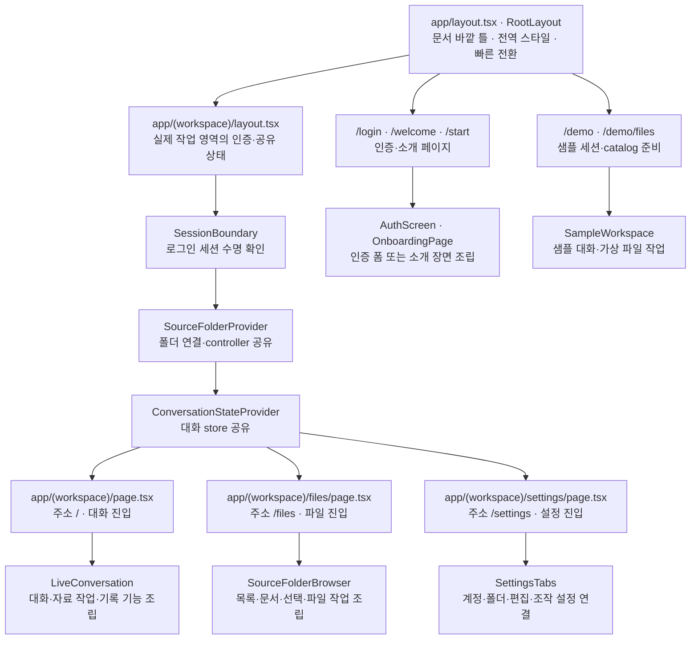
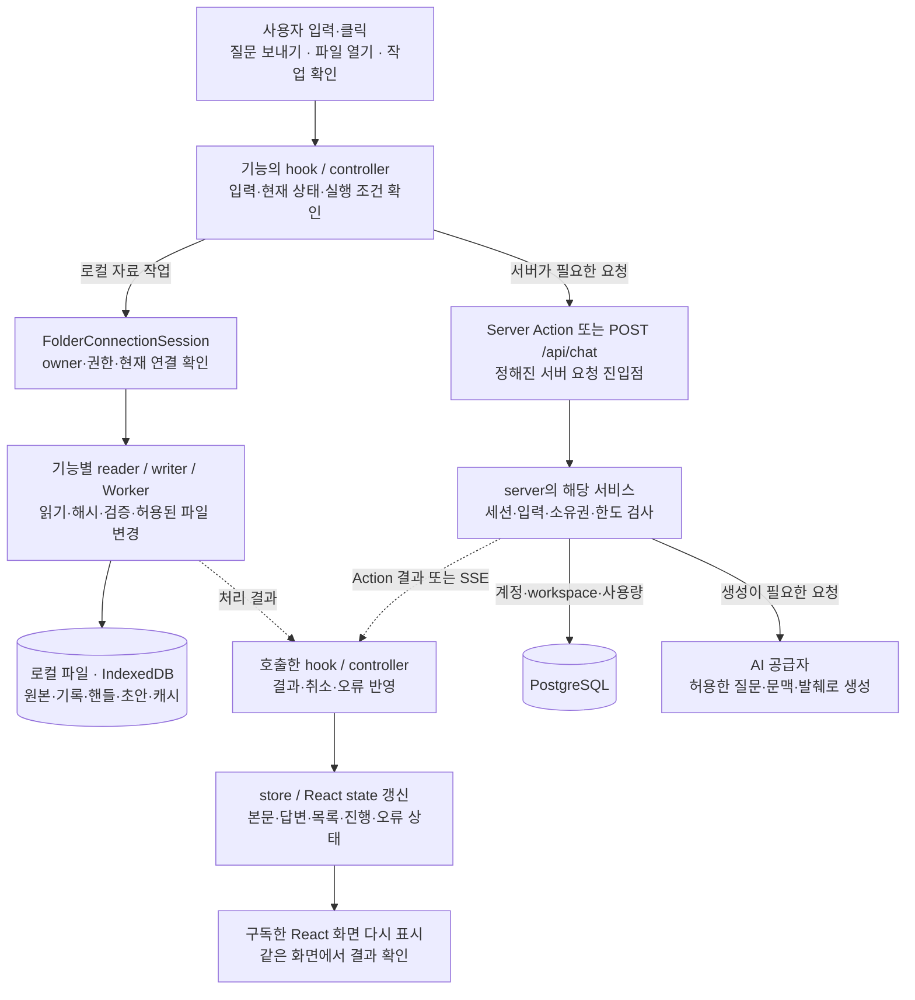

# 모아 전체 코드 흐름 설명서

기준: 2026-11-13 기능 중심 구조 개편 이후의 실제 소스.

이 문서는 화면에서 한 행동이 작은 부품을 거쳐 처리되고, 그 결과가 다시 화면에 나타나는 과정을 설명한다. 목표는 파일 이름을 외우는 데서 끝내지 않고, 코드를 열어 “이 값은 여기서 들어오고, 이 조건을 통과하면 이 함수를 호출하며, 반환값이 이 화면을 바꾼다”라고 설명할 수 있게 되는 것이다.

처음에는 01~05를 순서대로 읽는다. 그 뒤에는 실제로 사용할 기능의 장으로 이동해도 된다. 코드 링크를 열어 문서의 함수 이름을 찾고, 발췌 바로 앞뒤의 조건도 함께 읽으면 좋다. 아래 코드 블록은 실제 소스의 일부이며, 떨어진 부분을 묶은 경우에는 생략을 표시했다. 수정용 완성 코드가 아니다.

이번 문서 작성은 소스 읽기와 설명·링크 검증을 수행한 작업이다. 프로그램 실행 결과는 [구조 개편 검증 보고서](verification/feature-first-restructure-20261113/README.md)의 실행 시점과 범위를 따로 확인한다. 파일에 구현이 있다는 사실, 합성 환경에서 통과했다는 사실, 실제 계정·파일·공급자에서 확인했다는 사실을 구분한다.

분리 이유는 소스 주석·프로젝트 지침과 현재 구조가 만드는 효과를 근거로 설명한다. 주석에 없는 설계 동기는 코드 구조에 대한 해석이며, 개발 당시의 결정을 새로 입증한 기록으로 보지는 않는다.

<a id="visual-map"></a>
## 전체 연결 구조를 그림으로 보기

### 페이지에서 기능 부품으로 내려가는 구조

첫 그림의 화살표는 **바깥 틀이 안쪽 화면을 감싸거나 연결하는 관계**다. 모든 페이지가 차례로 실행된다는 뜻은 아니다. Next가 현재 주소에 맞는 page를 고르고, 그 page가 해당 기능의 큰 부품을 연결한다.



작업 영역의 세 페이지는 같은 Provider 아래의 연결과 대화 상태를 사용한다. 로그인·소개·샘플 페이지는 그 작업 영역 밖에 있다. 특히 `SampleWorkspace`는 실제 개인 폴더의 핸들을 공유하지 않고 샘플 세션과 가상 자료를 사용한다. 각 페이지 안의 세부 부품은 [03 화면 조립](#assembly)부터 따라 읽는다.

### 행동이 처리되고 화면으로 돌아오는 흐름

두 번째 그림의 실선은 **호출과 처리 방향**, 점선은 **처리 결과가 돌아오는 방향**이다. 사용자가 누른 기능에 따라 로컬 처리 또는 서버 처리로 들어가고, 결과를 받은 hook/controller가 상태를 바꾸면 화면이 다시 표시된다.



로컬 처리는 [06~15장](#folders), 일반 채팅은 [16장](#chat), 자료 답변과 정리는 [17~18장](#grounded)에서 실제 함수 안으로 내려간다. 서버 결과는 Action 반환값 또는 채팅 SSE를 거쳐 호출한 쪽으로 돌아온다. 파일 변경은 해당 기능의 검토·권한·원본 재검사를 통과한 실행에서 이루어진다. AI 전송은 명시적 보내기와 필요한 자료·문맥 동의, 서버 검사를 거친다.

그림은 주요 연결을 축약한 지도다. `reader / writer / Worker`가 모두 같은 일을 하거나, 모든 서버 요청이 DB와 AI를 함께 호출한다는 뜻으로 읽지 않는다. 버튼 하나를 따라갈 때는 그 기능의 장에서 **호출 → 입력 → 내부 처리 → 반환 → 상태·화면**을 이어 확인한다.

## 읽을 위치

| 배우려는 내용 | 이동 |
| --- | --- |
| 전체 프로그램과 실행 시작 | [전체 연결 그림](#visual-map), [01 전체 지도](#orientation), [02 실행 준비](#startup) |
| 큰 페이지에서 작은 부품으로 내려가기 | [03 화면 조립](#assembly), [04 로그인](#auth), [05 상태](#state) |
| 폴더·파일·문서 | [06 연결](#folders), [07 탐색](#browsing), [08 미리보기](#preview), [09 검색](#search) |
| 실제 파일 변경 | [10 편집](#editing), [11 생성](#creation), [12 계획](#planning), [13 실행](#execution), [14 복구](#recovery), [15 재진입](#workflow) |
| 채팅·자료·기록 | [16 일반 대화](#chat), [17 자료 대화](#grounded), [18 정리 요청](#organization), [19 기록](#records) |
| 다른 화면 | [20 설정·계정](#settings), [21 데모](#demo), [22 소개](#intro) |
| 공통 부품과 프로그램 기반 | [23 UI·탐색·로딩](#common-ui), [24 스타일](#styles), [25 서버](#server), [26 DB](#database), [27 공통 규칙](#shared), [28 개발·검증 설정](#tooling) |
| 직접 코드를 설명하고 수정 위치 찾기 | [29 설명 연습](#trace), [30 전체 책임 지도](#coverage) |

<a id="orientation"></a>
## 01. 이 프로그램은 어디에서 무엇을 처리하는가

모아에는 실행 장소가 다른 세 부분이 있다.

1. 브라우저는 입력·선택·열림 상태를 보여 주고, 사용자가 연결한 로컬 폴더를 읽거나 허용된 파일 작업을 실행한다.
2. Next 서버는 로그인 세션·workspace·외부 AI 요청·사용량과 DB 접근을 처리한다.
3. PostgreSQL은 인증·workspace·계정 연결·사용량 원장을 저장한다. 사용자의 로컬 폴더 핸들은 브라우저의 IndexedDB에 보관한다.

페이지를 읽을 때는 우선 이 코드가 어느 장소에서 실행되는지 확인한다. 브라우저의 `window`와 파일 핸들, 서버의 쿠키와 DB 연결은 서로 다른 환경의 기능이다. 서버가 사용자의 기기 폴더를 절대 경로로 직접 여는 구조는 이 코드에 없다.

큰 연결을 먼저 보자. 아래는 호출 시각을 모두 같다고 가정한 실행 코드가 아니라, 책임과 데이터가 이어지는 지도다.

```text
주소로 진입
  app의 page/layout
    서버에서 세션·표시 데이터 준비
    기능 컴포넌트에 값과 Server Action 참조 전달
      기능의 상위 화면
        작은 화면 부품 + hook/controller
          로컬 파일 작업 → 브라우저의 session/reader/writer/Worker
          서버 작업     → Action 또는 정해진 Route → 서버 서비스 → DB/AI
        처리 결과 → 상태 갱신 → 구독한 React 화면 다시 표시
```

여기서 “부품”은 버튼처럼 작은 표시만 뜻하지 않는다. `LiveConversation`은 대화를 조립하는 큰 부품이고, `useGeneralChat`은 대화 동작을 연결하는 부품이며, `chatReducer`는 상태를 계산하는 더 좁은 부품이다. 이들을 각각 함수·파일·폴더로 나누되, 같은 기능을 찾는 사람이 멀리 돌아다니지 않게 배치했다.

폴더 역할은 다음처럼 읽는다.

| 위치 | 실제로 찾는 것 |
| --- | --- |
| `apps/web/src/app` | 어떤 주소가 어떤 화면·요청 처리로 들어가는지 |
| `features` | 사용자 기능의 화면·상태·동작·작은 규칙 |
| `components` | 여러 기능이 함께 쓰는 작업 프레임과 표시·조작 |
| `server` | 인증·권한·외부 서비스·DB를 사용하는 서버 처리 |
| `shared` | 양쪽이 공유하는 입력/결과 형태와 공통 규칙 |
| `styles` | 공통 색상·간격·화면 배치·조작 스타일 |
| `packages/domain` | React·Next·DB 없이 실행되는 일부 순수 규칙 |
| `apps/web/tests`, 루트 `tests` | 제품 코드를 호출해 성공·실패 조건을 확인하는 검사 |

`shared`라는 이름이 붙었다고 모든 것을 그곳에 넣는 것은 아니다. 대화에서만 사용하는 상태는 대화 기능에, 복원에서만 쓰는 검사는 복구 기능에 있다. 실제로 책임이 공유될 때 공통 위치로 올린다.

<a id="startup"></a>
## 02. 코드는 어떻게 실행을 시작하는가

먼저 [루트 package.json](../package.json)과 [웹 package.json](../apps/web/package.json)을 연결해 보자.

루트의 `pnpm dev`는 웹 패키지의 `dev`를 실행한다. 웹의 명령에는 다음 순서가 적혀 있다.

```json
"dev": "node scripts/prepare-ocr-assets.mjs && prisma generate && next dev --hostname 127.0.0.1 --port 3034"
```

`&&`는 앞 명령이 성공했을 때 다음 명령을 실행하게 한다. 따라서 로컬 OCR 자원을 준비하고, Prisma Client 코드를 생성한 다음, 개발용 Next 서버를 연다. 사용자가 파일을 열 때마다 이 세 명령을 다시 실행하는 흐름은 아니다. 앱을 실행할 준비 단계다.

`pnpm build`도 OCR 자원 준비와 Prisma 생성을 거쳐 `next build`를 수행한다. 이때 TypeScript와 JSX가 실행·배포 가능한 결과물로 바뀌고 `.next`에 저장된다. `pnpm start`는 그 빌드 결과로 서버를 실행한다. 개발 실행과 production 실행은 쓰는 결과물과 갱신 방식이 다르다.

이 저장소의 중요한 도구는 각자 역할이 있다.

- TypeScript는 값과 함수의 형태가 맞는지 검사한다. 타입 표기 대부분은 실행 시 남지 않는다.
- React는 상태에 맞는 화면 구조를 계산한다. 상태가 바뀌면 필요한 화면을 다시 계산한다.
- Next는 주소·서버 렌더링·브라우저 전송·Server Action·Route Handler를 연결한다.
- pnpm workspace는 웹과 domain 같은 패키지를 한 저장소에서 관리한다.

`.ts`와 `.tsx`는 실행 장소를 구별하는 확장자가 아니다. `.tsx`는 JSX를 포함할 수 있다는 뜻이다. 실제 서버/브라우저 경계는 Next의 컴포넌트 경계, `"use client"`, `"use server"`, `server-only`와 import 관계를 함께 봐야 한다.

현재 설치 기준은 Next16.4.3, React19.3.1, TypeScript5.9.3이며 프로젝트 명령은 Node24.22.1을 사용하도록 설정되어 있다. 버전 선택은 package와 lockfile에 기록되어 있다. 이 설명을 다른 버전의 Next 프로젝트에 그대로 적용할 때는 그 프로젝트의 규칙을 다시 확인해야 한다.

<a id="assembly"></a>
## 03. 전체 페이지는 어떻게 작은 부품으로 조립되는가

### 03-1. 모든 주소의 바깥 틀

[app/layout.tsx](../apps/web/src/app/layout.tsx)의 `RootLayout`은 HTML 문서의 언어·기본 바탕·전역 스타일·공통 빠른 전환을 연결한다.

```tsx
export default function RootLayout({ children }: Readonly<{ children: React.ReactNode }>) {
  return <html lang="ko" style={{ background: "#e4e8e6", colorScheme: "light" }}>
    <body>
      <NavigationGuardProvider>
        {children}
        <WorkspaceQuickSwitch />
      </NavigationGuardProvider>
    </body>
  </html>;
}
```

`children`은 Next가 현재 경로에 맞게 넣어 주는 안쪽 화면이다. `{ children }`은 전달받은 객체에서 `children`이라는 값을 꺼내는 JavaScript 문법이다. `Readonly<{ children: React.ReactNode }>`는 TypeScript 설명으로, 표시 가능한 자식을 받으며 이 입력 객체를 읽는 용도로 사용한다는 뜻이다. 런타임 데이터에 보안 잠금을 거는 코드는 아니다.

JSX의 `<WorkspaceQuickSwitch />`는 화면 트리에 부품을 넣는다. 이 부품의 파일이 브라우저에서 키보드·포인터 이벤트를 처리한다. `{children}`은 특정 기능의 구현을 RootLayout 안에 복사하지 않고, Next가 고른 화면을 들어오게 하는 연결 지점이다.

[NavigationGuardProvider](../apps/web/src/components/navigation/NavigationGuard.tsx)는 편집 내용을 소유하지 않는다. 편집기가 “이동 전에 확인이 필요하다”는 callback을 등록하면 공통 메뉴와 프로그램 이동을 잠시 멈추고, 사용자의 선택 뒤 그 이동을 재개한다. 기록 편집 중 새로고침·탭 닫기는 `beforeunload`로 브라우저 기본 확인창을 요청한다. 브라우저 강제 종료까지 저장을 보장하는 방식은 아니다.

### 03-2. 실제 작업 영역의 공통 틀

`/`, `/files`, `/settings`는 [app/(workspace)/layout.tsx](<../apps/web/src/app/(workspace)/layout.tsx>)를 공유한다. `(workspace)`는 URL에 표시되지 않는 route group 이름이다. 사용자 주소는 `/files`이며 `/(workspace)/files`가 아니다.

이 layout의 바깥 `Suspense`는 안쪽의 비동기 인증 준비가 끝나기를 기다리는 동안 fallback 화면을 보여 준다. `AuthenticatedWorkspace`는 `requireWorkspace()`를 기다린 뒤 소유자와 세션 정보를 얻는다. 계정 확인이 끝나야 다음 연결이 만들어진다.

```tsx
<SessionBoundary
  key={sessionUserId}
  userId={sessionUserId}
  initialExpiresAt={sessionExpiresAt}
  checkSessionAction={checkAuthSessionAction}
>
  <SourceFolderProvider key={`${owner.userId}:${owner.workspaceId}`} owner={owner}>
    <ConversationStateProvider>
      {children}
    </ConversationStateProvider>
  </SourceFolderProvider>
</SessionBoundary>
```

이 중첩은 책임의 범위를 보여 준다. `SessionBoundary`는 인증 수명을 감시하고, `SourceFolderProvider`는 계정/workspace의 파일 연결을 공유하며, `ConversationStateProvider`는 대화 상태를 공유한다. 안쪽 페이지들이 같은 객체를 사용하므로 파일 화면에서 채팅 화면으로 이동해도 layout이 유지되는 동안 공유 상태를 이어 쓸 수 있다.

`key`는 React가 같은 부품 인스턴스로 볼지 판단하는 표식이다. 이 코드에서 user/workspace 조합이 바뀌면 이전 소유자의 Provider 상태를 새 소유자에게 계속 붙이지 않게 한다. 같은 경로 이동에서 상태를 유지하는 것과 소유자 변경 때 새 수명을 만드는 것을 함께 다룬다.

### 03-3. 홈 페이지가 대화 부품에 넘기는 것

[홈 page](<../apps/web/src/app/(workspace)/page.tsx>)의 핵심은 짧다.

```tsx
const provider = getAiProvider();

return <LiveConversation
  aiProvider={provider}
  organizeAction={liveOrganizationAction.bind(null, provider)}
  groundedAction={groundedChatAction.bind(null, provider)}
  readUsage={readUsageAction}
/>;
```

`aiProvider`에는 현재 선택된 공급자 값이 들어간다. `readUsage={readUsageAction}`은 함수 참조를 전달한다. 이 JSX 줄에서 사용량 조회가 실행되는 것은 아니다. 실제 사용량 버튼을 눌러 그 함수가 호출될 때 서버 요청이 시작된다.

`.bind(null, provider)`는 첫 번째 인수를 미리 연결한 함수를 만든다. 페이지에서 정한 공급자를 가진 Action 참조를 안쪽에 넘기기 위한 방식이다. 이 줄도 AI를 호출하지 않는다. 서버 Action과 서비스는 실제 요청이 들어왔을 때 입력과 공급자 허용 범위를 다시 검사한다.

### 03-4. 공통 프레임과 기능 화면의 관계

[WorkspaceShell](../apps/web/src/components/layout/WorkspaceShell.tsx)은 제목·활성 메뉴·본문·폴더 트리를 받아 좌우 배치를 만든다. `folderTree`라는 prop으로 들어온 표시를 사이드바에 넣지만, 실제 파일 핸들을 직접 관리하지 않는다.

[LiveConversation](../apps/web/src/features/conversation-workspace/LiveConversation.tsx)은 대화 기능을 조립하고, [ConversationWorkspace](../apps/web/src/components/layout/ConversationWorkspace.tsx)는 전달받은 메시지·입력·자료 창·버튼을 배치한다. 따라서 화면의 공통 간격을 바꾸려면 공통 프레임을 보고, 어떤 요청을 AI로 보낼지 바꾸려면 기능의 요청 흐름을 읽는다.

이 부분을 설명한다면 이렇게 말할 수 있다. “Next의 layout이 인증과 공유 상태의 범위를 정하고, page가 기능에 서버 함수와 값을 넣습니다. 기능 화면이 그 상태와 동작을 묶으며, 공통 프레임은 그 결과를 표시합니다.”

<a id="auth"></a>
## 04. 로그인 버튼을 눌렀을 때 어디로 들어가는가

### 04-1. 먼저 로그인 페이지에 들어온다

[login/page.tsx](../apps/web/src/app/login/page.tsx)는 서버에서 시작한다.

```tsx
await requireGuest();

const configuration = socialProviderConfiguration();
const params = await searchParams;
```

`await`는 이 함수 안에서 비동기 결과가 준비된 뒤 다음 줄을 진행하게 한다. 로그인 확인을 기다린다고 모든 브라우저 동작이나 모든 요청이 하나의 줄로 묶이는 것은 아니다.

`requireGuest()`는 [session-guards](../apps/web/src/server/auth/session-guards.ts)에서 현재 세션을 확인한다. 이미 로그인했다면 `redirect("/")`로 로그인 페이지 흐름을 끝내고 홈으로 이동한다. 세션이 없으면 호출한 page의 다음 줄로 돌아온다. 세션 조회 자체가 실패한 경우는 정상적인 비로그인 상태와 구분한다.

`searchParams`는 URL 뒤의 값을 받는다. 이 프로젝트의 타입은 Promise이므로 `await`로 값을 얻는다. 예를 들어 `?connection=updated`면 정해 둔 안내 문구를 고르고, 그 외에는 서버의 `socialErrorMessage`로 등록된 오류 코드를 문구로 바꾼다. URL은 화면에 어떤 안내를 보여 줄지 결정하는 입력이지, 로그인 권한을 주는 근거가 아니다.

### 04-2. page에서 폼으로, 폼에서 제출 함수로

page는 `<AuthScreen operation="login" action={loginAction} ... />`를 반환한다. 여기까지는 로그인용 부품을 조립하는 단계다.

[AuthScreen](../apps/web/src/features/auth/form/AuthScreen.tsx)은 가입이면 `SignupScreen`, 다른 작업이면 `AuthFormScreen`을 선택한다. `AuthFormScreen`은 전달받은 `action`에 `submitAction`이라는 이름을 붙여 읽는다.

```tsx
const [state, formAction, pending] = useActionState(async (previous: AuthFormState, data: FormData) => {
  // 세션 변경 알림 등의 앞부분 생략
  try {
    const result = await submitAction(previous, data);

    if (result.status === "success") setSecretToken("");

    return result;
  } finally {
    if (changesSession) announceAuthSessionChange();
  }
}, initialState);
```

이 발췌의 `changesSession`은 생략한 앞부분에서 로그인/로그아웃 작업인지 계산한 값이다. 블록을 따로 복사해 실행하는 코드로 읽지 않는다.

React의 `useActionState`는 이전 결과, 제출에 연결할 함수, 진행 여부를 돌려준다. 이 프로젝트는 그 제출 함수 `formAction`을 실제 form의 action으로 사용한다. 사용자가 제출하면 React/Next가 이전 상태와 입력을 모은 `FormData`를 연결해 호출한다.

`submitAction(previous, data)`에서 비로소 page가 넣어 준 `loginAction`이 실행된다. `previous`는 이전 폼 결과이고, `data`는 이름이 붙은 입력 필드의 값이다. `pending`은 대기 표시와 중복 조작 제한에 사용한다. `finally`는 성공·실패에 관계없이 이 호출이 빠져나갈 때 실행할 세션 변경 알림을 맡는다.

### 04-3. Action은 서버 서비스에 맡기고 쿠키를 반영한다

[app/actions/auth.ts](../apps/web/src/app/actions/auth.ts)의 실제 로그인 함수다.

```ts
export async function loginAction(_previous: AuthFormState, data: FormData) {
  const state = await perform("login", data);

  if (state.status === "success") redirect("/");

  return state;
}
```

여기서 `perform` 안으로 들어간다. 로그인 작업의 세션 조건을 검사하고 `submitAuthForm`을 호출하며, 반환된 응답의 쿠키를 Next의 쿠키 저장소에 적용한다. 내부 인증 요청이 만든 `set-cookie`를 실제 브라우저 응답에 이어 주는 역할이다.

[auth-forms.ts](../apps/web/src/server/auth/auth-forms.ts)의 입력 검증 시작은 다음과 같다.

```ts
const parsed = schemas[operation].safeParse(Object.fromEntries(formData));
```

`Object.fromEntries`는 JavaScript가 제공하는 함수로 필드 쌍을 객체로 만든다. `schemas[operation]`은 프로젝트가 작업별로 정해 둔 Zod 검사 규칙을 고른다. `safeParse`는 Zod API이며 성공 여부와 검사한 값 또는 오류를 돌려준다. TypeScript 타입만으로 브라우저에서 온 값을 믿지 않고, 서버 실행 중에 다시 확인하는 이유가 여기에 있다.

검증 실패면 `fieldErrors`와 `status: "error"`가 돌아와 폼의 결과 상태가 된다. 검증을 통과하면 허용된 인증 경로의 내부 `Request`를 만들고 [auth-handler](../apps/web/src/server/auth/auth-handler.ts)로 보낸다. handler가 경로·메서드·origin 등 조건을 검사한 뒤 Better Auth에 처리를 맡긴다. 서버가 자기 공개 HTTP 주소를 다시 fetch하는 구조와 구분해 읽는다.

성공은 Action의 `redirect("/")`에서 다음 화면으로 이어진다. 실패는 `return state`를 따라 `useActionState`의 `state`로 돌아와 현재 폼에 표시된다. 따라서 “성공도 반드시 현재 폼에서 success 메시지를 그린 뒤 이동한다”고 설명하면 이 코드와 맞지 않는다.

### 04-4. 가입·인증 메일·비밀번호 재설정의 차이

[useSignupFlow](../apps/web/src/features/auth/signup/useSignupFlow.ts)는 URL의 `step`과 유효 시간이 있는 가입 초안을 함께 읽는다. 다음 단계 버튼은 현재 입력 조건을 확인하고, 이름·이메일·단계 같은 허용된 초안을 저장한 뒤 `history.pushState`로 URL 표시를 바꾼다. 최종 가입 제출과 화면 단계 이동은 각각의 호출이다. 비밀번호를 같은 초안 저장소에 넣지 않는다.

인증/재설정 링크는 서버가 URL의 token을 폼에 전달하고, 브라우저의 `AuthFormScreen` effect가 주소에서 token을 제거한다. 이후 입력용 메모리에 든 값을 제출한다. URL을 정리하는 것만으로 인증이 완료되지는 않는다. 실제 검증은 해당 Action과 서버의 token 검사에서 이루어진다.

소셜 로그인은 [auth-social](../apps/web/src/server/auth/auth-social.ts)이 공급자와 반환 URL을 검사하고, 통과한 주소로 Action이 이동시킨다. 계정에 새 로그인 수단을 연결하는 작업은 현재 계정과 최근 인증 여부를 추가로 검사하는 별도 흐름이다. 메일 발송은 [auth-mail](../apps/web/src/server/auth/auth-mail.ts)의 서버 책임이다.

<a id="state"></a>
## 05. 상태는 누가 가지고 있으며 화면은 왜 다시 그려지는가

### 05-1. 작은 화면 상태와 오래 살아야 하는 업무 상태

입력·접힘·현재 탭처럼 화면에 가까운 값은 컴포넌트의 `useState`에 둘 수 있다. 반면 폴더 연결·진행 중 작업·대화는 여러 화면이 함께 사용한다. 이 프로젝트는 Provider가 그 수명을 잡고, controller/store가 상태와 명령을 가진다.

[ConversationStateProvider](../apps/web/src/features/conversation-workspace/ConversationStateProvider.tsx)를 보면 다음 줄이 있다.

```tsx
const [store] = useState(() => new ConversationStore());
```

`useState`에 함수를 넘겨 초기 상태를 만들게 했다. 일반적인 재렌더마다 `new ConversationStore()`로 다른 객체를 만들지 않고, 현재 Provider 수명의 store를 계속 사용하려는 것이다. 개발 환경의 React 검사 과정에서 초기화 코드를 재실행할 수 있다는 점과, 화면에서 사용할 store의 수명을 유지한다는 설계 목적은 구분한다.

이 store는 Context의 `value`로 자식에게 전달된다. [SourceFolderProvider](../apps/web/src/features/local-folders/SourceFolderProvider.tsx)도 hook이 만든 연결 API를 Context로 제공한다. `useSharedSourceFolderConnection()`은 그 Context에서 현재 연결을 꺼내는 프로젝트 함수다. Provider 바깥에서 잘못 사용하면 조용히 빈 객체를 주지 않고 오류를 낸다.

이 문서에서 controller는 상태와 명령을 가진 프로젝트 객체를 뜻한다. Next나 React가 자동으로 만들어 주는 특별한 문법 이름은 아니다. 또 `FolderConnectionSession`은 브라우저 폴더 연결의 수명을 관리하는 객체이며, 서버 DB의 로그인 Session과는 다른 대상이다.

### 05-2. 외부 store가 바뀌었다는 것을 React에 알린다

[ConversationStore](../apps/web/src/features/conversation-workspace/conversation-store.ts)의 일부다.

```ts
subscribe = (listener: () => void) => {
  this.listeners.add(listener);

  return () => {
    this.listeners.delete(listener);
  };
};
```

`subscribe`는 상태 변경을 알릴 함수를 등록하고, 등록을 취소할 함수를 반환한다. 반환된 함수를 지금 실행하는 것은 아니다. 구독이 끝날 때 호출할 정리 수단으로 보관한다.

같은 store의 `dispatch`는 action을 `chatReducer`에 넣어 다음 상태를 구하고, 상태를 바꾼 뒤 listeners를 호출한다. reducer는 입력한 상태와 사건으로 다음 상태를 계산하는 함수다. 화면이나 DB를 직접 조작하는 역할과 분리되어 있다.

파일 연결 hook에서는 React의 구독 API를 이렇게 사용한다.

```tsx
const state = useSyncExternalStore(
  controller.subscribe,
  controller.getSnapshot,
  controller.getServerSnapshot,
);
```

첫 인수는 변경 알림 등록, 두 번째는 현재 상태 읽기, 세 번째는 서버 렌더링에서 사용할 기준 상태 읽기다. controller가 변경을 알리면 React가 새 snapshot을 읽어 화면을 다시 계산한다. 단순히 class 안의 변수를 바꾸는 것만으로 React가 모든 변경을 자동 발견하는 구조는 아니다.

여기서 snapshot은 구독자가 읽는 현재 상태 값이다. 뒤에서 파일 검사에 사용하는 snapshot은 특정 시점의 파일 경로·크기·hash 같은 검사 자료를 뜻한다. 같은 단어라도 실제 타입과 사용하는 함수가 다르므로 그 문맥을 함께 확인한다.

### 05-3. useRef와 useEffect가 이 코드에서 필요한 이유

[useSourceFolderConnection](../apps/web/src/features/local-folders/use-source-folder-connection.ts)은 effect에서 브라우저 지원 여부를 확인하고 연결 복원을 시작한다. 서버 렌더 중에는 사용자의 `window`, IndexedDB, picker를 바로 사용할 수 없기 때문이다. effect의 의존성 배열은 이 연결에 사용한 객체나 owner가 달라질 때 이전 effect를 정리하고 새 연결 과정을 만들게 한다.

`useRef`는 DOM 요소나 진행 중 요청 표식처럼 재렌더 사이에 보관할 값을 담는다. `ref.current`를 바꾸는 것 자체는 `setState`처럼 화면 갱신을 예약하지 않는다. 예를 들어 채팅의 한국어 조합 여부, 현재 DOM 초점, 애니메이션 진행 여부에 ref를 사용하는 이유를 해당 행동과 연결해 읽으면 된다.

### 05-4. 정리는 실제 동작이다

폴더 연결 hook의 종료 흐름은 다음과 같다.

```ts
const revoke = () => {
  records.stop();
  recovery.stop();
  controller.stop();
  void session.switchOwner(null);
};
```

기록·복구·연결 controller를 정지하고 이전 소유자의 session을 비운다. `void`는 반환 Promise를 이 자리에서 기다리지는 않겠다는 표현이다. 함수 호출 자체는 실행된다. 이 작업은 effect cleanup과 인증 범위 폐기 이벤트에 연결되어 있다.

비동기 요청에는 “시작할 때의 owner와 요청 번호가 아직 유효한가”라는 검사도 있다. 사용자가 다른 파일을 열거나 로그아웃한 뒤 옛 요청이 늦게 끝나더라도, 그 결과를 현재 화면에 덮어쓰지 않으려는 장치다. `AbortController`는 취소 신호를 전달하고, generation/sequence 검사는 늦은 결과의 반영 여부를 판단한다. 둘의 역할을 함께 읽는다.

### 05-5. 이 값은 어디에 남는가

| 보관 위치 | 대표 데이터 | 수명과 읽는 기준 |
| --- | --- | --- |
| React state/ref·controller/store 메모리 | 화면 입력·열림·진행 요청·현재 대화 | 컴포넌트/Provider 수명. 별도 저장 없이 브라우저 종료까지 보장하지 않음 |
| localStorage | 편집/빠른 전환 같은 문자열 설정 | 기기 브라우저 저장. 기능 parser가 다시 해석 |
| sessionStorage | 샘플 진행·일부 초안/긴급 편집 텍스트 | 탭의 세션 범위와 각 기능의 만료 규칙 |
| IndexedDB | owner별 폴더 핸들·workflow 초안·로컬 추출 텍스트 캐시 | 브라우저 기기 저장. 현재 권한·owner·root를 다시 확인 |
| 선택한 로컬 파일/기록 폴더 | 실제 문서·대화/결과물/위키 기록 | 명시적 파일 접근과 해당 reader/writer/repository 계약 |
| 보존 archive/복구 보관함 | 원본 보존 payload·manifest·journal | 복구·이력 검증 규칙에 따라 읽기/복원 |
| 서버 DB | 인증·workspace·계정 연결·사용량 | 세션·서버 서비스·DB 정책과 제약 |
| 외부 AI 요청 | 사용자가 해당 요청에 허용한 질문·문맥·발췌 | 서버 전송 시 입력·동의·한도 검사. 로컬 저장과 별도 경계 |

브라우저 저장소의 “저장 성공”이 디스크 원본의 “저장 성공”과 같은 뜻은 아니다. 반대로 원본 파일이 남아 있어도 브라우저 권한이 철회되면 다시 읽을 수 있는지 확인해야 한다. 어느 저장소를 바꾸는 함수를 호출했는지 말하는 습관이 중요하다.

<a id="folders"></a>
## 06. 폴더 연결은 어떤 순서로 이루어지는가

먼저 [SourceFolderProvider](../apps/web/src/features/local-folders/SourceFolderProvider.tsx) → [useSourceFolderConnection](../apps/web/src/features/local-folders/use-source-folder-connection.ts) → [SourceConnectionController](../apps/web/src/features/local-folders/connection/source-connection-controller.ts) → [FolderConnectionSession](../apps/web/src/features/local-folders/connection-session.ts)을 따라간다.

hook은 `IndexedDbHandleRepository`, session, source/recovery controller, AI 기록 controller를 조립한다. 이때 constructor가 있다는 사실과 파일 선택창을 열었다는 사실은 다르다. 브라우저 지원 확인과 연결 참조 복원은 effect에서 시작하고, 새 폴더 선택은 사용자 버튼 행동에서 시작한다.

사용자가 연결 버튼을 누르면 화면의 callback → `controller.connect()` → `session.select()` → picker 순서로 들어간다. 읽기 연결은 `showDirectoryPicker({ mode: "read" })`로 선택한다. 이후 권한과 현재 owner/요청 상태를 확인하고 repository에 연결 참조를 기록한 다음 연결 snapshot을 갱신한다. controller의 구독자가 그 결과로 연결된 폴더 이름과 목록을 표시한다.

여기서 폴더 핸들은 브라우저가 해당 폴더에 접근하는 데 사용하는 객체다. 폴더 이름을 담은 문자열과는 역할이 다르다. [handle-repository](../apps/web/src/features/local-folders/connection/handle-repository.ts)는 owner/workspace 기준으로 핸들 참조와 연결 메타데이터를 IndexedDB에 보관한다. 연결 저장은 원본 폴더 전체 내용을 서버에 저장하는 단계가 아니다.

기존 참조를 복원했어도 현재 권한이 유효한지는 별도로 확인해야 한다. `view()`는 현재 연결 상태를 표시하기 위한 읽기이며 권한창을 여는 명령이 아니다. 재연결 버튼과 실제 작업 과정에서 필요한 권한을 확인한다. 브라우저가 picker·IndexedDB·Web Locks 또는 보안 컨텍스트를 지원하지 않으면 연결 기능을 사용할 수 없다는 상태를 제공한다.

연결 해제는 repository와 화면의 접근 연결을 정리한다. 원본 디렉터리를 삭제하는 동작을 이 버튼에 넣지 않았다. 원본 제거는 나중에 다룰 파일 작업의 명시적 실행 경로에서 검토한다.

이 분리가 필요한 이유는 같은 폴더 연결을 설정·파일·채팅이 공유하기 때문이다. 버튼마다 각자 핸들을 보관하면 계정 변경·해제·늦은 요청을 한꺼번에 정리하기 어렵다. 현재 코드에서는 session이 연결과 유효성 경계를, controller가 화면에 보여 줄 진행/오류 상태를 맡는다.

<a id="browsing"></a>
## 07. 폴더를 열고 파일을 선택하면 어떤 값이 바뀌는가

### 07-1. 페이지에서 목록 부품으로 들어간다

[/files의 page](<../apps/web/src/app/(workspace)/files/page.tsx>)는 공통 테마와 `Suspense`를 연결해 [SourceFolderBrowser](../apps/web/src/features/local-folders/SourceFolderBrowser.tsx)를 넣는다. page 자체에 파일 읽기 반복문을 넣지 않았다.

`SourceFolderBrowser`는 공유 연결을 꺼내 폴더 프레임·목록·미리보기·선택 조작·작업 dialog를 연결하는 상위 부품이다. [browsing](../apps/web/src/features/local-folders/browsing) 안의 프레임과 작은 목록 부품들이 경로 표시·행·선택 조작을 맡는다. 화면 조립과 파일 접근을 한 파일에서 모두 실행하지 않도록 나눈 것이다.

### 07-2. 목록 요청 안으로 내려갔다 돌아온다

폴더를 여는 동작은 [SourceListingController](../apps/web/src/features/local-folders/browsing/file-list/source-listing-controller.ts)의 `open(path)`로 이어진다. `path`는 연결 폴더를 기준으로 한 경로 조각들의 배열이다. session의 `listSourceFolder()`가 현재 연결을 확인하고 [readSourceFolderListing](../apps/web/src/features/local-folders/browsing/source-folder-listing.ts)을 호출한다.

reader는 경로·읽기 권한을 검사하고 해당 디렉터리의 직계 항목을 열거한다. 현재 구현에는 목록 한도와 복구용 폴더 제외, 폴더 우선 정렬이 있다. 모든 하위 폴더의 본문을 자동으로 끝까지 읽는 동작은 이 목록 함수의 책임에 들어가지 않는다.

반환값은 화면에서 표시할 목록 데이터다. controller가 이 결과와 현재 경로를 snapshot에 반영하고 변경을 알리면 행 목록이 바뀐다. 같은 폴더 새로고침 실패와 소유자/연결 변경은 기존 목록을 보존할지 비울지 판단하는 조건도 다르므로 `catch`와 reset 흐름까지 함께 읽는다.

### 07-3. 선택·이름 검색·이동 기록은 서로 다른 상태다

checkbox를 누르면 listing controller의 선택 집합이 바뀐다. 이 선택이 이후 복사·이동·자료 준비의 입력이 된다. checkbox 하나를 눌렀다는 사실만으로 그 파일 내용을 AI에 보내지 않는다.

현재 폴더의 이름 필터는 [file-name-search](../apps/web/src/features/local-folders/browsing/search/file-name-search.ts)와 목록 상태를 따라 읽는다. 표시되는 항목의 이름을 좁히는 기능과 문서 본문을 찾는 기능은 읽는 자료와 비용이 다르다. 표시 밖에 남은 선택도 작업 계획에 포함될 수 있어, 화면에 보이는 행 수와 전체 선택 수를 함께 확인해야 한다.

방문 기록과 브라우저 뒤로/앞으로 연결은 [browsing/navigation](../apps/web/src/features/local-folders/browsing/navigation)에서 찾는다. 폴더 경로가 바뀌면 새 목록을 열고, 연결 reset이 일어나면 이전 owner의 방문 기록도 정리한다. 목록의 요청 취소와 generation 검사는 “이전에 누른 폴더의 결과가 나중에 현재 폴더를 덮는 현상”을 막는다.

<a id="preview"></a>
## 08. 파일을 누르면 본문은 어떻게 표시되는가

### 08-1. 클릭한 파일 경로가 읽기 함수의 입력이 된다

목록에서 파일을 열면 [SourcePreviewController](../apps/web/src/features/local-folders/documents/preview/source-preview-controller.ts)의 `open(path, expectation)`으로 들어간다. 보통 파일을 열 때의 경로와, AI 인용에서 특정 버전의 문장을 확인하려고 여는 경로는 `expectation`의 유무로 구분한다.

controller는 진행 상태를 만들고 session의 `readSourceFile()`을 호출한다. 그 안에서 [readSourceFilePreview](../apps/web/src/features/local-folders/documents/preview/source-file-preview.ts)로 내려간다. 주요 입력은 다음과 같다.

- `root`: 연결된 폴더 핸들.
- `path`: 연결 폴더 기준으로 읽을 파일의 경로 조각.
- `assertCurrent`: 이 작업의 owner·연결·요청이 아직 유효한지 확인하는 callback.
- `signal`: 취소가 요청됐는지 전달하는 신호.
- `expectation`: 인용 근거를 열 때 확인할 hash·크기·인용문 같은 기대값.

함수는 먼저 경로를 검사해 복사한다. 비동기 작업을 기다리는 동안 호출자가 원래 배열을 바꿔도 읽을 대상이 달라지지 않게 하기 위한 것이다. 배열을 복사하는 일도 여기서는 입력의 수명을 고정하는 역할을 한다.

### 08-2. 파일을 얻는 것과 내용을 해석하는 것

다음은 실제 reader의 일부다.

```ts
const directory = await openSourceDirectory(root, requestedPath.slice(0, -1), assertCurrent);
const handle = await directory.getFileHandle(name, { create: false });

assertCurrent();

const file = await handle.getFile();
```

`slice(0, -1)`은 마지막 파일명을 제외한 부모 폴더 경로를 만든다. `getFileHandle(..., { create: false })`는 이미 있는 파일을 얻는 호출이다. `getFile()`은 그 시점의 파일 내용을 읽기 위한 `File` 객체를 반환한다. 파일 핸들과 File 객체를 같은 값으로 설명하지 않는다.

reader는 권한·확장자·크기·인코딩을 검사한다. 텍스트는 올바른 UTF-8인지 확인하고, PDF·이미지 또는 인용 기대값이 필요한 읽기는 Worker의 텍스트/hash 처리를 이용한다. 반환값에는 `path`, `text`, `size`, `lastModified`와 필요한 PDF/OCR 정보가 들어간다. controller가 이를 ready 상태로 만들면 [SourceDocumentPreview](../apps/web/src/features/local-folders/documents/preview/SourceDocumentPreview.tsx)가 본문을 표시한다.

### 08-3. PDF와 OCR은 어디에서 연결되는가

[content/copy-hash.ts](../apps/web/src/features/local-folders/content/copy-hash.ts)는 Worker와 메시지를 주고받는 어댑터다. UI가 직접 Worker 이벤트마다 화면을 조립하지 않도록 `hash()`·`readText()` 같은 호출 형태로 감싼다. 실제 Worker는 [copy-hash.worker.ts](../apps/web/src/features/local-folders/content/copy-hash.worker.ts)에 있다.

PDF의 문자 추출은 [content/pdf](../apps/web/src/features/local-folders/content/pdf), 로컬 OCR 처리는 [content/ocr](../apps/web/src/features/local-folders/content/ocr)에서 내려가며 관련 라이브러리와 Worker 자원을 사용한다. OCR 자원 준비 스크립트가 앱 시작/빌드 앞에 있었던 이유도 이 로컬 처리에 필요한 자원을 제공하기 위해서다.

Worker는 브라우저 메인 화면 처리와 다른 실행 공간에서 큰 해시·문서 처리를 수행한다. 사용자가 스크롤하고 입력하는 실행 경로에 긴 계산을 계속 묶어 두지 않으려는 선택이다. 작업이 끝나거나 취소되면 정리해야 하므로 reader의 `try/finally`와 어댑터의 `dispose`도 본문 추출만큼 중요한 부분이다.

### 08-4. 읽은 뒤에도 같은 파일인가 확인한다

읽기 중 외부 프로그램이 파일을 바꿀 수 있다. 따라서 내용을 얻은 뒤 파일을 다시 읽어 크기·수정일을 비교하고, 인용 검증이 필요하면 hash와 인용 문장도 검사한다. hash는 파일 바이트로 계산한 지문이다. 파일명이 같다는 것보다 내용이 같은지 확인하는 데 사용한다.

검사를 통과한 값만 현재 미리보기 상태로 돌아온다. 실패하면 이전 질문의 근거를 현재 파일의 검증된 내용처럼 표시하지 않고 오류/다시 읽기 경로로 들어간다. 글자를 읽어 온 함수의 반환이 곧 편집 저장이나 AI 전송을 의미하지는 않는다. 각각 다음 행동에서 별도로 연결된다.

<a id="search"></a>
## 09. 이름 찾기·문서 찾기·본문 안 찾기는 어떻게 다른가

검색창이라는 외형이 비슷해도 처리 대상이 다르다.

| 행동 | 찾는 대상 | 중심 코드 |
| --- | --- | --- |
| 현재 목록 이름 필터 | 이미 읽은 현재 폴더의 항목 이름 | [browsing/search](../apps/web/src/features/local-folders/browsing/search) |
| 하위 폴더 탐색 검색 | 폴더 트리의 이름·경로 | 같은 폴더의 `folder-tree-search`와 controller |
| “회의 자료를 찾아 줘” | 사용자가 확정한 범위의 문서 본문·날짜 근거 | [DocumentFindController](../apps/web/src/features/local-folders/search/documents/document-find-controller.ts) |
| 열린 문서에서 문자열 찾기 | 현재 문서에 이미 표시된 본문 | 문서 표시/찾기 부품과 관련 hook |

문서 찾기의 큰 흐름은 대화 입력 → 찾기 요청 분류 → 조건 확인 → 명시 검색 → `DocumentFindController` → session의 `findSourceDocuments()` → `inspectSourceSnapshot()` → `readSourceSnapshot()` → 결과 상태 → 결과 표시다. 조건이 부족하면 질문을 먼저 보여 주고, 추가 답변을 기존 요청의 조건에 반영한다.

이 검색은 현재 구현의 로컬 키워드·범위·날짜 조건과 추출 텍스트 근거를 사용한다. 의미 임베딩 벡터 DB 검색이 구현된 것으로 설명하면 안 된다. AI 생성 함수도 문서 찾기 버튼마다 반드시 호출되는 것이 아니다.

[LocalTextIndex](../apps/web/src/features/local-folders/search/documents/local-text-index.ts)는 추출한 텍스트를 IndexedDB에 보관하는 재생성 가능한 캐시다. owner/workspace/connection 범위와 파일 경로·hash·파서 버전이 중요하다. 이미 읽은 결과를 재사용해 반복 비용을 줄일 수 있지만, 현재 원본과 권한의 기준은 계속 파일 핸들 쪽에 있다.

검색 결과가 반환되면 controller가 요청 generation과 취소 신호를 확인한 뒤 ready 상태로 알린다. 결과에서 문장을 누르면 기존 preview의 경로로 다시 들어가 원문을 확인한다. “어디에서 찾았는지”를 보여 주는 결과와, 지금 원문이 그 근거와 같은지 확인하는 과정이 이어져 있다.

이 부분을 설명할 때는 검색 입력을 받았다는 사실에서 바로 결과 화면으로 건너뛰지 말고, 어떤 범위를 확정했는지·본문을 어느 함수가 읽는지·캐시가 무엇을 재사용하는지·클릭 후 원문을 어떻게 여는지를 차례로 말하면 된다.

<a id="editing"></a>
## 10. 문서의 글자를 바꾸면 언제 원본 파일에 저장되는가

### 10-1. 원문 표시와 편집 초안의 상태를 나눈다

[DocumentWorkspace](../apps/web/src/features/local-folders/documents/DocumentWorkspace.tsx)는 문서를 읽거나 편집할 공통 작업면이다. [InlineDocumentEditor](../apps/web/src/features/local-folders/documents/editing/InlineDocumentEditor.tsx)와 [use-inline-editor](../apps/web/src/features/local-folders/documents/editing/use-inline-editor.ts)가 편집 입력을 연결하며, [inline-editor-controller](../apps/web/src/features/local-folders/documents/editing/inline-editor-controller.ts)가 초안·저장 진행·오류 상태를 관리한다.

사용자가 글자를 입력하면 먼저 메모리의 draft가 바뀐다. 수동 저장이나 설정에 따른 자동 저장이 session의 `saveInlineEditor()`로 들어갔을 때 실제 저장 검사가 시작된다. `inline-editor-session`은 열 때 확보한 원본 버전과 첫 보존 상태를 관리한다.

초안을 따로 갖는 이유는 저장 실패 뒤에도 사용자가 입력한 내용을 표시하고 다시 시도할 수 있어야 하기 때문이다. 키 입력 상태와 디스크에 성공적으로 저장한 버전을 같은 값으로 취급하면 이 차이를 설명하기 어렵다.

### 10-2. 쓰기 직전에 검사하는 기준

[writeVerifiedText](../apps/web/src/features/local-folders/documents/editing/verified-text-writer.ts)는 첫 저장과 반복 저장이 공유하는 좁은 쓰기 경계다. 입력의 `proof`에는 기존 파일 핸들·경로·크기·수정일·hash가 들어 있다.

```ts
if (!await proof.handle.isSameEntry(handle) || file.size !== proof.size || file.lastModified !== proof.modified
  || await hash(file) !== proof.sha256) throw Error("managed-changed");
```

`isSameEntry`는 핸들이 같은 실제 항목인지 확인한다. 이어서 크기·수정일·hash까지 검사한다. 파일명만 같은 다른 파일이나, 편집 중 외부에서 바뀐 내용을 그대로 덮어쓰는 일을 막기 위한 조건이다. 검사가 실패하면 함수는 오류를 내고 정상 저장 반환까지 진행하지 않는다.

`beforeCommit`은 호출자가 넘긴 비동기 callback이다. writer는 구현을 직접 알지 않고, 원본을 바꾸기 전에 필요한 보존/검증을 호출자에게 요구한다. 첫 저장에 필요한 백업 증거는 편집 session에서 관리한다. 공통 writer가 보존 업무 전체까지 떠안지 않도록 나눈 연결이다.

### 10-3. 실제 쓰기·마무리·재검사

실제 코드에는 다음 구간이 있다. 그 사이의 재검사와 실패 처리는 아래 설명에 함께 읽는다.

```ts
const stream = await handle.createWritable({ keepExistingData: false, mode: "exclusive" } as FileSystemCreateWritableOptions);

// 중간 검사를 생략한 실제 쓰기 반복
for (let offset = 0; offset < value.size; offset += 65536) {
  await stream.write(value.slice(offset, offset + 65536));
  check();
}
```

`createWritable`은 쓰기 스트림을 연다. `slice`로 일정 바이트씩 나누어 쓰고 그 사이에도 현재 작업인지 확인한다. 이후 원본/보존 조건을 다시 확인하고 `stream.close()`로 쓰기를 마무리한다. 실패하면 `abort()`를 시도하고 오류를 호출자에게 다시 던진다. 파일 전체를 한 번에 끝났다고 가정하지 않는다.

마지막으로 파일을 다시 열어 동일 핸들·결과 크기·결과 hash를 검사하고 새 proof를 반환한다. 호출자는 이 성공 반환을 받은 뒤 저장된 버전과 화면 상태를 갱신한다. 이 순서를 설명할 때는 “입력 → 보존/동일성 검사 → 쓰기 → close → 재읽기 검증 → 저장 상태 갱신”으로 연결하면 된다.

<a id="creation"></a>
## 11. 새 폴더와 빈 문서는 어떻게 만들어지는가

[SourceFolderBrowser](../apps/web/src/features/local-folders/SourceFolderBrowser.tsx)는 [NewEntryForm](../apps/web/src/features/local-folders/creation/NewEntryForm.tsx)에 현재 경로를 넣고 `onCreated={listing.refresh}`를 전달한다. `onCreated`는 생성 함수가 아니라, 생성이 끝난 뒤 목록을 다시 읽으라는 연결이다.

폼과 생성 controller가 이름·종류를 준비하면 session의 `createSourceEntry()`로 들어간다. session은 현재 연결과 동시 진행 중인 다른 작업을 확인하고 [createEntry](../apps/web/src/features/local-folders/creation/create-entry.ts)를 호출한다. 이 함수는 쓰기 권한·부모 경로·이름 충돌을 확인하고 journal에 시작 상태를 남긴다. journal은 작업의 시작·완료·실패처럼 어디까지 진행했는지 남기는 기록이다.

실제 항목 생성 지점은 다음과 같다.

```ts
const created = kind === "folder"
  ? await parent.getDirectoryHandle(name, { create: true })
  : await parent.getFileHandle(name, { create: true });
```

`create: true`는 앞의 미리보기에서 본 `create: false`와 동작이 다르다. 여기서는 충돌 검사와 시작 기록을 통과한 뒤 새로운 항목을 만든다. 파일 생성은 빈 TXT/MD 같은 지원 대상이며, 임의의 기존 문서를 같은 이름으로 덮어쓰는 요청과 분리한다.

함수는 생성한 항목을 다시 열어 같은 항목인지, 파일이면 비어 있는지, 부모 폴더가 바뀌지 않았는지 확인한 뒤 journal을 ready로 바꾸고 생성 경로를 반환한다. 이 반환을 받은 controller/폼이 완료를 알리고 목록을 refresh한다. 생성이 시작된 뒤 결과를 확정하지 못한 경우에는 `uncertain` 상태를 기록해 정상 완료와 구분한다.

<a id="planning"></a>
## 12. 선택한 파일의 계획과 목적지 선택은 어떻게 조립되는가

### 12-1. 먼저 선택이 어떤 실행 흐름으로 들어가는지 본다

현재 [SourceFolderBrowser](../apps/web/src/features/local-folders/SourceFolderBrowser.tsx)의 분기는 중요하다. 전체 `onReviewPlan` callback에서 선택 목록을 읽은 뒤 실행하는 부분이다.

```tsx
if (operation === "move" || folders) {
  void managed.open({
    kind: operation,
    source: current.result?.path ?? [],
    names: current.selectedNames,
    destination: current.result?.path ?? [],
  });
} else plan.open(operation);
```

`folders`는 선택 항목에 디렉터리가 포함됐는지 앞에서 계산한 값이다. 이동 또는 폴더가 포함된 작업은 managed 흐름으로, 파일만 복사하는 작업은 기존 plan/copy 흐름으로 들어간다. 따라서 모든 복사·이동을 `executeCopy()` 한 함수가 처리한다고 설명하면 실제 분기를 놓친다.

`current.result?.path ?? []`도 실제 의미를 읽어 보자. `?.`는 result가 없을 수 있어 안전하게 path를 읽는 문법이고, `?? []`는 값이 null/undefined면 빈 경로 배열을 사용하는 표현이다. 빈 배열은 이 기능에서 연결 루트를 가리킨다. 이 기본값이 있어도 아래 session의 연결·경로 검사를 건너뛰지는 않는다.

### 12-2. 목적지를 고르는 부품이 파일을 복사하지는 않는다

[destination-picker](../apps/web/src/features/local-folders/destination-picker)에는 `DestinationFolderPicker`, `FolderPathTree`, `DestinationPathForm`, `PlanDestinationInput` 등이 있다. controller는 현재 탐색 위치·확정한 경로·진행 상태를 관리하고, 각 화면은 트리 선택·경로 입력·확정 조작을 맡는다.

목적지 picker 화면에는 기존 `NewEntryForm`이 연결되어 현재 목적지에 새 항목을 만들 수 있다. 이 picker를 사용하는 작업들은 같은 탐색·생성 조작을 재사용한다. 다만 picker에서 위치를 확정하는 일과, 복사·이동·복원의 내용을 실제로 쓰는 execution 호출은 각 작업의 책임이다.

[SourcePlanController](../apps/web/src/features/local-folders/operations/planning/source-plan-controller.ts)는 선택과 목적지로 변경 계획을 만들고, 검사/실행 controller를 연결한다. 순수 계획 규칙과 실제 파일 접근도 나뉜다. 이름 충돌·예정 경로 같은 계산은 계획의 책임이며 현재 권한·원본 내용 검사는 실행을 준비하는 I/O 책임이다.

### 12-3. 검사 결과가 유효한 기간

[copy-inspection](../apps/web/src/features/local-folders/operations/copying/copy-inspection.ts)은 읽기 전용으로 원본·목적지 상태와 hash를 확인한다. 검사 후 사용자가 다른 파일을 선택하거나 연결이 바뀌면 이전 계획/검사 결과가 현재 작업에 그대로 쓰이지 않도록 폐기된다.

검사를 한 번 통과했다고 영구 실행 권한이 생기는 것은 아니다. 검사와 최종 클릭 사이에 파일이 바뀔 수 있어, 다음 장의 실행 함수는 현재 연결·원본·목적지를 다시 확인한다.

<a id="execution"></a>
## 13. 복사·이동·앱 휴지통은 언제 실제 파일을 바꾸는가

### 13-1. 파일만 복사하는 기존 경로

파일만 선택한 복사는 plan → 읽기 전용 inspection → 사용자 확인 → session의 `executeSourceCopy()` → [executeCopy](../apps/web/src/features/local-folders/operations/copying/copy-execution.ts)로 이어진다.

session은 검사 때의 계획·보고서·연결 generation·요청 번호가 현재와 일치하는지 확인한다. 실제 함수는 쓰기 권한과 원본 hash·목적지 충돌을 다시 검사하고 copy journal을 기록한 뒤 대상 파일을 쓴다. 작성 후 크기/hash를 검사한다. 이 `executeCopy` 경로에는 이동을 위한 source 제거 단계가 없다.

### 13-2. 이동·폴더·휴지통의 managed 경로

[operations/managed](../apps/web/src/features/local-folders/operations/managed)의 controller와 dialog는 검토·보존·실행·보관 항목을 연결한다. session의 `prepareManaged()`는 검사 결과와 내부 실행 준비 상태를 만들고, 사용자가 확인하면 `executeManaged()`가 [managed-execution](../apps/web/src/features/local-folders/operations/managed/managed-execution.ts)으로 들어간다.

managed 이동의 실제 순서는 다음과 같다.

```text
현재 원본 트리·권한 재검사
  → .moa-history 보존 archive 생성
  → 보존 파일 재읽기와 hash 감사
  → 목적지 파일/폴더 생성·내용 복사
  → 목적지 핸들·크기·hash 검사
  → 원본 재검사와 제거 시작 journal
  → 원본의 하위 항목부터 제거
  → 제거 결과 확인과 완료/중단 기록
```

archive는 이 작업의 원본 상태와 payload를 보존하는 묶음이다. journal은 작업이 어디까지 진행됐는지 기록한다. 둘은 이름이 비슷한 로그 파일을 만드는 장식이 아니라, 보존 증거와 중단 상태를 각각 맡는다.

실제 제거는 `parent.removeEntry(name)` 호출에서 이루어진다. 그 직전에도 파일 hash와 보존 archive를 확인한다. 폴더는 같은 핸들인지와 비어 있는지 확인하고 비재귀 제거를 사용한다. 목적지 복사와 검증보다 먼저 원본을 제거하는 순서로 설명하면 안 된다.

앱 휴지통은 managed 보존 뒤 source 제거 단계로 들어가는 흐름이다. 운영체제의 휴지통 화면을 직접 조작하는 기능과는 구분한다. 이후 앱의 보관 항목과 복원 기능으로 이어진다.

### 13-3. 완료 결과는 어디로 돌아가는가

[ManagedFilesDialog](../apps/web/src/features/local-folders/operations/managed/ManagedFilesDialog.tsx)에 연결한 `onChanged`가 목록을 다시 읽고, 열려 있는 미리보기도 refresh한다. 기존 파일 복사의 `onCopied(path)`는 navigation으로 목적지를 열고 제목에 초점을 돌려준다. 파일 변경 이후의 화면 갱신까지 있어야 사용자가 작업 결과를 확인할 수 있다.

여러 파일 작업이 중간에 실패할 수 있어 journal·부분 결과·보존 상태를 읽어야 한다. 이 구현을 DB의 단일 트랜잭션처럼 “전체 파일 변경이 한 번에 성공하거나 모두 자동 원복된다”고 설명하지 않는다. 실패와 중단을 기록하고 가능한 복구 흐름을 제공하는 계약이다.

<a id="recovery"></a>
## 14. 복구 보관함·보존본·덮어쓰기·복원은 어떻게 이어지는가

### 14-1. 연결과 보관함 생성

[RecoveryConnectionController](../apps/web/src/features/local-folders/recovery/recovery-connection-controller.ts)는 보관함 선택·생성·재연결·해제의 진행/실패 상태를 소유한다. 실제 핸들 관계와 보관함 식별 자료는 [recovery](../apps/web/src/features/local-folders/recovery)의 서비스와 session이 검사한다.

보관함 위치를 고르는 것, 보관함을 새로 만드는 것, 안의 보존 항목을 읽는 것은 다른 명령이다. 자료 루트와 보관함의 관계도 검사한다. 화면의 폴더 이름만으로 “유효한 복구 보관함”이라고 결정하지 않는다.

연결 hook은 focus·visibility 변경과 주기 확인을 통해 현재 보관함 존재 상태를 갱신한다. 이 확인은 UI 상태를 맞추기 위한 읽기다. 원본 파일을 주기적으로 자동 복원하는 타이머가 아니다.

### 14-2. 기존 대상을 바꾸기 전의 백업

[recovery/backup](../apps/web/src/features/local-folders/recovery/backup)은 변경 대상과 계획에 따라 보존할 대상·메타데이터·hash·내용을 확인하고 보관함과 대상 폴더의 `.moa-history`에 필요한 기록을 남긴다. 특히 덮어쓰기 흐름에서는 검증된 backup이 선행되어야 한다. [recovery-overwrite](../apps/web/src/features/local-folders/recovery/backup/recovery-overwrite.ts)는 그 보존과 실제 덮어쓰기를 연결한다. managed archive와 각 백업 기능은 같은 “원본을 바꾸기 전에 검증된 보존이 필요하다”는 목적을 가지지만, 실제 사용하는 기록 형식과 controller는 해당 경로에서 확인한다.

### 14-3. 보존 항목을 실제 폴더로 꺼낸다

사용자가 복원 항목을 고르면 controller → session의 `prepareRecoveryRestore()` → [recovery-restore](../apps/web/src/features/local-folders/recovery/restore/recovery-restore.ts) 준비로 들어간다. 대상 폴더와 이름 충돌, backup asset과 목적지 상태를 읽고 검토 결과를 반환한다.

확인 버튼의 `executeRecoveryRestore()`는 보관함/대상 권한·보존본 hash·목적지 상태를 다시 확인한다. 이후 journal과 필요한 history backup을 만들고 실제로 쓴 뒤, 결과를 재읽어 검증한다. preview용 파일 내용이 곧바로 복원 권한으로 쓰이는 구조는 아니다.

보관 항목 목록·상세는 [recovery/archive](../apps/web/src/features/local-folders/recovery/archive)에서, 복원 이력과 현재 대상 비교는 [history](../apps/web/src/features/local-folders/history)에서 이어진다. 기록의 예전 경로를 보여 주는 것과 지금 그 경로의 파일을 확인하는 것은 따로 수행해야 한다.

이 부분을 설명한다면 “복구 버튼은 백업 파일을 즉시 덮어쓰는 버튼이 아니라, 보존본과 목적지를 검토하고 현재 권한과 hash를 재확인한 뒤 실행하는 절차를 엽니다”라고 말할 수 있다.

<a id="workflow"></a>
## 15. 새로고침·뒤로 가기 뒤에 작업은 어떻게 복원되는가

[use-workspace-workflow](../apps/web/src/features/local-folders/workflow/use-workspace-workflow.ts)는 URL의 `flow`, `draft`와 브라우저 history 정보를 읽어 파일 작업의 화면 단계를 복원한다. 실제 초안 저장은 [workflow-drafts](../apps/web/src/features/local-folders/workflow/workflow-drafts.ts)를 따라간다.

URL에는 초안 ID와 화면 단계 같은 식별값을 두고, 경로·파일명·핸들·편집 초안은 IndexedDB 쪽 기록에 owner/root와 함께 둔다. 이 분리가 있어 주소를 바꾼 것만으로 다른 사용자의 저장 초안을 그대로 여는 것을 검사할 수 있다.

복원할 때는 현재 user/workspace와 폴더 root가 같은지 확인한다. 편집은 폴더 → 미리보기 → editor 순서로, 복사는 목록·선택 → plan → 목적지·검사 단계 순서로 다시 조립한다. 기존에 만들어 둔 화면 객체를 통째로 디스크에서 되살리는 것이 아니라 필요한 데이터와 현재 파일 상태로 기능을 다시 연다.

중단된 작업의 초안을 읽는 것과 쓰기 작업의 재실행은 다른 경계다. interrupted 상태는 안내와 검토를 복원하고, 파일 변경을 자동 재실행하지 않는다. 복구할 편집 텍스트는 sessionStorage의 더 최신 emergency 초안으로 보완할 수 있으나, 원본 파일 저장 성공으로 바꾸지는 않는다.

[FolderHistoryController](../apps/web/src/features/local-folders/history/folder-history-controller.ts)는 작업 기록 목록과 선택 상태를 관리한다. history 화면은 과거 결과·부분 실패·복원 기록을 읽는 창이다. 기록 행을 클릭하는 것이 예전 복사/복원 명령을 다시 호출한다는 뜻은 아니다.

<a id="chat"></a>
## 16. 같은 채팅 입력창에서 일반 질문은 어떻게 답변을 받는가

### 16-1. 입력값이 어느 기능으로 갈지 결정한다

[LiveConversation](../apps/web/src/features/conversation-workspace/LiveConversation.tsx)은 일반 대화 hook, 자료 작업 hook, 대화 보관 hook을 조립한다. 실제 textarea와 버튼 배치는 공통 `ConversationWorkspace`에 맡기고, 입력 변경 함수와 제출 함수를 props로 전달한다.

사용자가 입력하면 `onChange`가 새 문자열을 위로 전달해 draft를 바꾼다. submit에서는 [useWorkspaceConversation](../apps/web/src/features/conversation-workspace/material-work/useWorkspaceConversation.ts)의 `submit(selected?)`로 들어간다. 현재 초안·진행 중 상태·추가 질문 여부를 확인한 뒤 선택한 요청 종류 또는 분류 결과를 사용한다.

실제 분기의 일부다.

```ts
if (kind === "choose") {
  setChoice(request);

  return;
}

setChoice(null);

if (kind === "chat") {
  await chat.send();

  return;
}

if (kind === "find" || kind === "organize") {
  startMaterial(kind, request);

  return;
}
```

`return`은 그 분기의 처리를 마치고 현재 함수에서 빠져나온다. 일반 질문을 처리한 다음 다시 파일 정리 분기까지 연속으로 실행하는 코드가 아니다. 요청 종류가 모호하면 `setChoice`로 선택 화면을 먼저 연다. 질문의 분류 규칙은 [material-work](../apps/web/src/features/conversation-workspace/material-work)에 있다.

### 16-2. 일반 질문의 입력을 만든다

[useGeneralChat](../apps/web/src/features/conversation-workspace/messaging/useGeneralChat.ts)의 `send()`는 현재 draft와 필요한 최근 대화·선택한 개인 문맥을 읽고, `chatRequestSchema`로 요청 형태를 검사한다. 새로운 요청 ID와 취소 controller를 연결해 진행 상태를 만든 다음 `readChatStream()`을 호출한다.

브라우저 입력 검사는 잘못된 조작을 빨리 알려 주기 위한 것이며, 서버도 같은 요청을 다시 검사한다. 완료된 대화 중 문맥 사용 조건을 만족하는 항목만 최근 문맥으로 고른다. 중단된 답변을 사용자가 모르는 사이 후속 문맥으로 보내지 않도록 한 규칙은 [chatContext](../apps/web/src/features/conversation-workspace/messaging/general-chat-state.ts)에서 확인한다.

### 16-3. 정해진 서버 주소로 스트림을 요청한다

[chat-stream.ts](../apps/web/src/features/conversation-workspace/messaging/chat-stream.ts)의 실제 전송이다.

```ts
const response = await fetch("/api/chat", {
  method: "POST",
  headers: { "content-type": "application/json" },
  body: JSON.stringify(input),
  credentials: "same-origin",
  cache: "no-store",
  redirect: "error",
  signal,
});
```

이곳은 프로젝트가 허용한 브라우저 직접 fetch의 단일 채팅 예외다. 주소는 같은 origin의 고정 `/api/chat`이고 외부 AI 주소와 비밀키는 브라우저에 넣지 않는다. `JSON.stringify`는 객체를 전송할 JSON 문자열로 바꾸는 JavaScript 함수다. `signal`은 요청 중단과 연결된다. `redirect: "error"`는 이 전송이 다른 주소로 바뀌는 응답을 그대로 따라가지 않게 한다.

서버의 [api/chat/route.ts](../apps/web/src/app/api/chat/route.ts)는 HTTP POST를 [handleChat](../apps/web/src/server/chat/chat.ts)에 연결하는 진입점이다. handler는 origin·세션·workspace/owner·입력·중복 요청·사용 한도를 확인하고 공급자 생성 함수를 호출한다. 브라우저에서 전달된 ID만으로 다른 사용자의 workspace 권한을 주지 않는다.

### 16-4. 받은 조각이 답변 상태가 되는 과정

`fetch` 결과를 얻은 뒤에도 본문은 계속 들어올 수 있다. 서버는 SSE라는 이벤트 형식으로 `accepted`, `text_delta`, `completed` 또는 `error`를 보낸다. 네트워크가 나누어 준 바이트 조각과 SSE 이벤트 하나의 경계는 같지 않을 수 있다.

그래서 [readSseData](../apps/web/src/shared/sse.ts)가 이벤트 경계를 복원하고, `chat-stream`이 JSON과 schema를 검사한다. 요청의 `generationId`와 순차적인 `sequence`가 맞는지, 첫 이벤트가 accepted인지, 길이와 종료 조건이 맞는지도 확인한다. 이상한 조각을 무조건 답변 문자열에 붙이지 않는다.

그 결과는 callback `onEvent(event)`를 통해 hook과 reducer로 돌아간다. [general-chat-state.ts](../apps/web/src/features/conversation-workspace/messaging/general-chat-state.ts)의 실제 계산 일부다.

```ts
if (event.type === "accepted") return { ...state, sequence };

if (event.type === "text_delta") updated = { ...turn, answer: turn.answer + event.text };
else if (event.type === "completed" && turn.answer) updated = { ...turn, status: "completed", model: event.model, usage: event.usage };
```

`{ ...turn, answer: ... }`는 기존 속성을 복사한 새 객체에 answer만 바꾼다. 같은 객체를 몰래 수정하지 않고 다음 상태를 만드는 방식이다. store가 이 상태를 알리면 화면은 새 답변을 표시한다. hook의 `requestAnimationFrame` 처리는 받은 글자의 화면 공개를 조절한다. 실제로 받지 않은 AI 내용을 만들어 내는 함수는 아니다.

중지 버튼은 요청의 abort와 상태 변경으로 이어진다. 오류인데 답변이 전혀 없으면 질문을 draft로 되돌리는 분기도 있다. 세션 만료와 사용자 중지 때에는 이미 화면에 공개한 길이까지만 남기는 규칙도 있다. 정상 완료 화면만 보면 이 처리의 이유를 놓치므로 reducer의 stop/fail 분기도 함께 읽는다.

### 16-5. 한국어 Enter는 왜 여러 조건을 보는가

[ConversationWorkspace](../apps/web/src/components/layout/ConversationWorkspace.tsx)의 textarea는 `onCompositionStart/End`로 조합 여부를 기록하고, Enter 처리에서 `nativeEvent.isComposing`과 `keyCode !== 229`를 확인한다. 한글 글자 조합을 확정하려는 Enter가 질문 제출이 되지 않도록 하는 경계다.

`send()`도 현재 조합 중인지·보낼 수 있는지·진행 중인지·초안이 비었는지 확인한 뒤 위로 받은 `onSend()`를 호출한다. form submit과 키보드 Enter가 이 공통 함수로 모인다. Shift+Enter는 줄바꿈으로 남긴다. 이 문서에서 이해한 코드 경계와 실제 물리 IME를 기기에서 확인하는 검증은 따로 구분한다.

<a id="grounded"></a>
## 17. 선택한 자료를 근거로 질문하면 무엇이 추가되는가

일반 질문에서는 현재 문서 본문을 자동으로 모두 읽지 않는다. 선택 자료의 근거 답변은 [useGroundedConversation](../apps/web/src/features/conversation-workspace/grounded/useGroundedConversation.ts)의 별도 흐름을 사용한다.

먼저 owner·연결·선택 문서의 ID/경로/hash/excerpt hash와 질문으로 현재 요청을 식별하는 key를 만든다. 동의 값이 그 key와 같고 자료가 준비되어야 전송할 수 있다. 이 값들이 바뀌면 이전 동의로 새 요청을 보낼 수 없게 된다. 현재 grounded hook의 key에는 provider가 직접 들어가지는 않는다. 공급자를 포함하는 샘플 화면의 동의 key와 구분한다. checkbox 하나가 모든 미래 요청에 영구 권한을 부여하는 구조로 설명하지 않는다.

사용자가 명시적으로 보내면 현재 source snapshot을 다시 확인하고, excerpt와 원본 hash 등을 포함하는 요청을 만든다. excerpt는 해당 답변에 제공할 문서의 발췌 텍스트다. 브라우저의 파일 핸들을 서버에서 그대로 열도록 넘기는 것이 아니다.

```text
자료·질문·동의 준비
  → grounded.send
  → 로컬 snapshot 재검사
  → groundedChatAction
  → server/organization/grounded-chat의 answerGrounded
  → 세션·owner·origin·입력·hash·한도 재검사
  → 제공된 발췌로 AI 생성
  → 답변·citation 검증
  → 브라우저에서 원본 snapshot 다시 확인
  → hook 결과 상태
  → GroundedAnswerView
```

[live-ai Action](../apps/web/src/app/actions/live-ai.ts)은 서버 요청의 입구이고, [grounded-chat 서비스](../apps/web/src/server/organization/grounded-chat.ts)가 실제 검증과 생성 업무를 맡는다. 이 자료 답변은 일반 `/api/chat`의 SSE 처리와 동일한 전송 방식이라고 가정하지 말고, Action의 결과를 기다리는 현재 호출을 읽는다.

브라우저는 전송 전과 응답 후에 현재 원본 snapshot을 확인한다. 서버는 세션·owner·전달받은 발췌와 hash의 일치·한도를 검사한다. 서버가 브라우저의 개인 디스크에 접속해 원본을 직접 재읽는 단계는 없다. 동의 UI, 로컬 원본 확인, 서버 입력 검증을 각각 연결해야 정확한 설명이 된다.

반환 답변에는 근거 ID·인용문 등이 연결된다. `GroundedAnswerView`에서 근거를 열면 앞에서 배운 preview의 `expectation` 경로로 들어간다. 현재 파일이 그 hash와 인용 문장에 맞는지 검사해야 과거 답변의 근거를 현재 파일과 연결할 수 있다.

답변이 완료돼도 사용자가 원본 파일에 반영하거나 위키로 저장한 것은 아니다. 결과물 저장과 위키 생성은 각각의 명시적 명령으로 이어진다. 저장 지점은 19장에서 다시 연결한다.

<a id="organization"></a>
## 18. “자료를 정리해 줘”는 어떤 준비와 실행을 거치는가

### 18-1. 요청을 파일 작업으로 준비한다

같은 채팅 submit에서 `find` 또는 `organize`가 선택되면 `startMaterial()`로 들어간다. [useWorkspaceConversation](../apps/web/src/features/conversation-workspace/material-work/useWorkspaceConversation.ts)은 자료 작업의 질문·진행·검토 결과를 대화 turn과 연결한다. 대화 화면 전체를 새로운 임시 페이지로 갈아 끼우기보다 같은 대화 안에서 기존 파일 기능 상태를 보여 준다.

로컬의 [organization-preparation-controller](../apps/web/src/features/local-folders/organization/organization-preparation-controller.ts)는 범위·참고 자료·목적지·요청 조건을 준비한다. session과 snapshot reader가 실제 후보와 본문 근거를 읽고, 조건이 모자라면 사용자에게 추가 질문을 만든다.

이때 범위는 정리할 대상이고, 참고 자료는 판단에 사용할 입력이며, 목적지는 바뀔 위치다. 같은 경로 문자열처럼 보여도 기능에서 맡은 역할이 다르다. 목적지 폴더를 선택했다고 그 안의 문서 본문을 이미 읽은 것으로 간주하지 않는다.

### 18-2. 추가 답변은 앞 질문과 연결된다

사용자가 후속 답변을 입력하면 `submit`은 진행 중인 질문을 먼저 본다. 정리 질문이면 `parseOrganizationReply()`로 지원하는 응답을 해석하고 `updateReply`·`submitReply`로 기존 조건에 반영한다. 문서 찾기 질문이면 `parseFindReply()`와 찾기 controller의 응답 처리로 들어간다.

이 해석은 일반 AI 대화를 한 번 더 호출하는 것과 같은 단계가 아니다. 이미 가진 질문과 로컬 검증 규칙을 연결한다. 조건이나 자료가 바뀌면 이전 동의를 폐기하고 새 명시 전송이 필요하게 만든다.

### 18-3. 서버는 제안을 만들고 검증한다

명시 전송은 로컬 snapshot 재검사 → `liveOrganizationAction` → [organizeLive](../apps/web/src/server/organization/live-organization.ts) → 공통 [organization-generation](../apps/web/src/server/organization/organization-generation.ts)과 선택된 AI 공급자로 이어진다.

서버는 schema·동의·세션·owner·문서 경로/hash·범위·답변·사용량을 확인한다. 결과도 허용된 문서와 경로에 맞는 정리 계획인지 검증한 뒤 반환한다. AI가 제안한 문자열을 그대로 파일 시스템 명령으로 실행하지 않는다.

### 18-4. 제안이 실제 파일 변경이 되는 마지막 연결

[organization-execution-controller](../apps/web/src/features/local-folders/organization/organization-execution-controller.ts)는 제안을 현재 작업의 검토 데이터로 연결한다. 사용자가 검토·확인한 뒤 기존 managed 실행으로 들어가야 실제 원본 변경이 일어난다. 계획 생성 Action이 서버에서 사용자의 디스크를 직접 수정하는 구조는 아니다.

따라서 이 기능은 “본문 읽기 → 필요한 조건 질문 → 동의한 자료만 전송 → 검증된 계획 반환 → 기존 파일 작업으로 검토 → 권한/버전 재검사 → 명시 실행”으로 설명해야 한다. AI 답변과 실제 실행 사이의 각 검사가 핵심 기능이다.

취소 버튼 역시 현재 일반 채팅·grounded·찾기·정리 중 어느 작업인지에 따라 해당 취소 함수를 호출한다. 브라우저 취소 이후 외부 공급자에 이미 도착한 요청의 비용이나 사용량까지 모두 없던 일로 되돌아간다고 보장하지 않는다. 예약과 정산은 서버의 별도 책임이다.

<a id="records"></a>
## 19. 대화·결과물·위키·기억은 어디에 어떻게 보관되는가

### 19-1. 대화 상태와 보관 기록을 연결한다

[useConversationRecords](../apps/web/src/features/conversation-workspace/records/useConversationRecords.ts)는 현재 대화 store와 기록 저장 기능을 연결한다. [AiRecordsController](../apps/web/src/features/ai-records/ai-records-controller.ts)는 기록 폴더의 연결·권한·목록·저장·삭제 상태를 관리하고, [ai-record-repository](../apps/web/src/features/ai-records/storage/ai-record-repository.ts)는 실제 기록 접근을 맡는다.

AI 기록 폴더는 사용자가 선택하는 로컬 저장 위치다. DB에 있는 인증 세션, IndexedDB의 폴더 연결 참조, 기록 폴더의 대화 파일은 서로 다른 저장 대상이다. 이 차이를 알아야 “연결을 끊으면 무엇이 사라지는가”를 정확히 설명할 수 있다.

자동 저장 effect는 임시 대화이거나 저장 폴더가 준비되지 않았거나 내용 변화가 없으면 건너뛴다. 저장 대상이면 진행 중 대화는2초, 완료된 대화는0.8초 뒤 저장하도록 timer를 설정하고, 그 사이 내용이 바뀌면 이전 timer를 정리한다. 매 토큰을 바로 파일로 쓰는 방식보다 저장 호출을 모으려는 선택이다. 이 지연은 현재 코드의 값이며 모든 장치에서의 성능 보증이 아니다.

### 19-2. 다른 대화를 열기 전에 현재 대화를 지킨다

`open`의 전환 판단 부분이다. 대상과 현재 snapshot·연결 revision을 묶는 부분만 생략했다.

```ts
const open = async (payload: ConversationPayload | null, temp = false) => {
  change?.assertAvailable();
  cancelOpen();
  // target에 대상·현재 상태·선택·연결 revision을 넣는 부분 생략
  try {
    if (target.selection.temporary && (target.state.draft || target.state.turns.length)) throw new Error("unsaved-conversation");
    await persist();
  } catch (error) {
    assertSwitch(target);
    pendingOpen.current = target;
    setNeedsDiscard(true);
    throw error;
  }
  assertSwitch(target);
  if (target.payload?.id === target.selection.id) return;
  switchConversation(target);
};
```

먼저 전환 가능한지 검사하고 현재 상태·선택·연결 revision을 함께 잡는다. `persist()`는 렌더 시점의 오래된 값 대신 store의 최신 snapshot으로 저장한다. 저장 뒤에도 그사이 내용이나 연결이 바뀌지 않았는지 `assertSwitch()`로 확인한 다음 `switchConversation()`이 `beforeRestore()` → `chat.restore()` → 선택 갱신을 실행한다. 현재와 같은 ID를 다시 열면 최신 저장 뒤 예전 목록 payload를 복원하지 않는다.

저장 실패나 미저장 임시 대화는 `needsDiscard`를 켜고 전환을 멈춘다. 기록함과 저장 위치에서 같은 확인 UI를 사용한다. ‘계속 편집’은 `cancelOpen()`만 실행하고 현재 내용을 유지한다. ‘미저장 내용 버리고 전환’은 `discardAndOpen()`이 현재 snapshot·선택·연결을 다시 검사한 뒤 사용자가 선택한 대화로 이동한다. 이미 저장한 파일은 지우지 않는다. 확인 뒤 내용을 수정하거나 계정·연결이 바뀌면 옛 버리기 확인은 적용하지 않는다. 자동 저장 실패 역시 현재 화면과 미저장 상태를 유지한다.

`beforeunload`는 저장되지 않은 내용이 있을 때 페이지 이탈 경고를 요청하고, cleanup에서도 마지막 저장을 시도한다. 브라우저 종료 시 비동기 저장이 반드시 끝난다고 보장하는 코드는 아니다. 화면의 미저장 상태와 이탈 경고를 별도로 유지하는 이유다.

### 19-3. 기록 UI는 필요한 값과 명령만 받는다

[LiveConversation](../apps/web/src/features/conversation-workspace/LiveConversation.tsx)은 만든 `conversation`을 [AiLibraryPanel](../apps/web/src/features/ai-records/library/AiLibraryPanel.tsx)에 넘긴다. 기록 UI의 prop 타입은 [ConversationRecordControls](../apps/web/src/features/ai-records/library/conversation-record-controls.ts)다.

이 타입에는 library/id/temporary/status, persist/open/enableStorage/detachDeletedConversation/detachStorage/assertAvailable과 미저장 전환 확인용 needsDiscard/cancelOpen/discardAndOpen이 있다. 타입 파일은 새 저장소나 실행 서비스를 만드는 코드가 아니다. 기록 패널이 대화 hook 전체 구현에 의존하지 않고, 자신에게 필요한 제어만 받도록 입력의 범위를 표현한다.

현재 대화를 삭제할 때 화면부터 비우지 않는다. 저장소가 owner·종류·ID를 검사하고 삭제 표식을 쓰고 다시 읽어 확인한 뒤 callback을 호출한다. controller는 같은 연결 세대인지, `detachDeletedConversation(id)`는 지금 열린 ID가 같은지 확인한다. 일치하면 본문·초안은 두고 저장 선택만 `id: null`, `temporary: true`로 바꾼다. 삭제 시작 전 권한 오류는 callback에 도달하지 않으므로 화면 내용과 기존 저장 선택이 그대로 남는다.

repository는 기록 버전과 연결 revision을 검사한다. 다른 탭에서 바뀐 기록이나 옛 연결의 늦은 저장이면 `stale-revision` 등으로 거부하고 새 상태를 다시 확인하게 한다. 저장 파일에는 [record-codec](../apps/web/src/features/ai-records/storage/record-codec.ts)와 [record-store](../apps/web/src/features/ai-records/storage/record-store.ts)가 담당하는 형식과 검증이 있다.

### 19-4. 결과물과 위키에는 근거와 수정 상태가 남는다

grounded의 `saveResult()`는 답변과 citation을 결과물로 저장한다. `saveWiki()`는 [wiki.ts](../apps/web/src/features/ai-records/wiki/wiki.ts)의 `makeWikiDraft()` 또는 `proposeWikiUpdate()`로 이어진다.

새 위키는 draft와 근거·모델·대화 연결 정보를 가진다. 기존 위키에 새 AI 결과가 생기면 곧바로 사용자가 편집한 본문을 덮지 않고 proposal에 후보를 둔다. [RecordEditor](../apps/web/src/features/ai-records/editing/RecordEditor.tsx)의 수락 동작이 `acceptWikiUpdate()`를 호출해야 본문과 생성 버전을 갱신한다. AI 제안과 사용자의 확정 편집을 분리한 부분이다.

[WikiSources](../apps/web/src/features/ai-records/wiki/WikiSources.tsx)는 브라우저 쪽 [checkWikiSources](../apps/web/src/features/ai-records/wiki/wiki-sources.ts)를 통해 현재 연결된 원본과 저장된 evidence를 다시 비교한다. current/needs-update/unavailable/wrong-connection 결과를 표시하며, proposal이 있고 현재 근거가 current인 상태에서 반영 버튼을 활성화한다. 사용자가 눌렀을 때 `acceptWikiUpdate()`가 본문과 생성 버전을 바꾼다. 기록을 과거에 저장했다는 사실과 현재 원본이 여전히 같은지는 다른 상태다.

### 19-5. 기억을 저장하면 모든 질문에 자동 전송되는가

일반 대화의 개인 문맥은 `includeMemory` 설정이 켜진 경우 [selectPersonalContext](../apps/web/src/features/ai-records/context/personal-context.ts)가 고른다. memory는 approved 상태이며 global 또는 현재 project 범위에 맞는 항목만 선택한다. profile은 별도의 approved 조건 없이 현재 목록의 첫 profile을 선택해 displayName/description/preferences를 합친다. profile 문자열은 최대4,000자로 제한하고, 전체 항목 수와 총 문자 수도 검사한다.

`RecordEditor`에서 기억의 proposed/approved/inactive 상태를 바꾸는 이유가 여기와 연결된다. “기억 파일이 있다”와 “현재 질문의 문맥으로 사용 가능하다”는 조건이 다르다. 반환 문맥은 실제 전송 요청에 들어가므로 서버의 입력·동의·크기 검사와 함께 읽는다.

<a id="settings"></a>
### 19-6. 기록 하나가 불완전하거나 삭제가 중간에 실패하면

기록함을 열거나 저장 위치에서 다시 읽기를 누르면 `AiRecordsController.load()`가 repository의 `list()`로 들어간다. 반환값은 정상 `records`, 읽지 못한 개별 기록인 `unreadable`, 기존 삭제를 마쳐야 하는 `pendingDeletes`다. 빈 기록 폴더나 JSON·본문 검증 오류가 있어도 정상 기록은 목록으로 돌아오고, controller는 제외한 수를 안내한다. 실패한 파일을 임의로 고치거나 지우지는 않는다. 계정·폴더 소유자·읽기 권한·연결 변경 오류는 개별 손상과 구분해 전체 접근을 막는다.

controller는 이 저장소 경고를 일시적인 저장 오류와 구분해 기억한다. 정상 대화가 자동 저장되어도 손상 기록이 고쳐졌다는 뜻은 아니므로 경고를 유지한다. 목록을 다시 검사해 문제가 없다고 확인하면 경고가 사라진다. 이 판단을 위해 매번 저장한 뒤 전체 폴더를 다시 읽지는 않는다.

대화와 결과물을 함께 지우다가 실패한 경우에는 대화의 삭제 표식에 `cascade:true`가 남는다. 다음 목록 조회는 그 대화를 참조하는 결과물을 `pendingDeletes`로 돌려주고, controller의 `refresh()`가 repository의 `resumeDelete()`에 넘긴다. 이미 자기 삭제 표식이 있지만 폴더 제거만 실패한 기록도 같은 흐름을 탄다. 같은 삭제 버튼을 다시 누르거나, 다시 연결하거나, 새로고침한 뒤에도 파일에 남은 표식으로 작업을 찾는다. 새 삭제 목록을 별도로 저장하지 않는다.

`resumeDelete()`는 대화 잠금과 기록 잠금을 얻은 뒤 최신 버전이 여전히 그 대화를 참조하는지와 삭제 표식을 다시 읽는다. 그사이 다른 탭에서 대화 연결을 제거해 독립된 결과물로 저장했다면 지우지 않는다. 완료 뒤에는 `list()`를 다시 읽고 상태를 게시한다. 일부 삭제가 실패해도 정상 기록은 유지하며, 삭제 확인 화면의 버튼이나 저장 위치의 ‘권한 확인·다시 읽기’로 이어 갈 수 있다. 손상되어 원본 대화 참조를 확인하지 못한 기록은 경고만 남기고 보존한다.

### 19-7. 기록500개와 단일 대화500턴은 다르다

[공통 한도](../apps/web/src/shared/ai-records.ts)의 `records`는 전용 AI 폴더 아래 기록 디렉터리 수다. repository는 새 ID를 만들 때 workspace 잠금 안에서 기존 디렉터리와 개수를 다시 확인한다. 500개이면 새 자리를 만들지 않고 실패하며, 이미 있는 기록의 수정과 삭제는 계속 허용한다. 옛 버전이나 외부 작업으로 상한을 넘은 경우 목록 전체를 비우지 않고 최대501개를 복구 창으로 표시한다. 경고를 보고 사용자가 정리한 뒤 다시 읽을 수 있다. 읽지 못한 기록도 실제 폴더가 남아 있으면 자리를 차지하며 자동으로 지우지 않는다.

`conversationTurns`는 한 대화 안의 질문·답변 또는 자료 작업 묶음 수다. 실패·중지 기록도 포함한다. 500개에 도달하면 전송 버튼뿐 아니라 일반 전송, 자료 작업 시작, reducer의 추가 분기도 막아 모델 호출이나 로컬 작업이 먼저 실행되지 않게 한다. 다음 질문의 초안은 유지한다. 기존 초과 내용은 잘라 버리지 않고 앞 절의 미저장 선택으로 새 일반/임시 대화에 이동한다. 파일 바이트와 revision 한도는 두500개 한도와 별도로 검사한다.

## 20. 설정 탭·사용량·계정 관리는 어떤 코드를 연결하는가

### 20-1. 탭 변경은 현재 보여 줄 화면을 선택한다

[/settings page](<../apps/web/src/app/(workspace)/settings/page.tsx>)는 `WorkspaceShell`과 [SettingsTabs](../apps/web/src/components/layout/SettingsTabs.tsx)에 account/folders/editor/controls 패널을 전달한다.

`SettingsTabs`는 현재 URL의 `?tab=`을 읽고, 버튼을 누르면 `history.pushState`로 선택 상태를 주소에 남긴다. 그 결과 어떤 패널을 보여 줄지 달라진다. 탭을 골랐다는 것만으로 계정 정보를 변경하는 Action이 호출되지는 않는다. 각 설정 화면의 저장/변경 버튼이 자기 명령을 실행한다.

폴더 탭은 앞에서 본 공유 연결을 사용한다. 편집 설정은 [EditorSettings](../apps/web/src/features/local-folders/documents/editing/EditorSettings.tsx), 조작 설정은 [QuickSwitchSettings](../apps/web/src/features/quick-switch/QuickSwitchSettings.tsx)가 관련 저장소와 UI를 연결한다. 이름이 모두 설정이어도 업무 상태의 주인은 각 기능에 있다.

### 20-2. 계정 정보는 서버에서 읽어 표시 데이터로 만든다

계정 패널은 현재 세션을 확인한 뒤 [readSettingsDisplay](../apps/web/src/server/settings/settings-display.ts)를 호출한다. 서버는 세션의 사용자 기준으로 계정과 연결 설정을 읽고, 화면이 필요한 값을 돌려준다. layout의 `after(() => prepareSettingsDisplay(requestHeaders))`는 응답 뒤 설정 표시 데이터를 준비하는 연결이며, 요청 시각과 캐시 정책은 [settings-cache-policy](../apps/web/src/server/settings/settings-cache-policy.ts)에서 확인한다.

계정의 소셜 수단·기존 계정 연결·연결할 workspace 선택·연결 해제는 [auth/account](../apps/web/src/features/auth/account)의 UI에서 해당 Server Action을 명시 호출한다. 서버 서비스가 최근 세션과 계정 관계를 확인한다. UI에서 항목을 숨겼다는 사실만으로 권한을 보장하지 않는다.

### 20-3. 사용량 버튼은 함수 참조를 실행한다

[UsageView](../apps/web/src/features/conversation-workspace/settings/UsageView.tsx)는 `read`라는 함수를 prop으로 받는다. 사용자가 조회 버튼을 누르면 pending을 켜고 `read()`의 Promise를 기다린다. 성공하면 summary를 상태에 넣고, 실패하면 notice를 표시하며, finally에서 pending을 끈다.

summary의 used/limit/retryAfter/ledger/entries는 서버가 계산한 표시 데이터다. 프론트는 그 값으로 사용 내역을 그린다. 화면의 남은 횟수 표시와 실제 요청 허용 여부의 최종 판단은 구분해야 한다. 서버가 요청마다 다시 제한을 검사한다.

### 20-4. 계정 삭제는 확인 링크와 서버 검사를 거친다

[auth-account-deletion](../apps/web/src/server/auth/auth-account-deletion.ts)은 최근 인증·요청 제한을 확인한 뒤 만료되는 확인 token을 만들고, 저장할 때 hash를 사용한다. 사용자가 확인 링크를 제출하면 세션·token·계정 연결 상태를 트랜잭션 안에서 확인하고 삭제를 수행한다.

DB에는 사용자 삭제 시 함께 정리되는 관계와 삭제를 제한하는 계정 연결 관계가 있다. 화면에서 버튼 하나를 감췄다는 설명보다 token 확인 → 서버 검증 → DB 관계 제약 → 쿠키/세션 정리의 연결을 읽어야 한다. 로컬 개인 폴더를 계정 DB 삭제와 함께 서버가 지우는 구조로 설명하지 않는다.

<a id="demo"></a>
## 21. 샘플 데모는 실제 작업 화면과 무엇을 공유하는가

사용자는 `/demo/intro`에서 소개를 보고 `/demo/start`로 체험에 들어간다. [demo/start/route.ts](../apps/web/src/app/demo/start/route.ts)는 샘플 세션을 준비하는 요청 진입점이며, [sample-session](../apps/web/src/server/demo/sample-session.ts)이 서명된 쿠키와 만료를 다룬다.

[/demo page](../apps/web/src/app/demo/page.tsx)는 그 쿠키를 읽어 유효한 access를 확인하고, 없으면 시작 경로로 이동한다. 유효하면 catalog·session·남은 시간·공급자와 sample 전용 Action 참조를 [SampleWorkspace](../apps/web/src/features/sample-workspace/SampleWorkspace.tsx)에 전달한다. `key={access.session.id}`는 다른 샘플 세션에 이전 상태를 계속 붙이지 않게 한다.

샘플의 상태와 sessionStorage 복원은 [sample-workspace-store](../apps/web/src/features/sample-workspace/sample-workspace-store.ts)가 맡는다. 저장 key도 `moa.sample.v1.${session.id}`로 샘플 세션을 구분한다. React의 key는 화면 인스턴스를, 이 저장 key는 복원할 데이터를 구분하는 연결이다. 화면 내부는 conversation/files/organization 부품으로 내려가며, 메뉴·비교 표시·목적지 조작 등 실제 공통 표시를 재사용한다.

AI 요청은 선택한 샘플 문서 ID·현재 공급자·동의 조건으로 sample 전용 Action을 호출한다. 서버는 [sample-catalog](../apps/web/src/server/demo/sample-catalog.ts)에서 해당 샘플 본문을 찾고 검증·사용량 경계를 적용한다. 샘플 AI 기능도 외부 생성이 연결될 수 있으므로 사용자의 명시 전송과 한도가 중요하다. 샘플 화면을 구경하는 행동과 AI 전송 버튼을 누르는 행동은 다르다.

샘플 계획을 적용하면 가상 catalog 상태를 바꾸고 실제 개인 폴더를 쓰지 않는다. 같은 모양의 컴포넌트를 쓴다고 실제 핸들·사용자 workspace·저장소까지 공유하는 것은 아니다. 실제 입력 경계가 다르기 때문에 sample 전용 상태와 서버 경로를 유지한다.

<a id="intro"></a>
## 22. 소개 페이지의 스크롤과 작은 장면은 어떻게 작동하는가

[/start page](../apps/web/src/app/start/page.tsx)는 [OnboardingPage](../apps/web/src/features/onboarding/OnboardingPage.tsx)를 연결한다. `/demo/intro`도 같은 상위 부품에 sample 모드와 초기 화면 값을 전달한다. 같은 소개를 재사용하면서 실제 시작 링크와 체험 링크의 목적을 구분한다.

상위 페이지는 header/hero/자료 예시/정리 장면/기록/마무리를 배치한다. [ScrollStories](../apps/web/src/features/onboarding/ScrollStories.tsx)가 이야기 구간을 묶고, [ProductScenes](../apps/web/src/features/onboarding/ProductScenes.tsx)는 검색 결과·폴더·정리 행·기록 같은 작은 예시 화면을 그린다. 이 장면의 글자와 파일명은 기능 소개용 자료다.

[KnowledgeExamples](../apps/web/src/features/onboarding/KnowledgeExamples.tsx)는 화면의 위치 표식을 `IntersectionObserver`로 관찰한다. 표식과 화면 기준점의 거리를 비교해 현재 active 단계를 고르고 state를 바꾼다. JSX는 `data-active-feature`에 그 값을 붙이고 CSS가 해당 단계의 강조·표시를 적용한다. 버튼도 같은 active 상태를 바꾸므로 스크롤과 직접 선택이 같은 장면을 제어한다.

[OrganizationDemo](../apps/web/src/features/onboarding/OrganizationDemo.tsx)는 target/current/moving을 나누어 빠른 스크롤의 목표와 현재 재생 단계를 관리한다.

```tsx
const advance = useCallback(() => {
  if (moving.current || target.current === current.current) return;
  moving.current = true;
  current.current += Math.sign(target.current - current.current);
  setIndex(current.current);
}, []);
```

`Math.sign`은 목표가 앞인지 뒤인지에 따라 한 단계 움직일 방향을 구한다. current와 target은 ref여서 비동기 애니메이션 처리에서 최신 값을 보관하고, 실제 표시 단계는 `setIndex`로 React에 알린다. 한 번에 목표 숫자로 건너뛰지 않고 인접 단계로 이동한다.

다른 effect는 `getAnimations({ subtree: true })`로 현재 장면의 애니메이션을 얻고, `Promise.allSettled`로 모두 정리될 때까지 기다린 뒤 다음 `advance()`를 시도한다. cleanup의 cancelled 표식은 이미 지난 단계의 완료 callback이 뒤늦게 현재 장면을 바꾸는 일을 막는다.

실제 이동 거리·시간·체크 순서는 [onboarding-motion.module.css](../apps/web/src/features/onboarding/onboarding-motion.module.css)에서 읽는다. 움직임 감소 설정과 JavaScript 없이 읽을 내용도 고려한다. 이 설명 장면은 실제 원본 파일 작업과 별개로, 기능의 절차를 눈으로 보여 주는 역할이다.

<a id="common-ui"></a>
## 23. 공통 UI·빠른 전환·로딩은 기능과 어떻게 연결되는가

### 23-1. 표시와 행동을 분리한 작은 부품

[ActionLink](../apps/web/src/components/ui/ActionLink.tsx)는 Next의 `Link`에 공통 클래스와 이동 대기 표시를 연결한다. 이동할 주소와 children을 받고 내부에서 계정이나 파일 상태를 결정하지 않는다. 파일 변경을 실행하는 버튼과 다른 역할이다.

[actionClasses](../apps/web/src/components/ui/action-classes.ts)의 전체 계산은 짧다.

```ts
return [styles.action, styles[variant], className].filter(Boolean).join(" ");
```

배열에 공통 action 클래스, variant별 클래스, 추가 클래스를 넣는다. `filter(Boolean)`은 비어 있는 값을 걸러내고 `join(" ")`은 공백으로 연결해 HTML의 className 문자열을 만든다. `styles[variant]`는 객체의 속성 이름을 변수로 골라 읽는 문법이다. 이 함수가 클릭을 실행하거나 disabled 상태를 결정하지 않는다. 행동과 사용 가능 여부는 호출자가 전달한다.

[Icon](../apps/web/src/components/ui/Icon.tsx)은 이름·크기로 작은 SVG 표시를 고르는 공통 부품이다. `SettingRow`, `StatusLabel`, `StatusNotice`도 해당 역할의 표시를 재사용한다. 같은 부품을 쓴다는 것은 스타일·접근성 계약을 맞추는 것이며 업무 데이터의 소유권까지 한곳으로 옮기는 것은 아니다.

### 23-2. 단계 표시는 현재 단계를 받아 그린다

[WorkflowStepper](../apps/web/src/components/ui/WorkflowStepper.tsx)는 파일 작업의 단계를, [PaperStepper](../apps/web/src/components/ui/PaperStepper.tsx)는 인증 등의 종이 단계 표시를 맡는다. 화면은 steps/current 같은 값을 넘기고 표시를 재사용한다. URL의 flow나 가입 step을 검사하고 다음 단계로 넘어갈 수 있는지를 결정하는 기능 로직은 각 controller/hook에 있다.

이 구조를 읽을 때 “Stepper를 눌러 단계 숫자가 바뀐다”와 “현재 입력과 권한이 유효해서 실제 업무 단계가 바뀐다”를 구별한다. 표시가 업무 상태의 진실을 대신하지 않도록 나누었다.

### 23-3. 자료 창을 닫을 때 초점과 대화가 유지되는 이유

[ConversationWorkspace](../apps/web/src/components/layout/ConversationWorkspace.tsx)는 메시지와 composer를 유지한 채 자료 창의 열림 상태를 받는다. [useDrawerDialog](../apps/web/src/components/layout/use-drawer-dialog.ts)는 native dialog를 화면 폭에 따라 `show()` 또는 `showModal()`로 열고 닫기 애니메이션을 관리한다.

닫기 요청이 왔다고 곧바로 모든 내용을 unmount하지 않고, 닫는 표시 단계와 실제 `dialog.close()` 시점을 나눈다. 실제로 닫힌 뒤에는 이전 버튼이 아직 화면에 있는지 확인해 초점을 돌린다. 빠른 열기/닫기에는 generation으로 지난 애니메이션의 완료 처리를 막는다.

대화의 초안과 긴 대화 상태를 자료 창 안에 넣지 않은 이유도 여기와 연결된다. 창을 여닫는 행동이 대화 저장소를 새로 만드는 행동이 되지 않게 한다.

### 23-4. 빠른 전환의 선택이 실제 이동이 되는 지점

[WorkspaceQuickSwitch](../apps/web/src/features/quick-switch/WorkspaceQuickSwitch.tsx)는 root layout에서 설치된다. [useQuickSwitch](../apps/web/src/features/quick-switch/use-quick-switch.ts)는 현재 URL·허용된 작업 영역·입력 중인 요소·overlay·포인터와 키보드를 검사해 메뉴 상태를 만든다.

방향 선택은 `quickDirection` 같은 순수 규칙으로 계산하고, 선택을 확정하면 바깥에서 전달한 `navigate(index)`를 호출한다. `navigate`가 `workspaceHref(mode, section)`으로 실제/샘플 주소를 구하고 `router.push()`를 실행한다. 설정은 조작 설정 탭으로 가도록 query를 붙인다.

`createPortal`은 메뉴의 DOM을 지정한 host에 표시한다. DOM의 표시 위치를 바꾸는 기능이며, portal을 썼다고 메뉴의 상태 소유자가 바뀌는 것은 아니다. focus 복원과 현재 modal host 확인도 메뉴를 잘못된 화면에 남기지 않기 위한 코드다.

### 23-5. 로딩은 어디에서 켜지는가

- [app/loading.tsx](../apps/web/src/app/loading.tsx)는 Next 경로 준비 중의 공통 대기 표시다.
- `Suspense fallback`은 해당 안쪽의 비동기 준비를 기다리는 표시다.
- [NavigationProgress](../apps/web/src/components/ui/feedback/NavigationProgress.tsx)는 Link 아래에서 `useLinkStatus().pending`을 읽는다.
- [LoadingOverlay](../apps/web/src/components/ui/feedback/LoadingOverlay.tsx)는 `PageLoading`을 document.body에 portal로 표시한다.
- [PageLoading](../apps/web/src/components/ui/feedback/PageLoading.tsx)은 문구·`role="status"`·`aria-busy`와 `MoaLoader`를 조합한다.

이들은 대기를 표현하는 공통 부품이며 실제 작업의 성공이나 완료를 정하지 않는다. 파일 실행과 AI 요청의 pending은 각 기능 상태에서 나온다. `useTransition`으로 이동 대기를 표현하는 것과 무거운 파일 계산을 Worker로 옮기는 것도 서로 다른 처리다.

<a id="styles"></a>
## 24. 색상·여백·폰트는 어떤 파일에서 화면에 적용되는가

### 24-1. 전역 기본값에서 작업 화면의 값으로 좁혀진다

RootLayout은 [globals.css](../apps/web/src/styles/globals.css)를 import한다. 이 파일에는 문서 기본 바탕, 기본 글꼴, button 초기화, focus-visible, 스크린리더용 클래스, 움직임 감소 규칙 등이 있다.

[workspace-ui.module.css](../apps/web/src/styles/workspace-ui.module.css)의 `.system`은 실제 작업 화면에 사용할 밝은 면과 글자·경계·간격 변수를 정한다. 예를 들어 `--ui-space-3`, `--ui-control-height`, `--ui-font-body` 같은 값이다. `WorkspaceShell`이 적용한 클래스 아래로 변수가 상속되어 자식 부품들이 같은 기준을 사용한다.

따라서 전역의 `:root` 값만 보고 실제 작업 화면의 색상을 확정하면 안 된다. 요소에 붙은 클래스와 부모의 CSS 변수 재정의를 따라가야 최종 값을 설명할 수 있다. 브라우저의 computed style이 적용 결과를 확인하는 근거다.

### 24-2. CSS Modules의 styles는 실제로 무엇인가

컴포넌트의 `import styles from "./example.module.css"`는 CSS 클래스 이름에 접근하는 객체를 만든다. JSX의 `className={styles.panel}`이 이 모듈의 panel 스타일을 해당 요소에 연결한다. 빌드가 범위를 구별하는 클래스 이름을 만들기 때문에 다른 파일의 같은 `.panel` 이름과 구분할 수 있다.

기능 전용 CSS는 그 기능 옆에 둔다. 공통 버튼·펼침 표시처럼 실제 여러 곳이 쓰는 규칙은 [controls.module.css](../apps/web/src/styles/controls.module.css)에 둔다. 최근 개편에서 사용량 전용7개 규칙을 [usage-view.module.css](../apps/web/src/features/conversation-workspace/settings/usage-view.module.css)로 옮긴 이유도 표시의 주인을 대화 설정 옆에 두기 위해서다.

### 24-3. 모양이 달라졌을 때 읽는 순서

먼저 JSX의 실제 className과 data/aria 속성을 확인한다. 다음으로 CSS Module의 해당 선택자, 부모의 공통 화면 클래스, CSS 변수, media query, 전역 규칙 순서로 이어 읽는다. 어떤 선언이 다른 선언을 덮는지와 어떤 화면 폭의 조건이 활성인지 확인해야 한다.

`data-organization-stage`처럼 state를 DOM 속성으로 연결한 곳은 그 속성 값이 CSS 선택자의 입력이 된다. React가 단계 데이터를 바꾸고 CSS가 배치·이동·지연을 적용하는 식으로 역할이 나뉜다. CSS가 원본 파일 이동 명령을 실행하는 것은 아니다.

의도한 시각 기준과 사용자 결정은 [DESIGN.md](../DESIGN.md)에, 일반 유지보수 원칙은 [guidelines](guidelines.md)에 있다. 문서의 의도와 실제 적용 CSS가 다른 경우에는 현재 소스와 브라우저 결과를 대조해야 한다.

<a id="server"></a>
## 25. page·Action·API route·서버 서비스는 왜 각각 있는가

### 25-1. 화면 준비와 요청 처리는 호출 계기가 다르다

페이지의 초기 조회는 Server Component에서 서버 서비스를 직접 호출한다. 예를 들어 로그인 page의 세션 확인과 설정 페이지의 계정 표시 조회가 여기에 해당한다.

브라우저의 명시적 업무 요청은 `app/actions`의 Server Action 참조로 연결한다. 폼 제출과 자료 정리/근거 질문이 예다. Next는 이 특수한 함수 참조의 서버 호출 전송을 연결한다. 일반 JavaScript 함수를 임의로 브라우저에 전달해 서버 권한을 준다는 뜻은 아니다.

프로토콜상 HTTP 입구가 필요한 것은 Route Handler로 둔다. `/api/chat`의 스트림, `/api/auth/[...all]`의 인증 프로토콜, 샘플 자원/시작 route, 단순 health 응답이 현재 코드의 예다. 사용자 정의 업무 함수를 모두 API route 하나에 몰아넣지 않았다.

### 25-2. 세 표식을 구분해 읽는다

| 표식 | 현재 코드에서의 역할 |
| --- | --- |
| `"use client"` | 이벤트·state·브라우저 API가 필요한 컴포넌트의 client 경계 |
| `"use server"` | Next가 호출할 Server Action의 서버 함수 경계 |
| `import "server-only"` | 이 모듈을 client 의존성에 잘못 포함하는 것을 막는 서버 전용 표식 |

Client Component도 첫 화면의 HTML 준비에 참여할 수 있다. `"use client"`를 “초기 HTML은 전혀 없고 모든 코드가 오직 브라우저에서만 실행된다”는 뜻으로 외우지 않는다. 브라우저 이벤트가 실제로 붙어 상호작용하게 되는 hydration과, 서버에서 화면 데이터를 준비하는 과정을 함께 읽는다.

이 설명은 저장소에 설치된 Next의 Server/Client Components 가이드와 현재 코드 경계를 기준으로 한다. 예를 들어 `window`를 사용하는 effect는 브라우저 시점에 연결하고, DB/비밀키를 읽는 서비스는 server-only 경계 안에 둔다.

### 25-3. 서비스와 공급자 어댑터를 나눈 이유

`server/auth`는 인증과 계정, `server/chat`은 일반 스트림, `server/organization`은 근거 질문과 자료 정리, `server/demo`는 합성 자료/체험, `server/settings`는 설정 표시, `server/ai`는 공급자와 사용량, `server/database`는 DB 연결을 맡는다.

자료 정리 서비스는 “누가 어떤 자료로 요청하는가”를 검증한다. [ai-generation](../apps/web/src/server/ai/ai-generation.ts)과 공급자 어댑터는 선택한 외부 생성 API의 요청/응답을 처리한다. [openai-generation](../apps/web/src/server/ai/openai-generation.ts), [gemini-generation](../apps/web/src/server/ai/gemini-generation.ts)의 경계를 보면 공급자별 차이를 어디에서 흡수하는지 알 수 있다. 일반 채팅 스트림의 생성 연결은 [server/chat](../apps/web/src/server/chat)에서 이어진다.

이 분리가 있으면 공급자 응답 구조가 달라졌을 때 어느 부분을 바꿀지와, 앱의 동의/소유권 규칙이 달라졌을 때 어느 부분을 바꿀지를 나누어 판단할 수 있다. 모든 서버 파일이 같은 목적의 “API 함수”는 아니다.

### 25-4. 프록시와 health를 실제 의미대로 읽는다

[proxy.ts](../apps/web/src/proxy.ts)는 정식 origin으로 주소를 맞추는 입구다. 설정된 정식 주소와 다르면 GET/HEAD는 redirect하고 다른 요청은403으로 거부한다. 로그인 여부를 판단하는 주체는 별도의 session guard와 각 서버 서비스다.

[api/health/route.ts](../apps/web/src/app/api/health/route.ts)는 고정된 JSON으로 웹 프로세스 응답을 확인한다. `status: "ok"`를 DB·AI·메일의 실제 통합 상태 전체가 정상이라는 진단으로 읽지 않는다. 현재 함수 안에는 각 외부 시스템으로 접속해 확인하는 호출이 없다.

### 25-5. 오류 처리도 반환 흐름의 일부다

서버는 입력 오류·세션 만료·origin 거부·한도·공급자 실패 등을 안전한 결과나 이벤트로 바꿔 돌려준다. 브라우저는 그 결과를 error/notice/재시도 가능 상태로 표시한다. 로그에는 민감 본문·비밀값을 그대로 남기지 않도록 [auth-diagnostics](../apps/web/src/server/auth/auth-diagnostics.ts) 등 진단 책임을 분리했다.

생성 요청을 임의로 자동 재시도하면 같은 요청이 외부에 중복 도달할 수 있다. 현재 전송·세션·사용량 경계는 요청 ID와 예약/정산을 함께 다룬다. 화면의 취소와 외부 공급자 청구가 완전히 같은 시점에 취소된다는 보장은 별도로 확인해야 한다.

<a id="database"></a>
## 26. DB 연결·테이블·사용자 격리는 어떻게 읽는가

### 26-1. 연결 객체와 데이터 처리의 책임

[database/client.ts](../apps/web/src/server/database/client.ts)는 Prisma Client와 Postgres adapter 연결을 만들고 재사용한다. [config.ts](../apps/web/src/server/database/config.ts)는 DB URL·허용 runtime 사용자·TLS CA 등의 조건을 검사해 pool 설정을 만든다. DB 연결 제한과 인증서를 확인하는 코드를 개별 UI 안에 두지 않는다.

`DATABASE_URL` 같은 실제 환경 값은 서버에서 읽는다. 공개 CA 인증서 경로와 비밀 접속 문자열은 성격이 다르다. 이 문서는 소스의 변수와 처리만 설명하며 실제 자격증명 값을 복사하지 않는다.

Prisma Client의 생성 코드는 `apps/web/generated/prisma`에 있고, 모델 원본은 [schema.prisma](../apps/web/prisma/schema.prisma)에 있다. 생성 결과물을 직접 수정하기보다 원본 schema와 migration을 읽고 바꾸는 흐름이다.

### 26-2. 현재 테이블이 보관하는 것

| 모델 | 용도와 중요한 연결 |
| --- | --- |
| User | 사용자 기본 계정. 이메일 unique |
| Session | 로그인 세션과 사용자 연결. token unique |
| Account | 로그인 공급자 계정. providerId/accountId 조합 unique |
| Verification | 인증·확인에 필요한 만료 데이터 |
| Workspace | 사용자 작업 공간. 현재 ownerUserId가 unique |
| LoginConnection / Member | 로그인 계정 사이 연결과 구성원·slot |
| RateLimit | 공유 요청 제한용 key와 시각·횟수 |
| AiUsageEvent | workspace/requestId별 예약·완료 상태와 사용량 |

이 테이블 설명은 현재 schema의 실제 모델 범위다. 로컬 폴더의 원본 파일 바이트와 브라우저 핸들을 이 목록의 사용자 테이블에 자동 업로드해 저장하는 구조로 설명하지 않는다.

`unique`는 같은 키의 중복 행을 막는 DB 제약이다. `index`는 해당 조건으로 찾는 조회를 돕는 구조다. 둘이 같은 의미는 아니다. 예를 들어 `(workspaceId, requestId)` unique는 같은 작업 공간에서 같은 요청의 원장 행이 중복되는 것을 막고, `(workspaceId, createdAt)` index는 그 공간의 최근 내역 조회와 연결된다.

`onDelete: Cascade`는 부모 삭제 때 연결된 자식 행도 삭제하도록 하는 관계다. `Restrict`는 해당 관계가 남아 있으면 삭제를 제한한다. 현재 User 하위의 세션·계정·workspace와 LoginConnection의 primaryOwner는 서로 다른 삭제 규칙을 가진다. 계정 삭제 서비스가 연결 관계를 먼저 확인하는 이유다.

### 26-3. Prisma 모델 밖에도 SQL 정책이 있다

RLS는 Row Level Security로, DB가 각 행에 접근할 수 있는 조건을 검사하는 기능이다. runtime 역할은 앱이 DB에 접속할 때 사용하는 권한 계정이다. 트랜잭션은 여러 DB 작업을 하나의 처리 단위로 묶어 성공/실패를 처리하는 기능이며, 앞의 파일 시스템 작업 전체를 자동으로 되돌리는 장치와는 적용 범위가 다르다.

Prisma schema만 읽으면 RLS 정책 전체를 볼 수 없다. 실제 정책은 [migrations](../apps/web/prisma/migrations)와 [setup-runtime-role.sql](../apps/web/prisma/setup-runtime-role.sql)에 있다.

Workspace의 기본 정책은 transaction-local `moa.user_id`와 행의 owner를 비교한다. 계정 연결용 migration은 연결 구성원이 읽을 수 있는 범위를 추가하며, 사용량 원장에도 workspace 기준 정책을 둔다. SQL의 `USING`은 기존 행 접근 조건, `WITH CHECK`는 새로 쓰거나 바꾸는 행이 만족할 조건을 표현한다.

서버의 workspace/chat/계정 연결/사용량 처리는 DB 트랜잭션 안에서 `set_config('moa.user_id', userId, true)`를 호출한다. 이 요청의 사용자 문맥을 해당 트랜잭션 범위에 설정해 정책이 읽게 하는 연결이다. runtime 역할은 superuser와 RLS 우회 권한을 주지 않는 SQL로 구성한다.

따라서 보호는 “로그인했는가 → 어떤 workspace를 사용할 수 있는가 → 서버가 확인한 사용자 문맥으로 DB 요청을 실행했는가 → DB 정책과 제약이 허용하는가”의 여러 단계로 읽는다. 연결된 workspace의 소유자와 현재 로그인한 세션 사용자가 다를 수 있는 계정 연결 흐름에서는 두 식별자의 역할도 구별해야 한다.

정책 SQL과 관련 테스트가 저장소에 있다는 사실은 현재 운영 DB에 동일하게 적용되어 있다는 새로운 실행 증거가 아니다. 실제 적용 상태는 해당 환경의 migration과 live 검증 시점으로 별도 확인한다. 이번 문서 작성에서 운영 DB를 새로 조회하거나 수정하지 않았다.

### 26-4. 사용량 예약과 정산

[server/ai/ai-usage.ts](../apps/web/src/server/ai/ai-usage.ts)의 `startUsage()`는 원장이 활성화됐을 때 reserved 행을 만들고, `finishUsage()`는 같은 workspace/request의 아직 reserved인 행을 종료 상태로 바꾼다. 이미 정산한 요청을 늦은 결과로 여러 번 정산하지 않게 하는 조건이 있다.

조회는 세션에서 사용자와 workspace를 구하고 제한 카운터와 최근 원장 결과를 표시 데이터로 돌려준다. 오래 남은 reserved를 unknown으로 정리하는 분기도 있다. 외부 생성 요청을 기다리는 내내 DB 트랜잭션을 잡아 두는 방식과 구분해서 예약 → 외부 요청 → 정산 순서를 읽는다.

<a id="shared"></a>
## 27. shared·domain·작은 유틸리티는 왜 필요한가

### 27-1. 같은 입력/결과 형태를 양쪽에서 쓴다

[shared](../apps/web/src/shared)에는 auth/general-chat/grounded/organization/record/usage 같은 계약이 있다. 브라우저가 어떤 요청을 만들고 서버가 어떤 결과를 돌려주는지 같은 이름과 형태로 읽게 한다.

TypeScript의 `type`·`interface`·`export type`은 개발 중 형태를 설명한다. 런타임 검증이 필요한 경계에서는 Zod의 schema나 명시적인 parser도 함께 실행해야 한다. `as SomeType`이라고 적는 타입 단언은 외부 입력이 실제로 그 형태인지 검사하는 함수가 아니다. auth의 `safeParse`와 record parser를 같이 읽으면 차이가 분명해진다.

공통 규칙도 일부 shared에 있다. `workspace-navigation`은 실제/샘플 주소 선택, `content-dates`는 여러 기능의 날짜 해석, `sse`는 이벤트 바이트 처리, `signal`은 알림 전달, `browser-string-store`는 브라우저 문자열 저장/구독을 맡는다. 데이터가 오가는 범위가 같다고 모든 기능의 상태까지 shared로 옮기지는 않는다.

### 27-2. 한 가지 규칙을 프레임워크 없이 계산한다

[packages/domain/src/index.ts](../packages/domain/src/index.ts)의 실제 후보 검사다.

```ts
export function checkDocumentCandidate(name: string, bytes: number): FileRejection | null {
  if (!/\.(md|txt|pdf|png|jpe?g)$/i.test(name)) return "unsupported-extension";

  if (!Number.isSafeInteger(bytes) || bytes < 0) return "invalid-size";

  if (bytes > DOCUMENT_LIMITS.fileBytes) return "too-large";

  return null;
}
```

입력은 이름과 바이트 수, 반환은 거부 이유 또는 null이다. React state·DB·파일 핸들 없이 계산할 수 있어 독립 테스트가 쉽다. 현재 파일별 한도는 `DOCUMENT_LIMITS`에서2MiB로 정하며, 전체 문서 수와 텍스트 총량의 임시 한도도 그 상수에서 읽는다.

이 함수가 후보를 허용했어도 실제 파일 읽기의 권한·디코딩·총량·원본 변경 검사가 끝난 것은 아니다. 작은 순수 규칙과 실제 I/O 검증의 범위를 구별한다.

[local-record.ts](../packages/domain/src/local-record.ts)의 `parseLocalRecord()`는 외부 JSON을 unknown으로 받아 정확한 필드·버전·ID·hash·경로·상태를 검사하고 허용된 `LocalRecord`를 반환한다. `canUseMemory()`는 승인 상태와 범위를 판별한다. 이 domain 모델과 웹의 `AiRecordPayload` 등은 쓰는 계약이 다를 수 있으므로 비슷한 이름만 보고 같은 형식으로 합쳐 설명하지 않는다.

### 27-3. 작은 저장 도구도 기능 규칙을 대신하지 않는다

[createBrowserStringStore](../apps/web/src/shared/browser-string-store.ts)는 저장소에서 문자열을 읽고 쓰며 같은 탭/다른 탭 변경을 구독하게 한다. 저장 실패 시 임시 메모리 값을 유지하고 성공 여부를 반환한다. 문자열이 올바른 편집 설정이나 퀵메뉴 설정인지는 각 기능의 parser가 판단한다.

[createSignal](../apps/web/src/shared/signal.ts)은 등록된 listener들에게 알림을 전달한다. 한 listener가 오류를 내더라도 다른 정리 listener를 실행한 뒤 오류들을 알리도록 구성돼 있다. 인증 범위 정리처럼 여러 구독자에게 신호를 전달하는 코드를 읽을 때, 호출 한 곳의 실패가 다른 정리를 막는지까지 살펴보면 이 도구를 둔 이유를 설명할 수 있다.

<a id="tooling"></a>
## 28. 화면에 보이지 않는 설정·테스트·자원 파일은 무엇을 하는가

### 28-1. 저장소와 빌드 설정

| 파일/폴더 | 읽는 이유 |
| --- | --- |
| [pnpm-workspace.yaml](../pnpm-workspace.yaml) | apps/packages를 함께 관리하고 의존성 설치 정책을 정함 |
| [pnpm-lock.yaml](../pnpm-lock.yaml) | 실제 해석한 의존성 버전을 재현함 |
| [tsconfig.base.json](../tsconfig.base.json), [웹 tsconfig](../apps/web/tsconfig.json) | 공통 타입 검사와 웹 DOM/JSX/Next 설정을 연결함 |
| [next.config.ts](../apps/web/next.config.ts) | domain 패키지 변환, 빌드에 필요한 공개 CA 포함, 특정 경로 응답 헤더를 설정함 |
| [eslint.config.mjs](../apps/web/eslint.config.mjs) | Next/TypeScript 규칙과 프로젝트 경계 규칙을 실제 lint에 연결함 |
| [server-boundary](../apps/web/tooling/server-boundary.mjs), [feature-boundary](../apps/web/tooling/feature-boundary.mjs) | 서버 표식·직접 통신·잘못된 기능 의존 방향을 검사함 |
| [prepare-ocr-assets](../apps/web/scripts/prepare-ocr-assets.mjs) | 로컬 OCR 라이브러리/언어 자원을 준비하고 확인함 |
| [prisma.config.ts](../apps/web/prisma.config.ts), prisma 폴더 | schema·migration·DB 생성/접속 도구의 기준 |
| [vercel.json](../apps/web/vercel.json) | 배포 환경의 빌드 명령과 지역 설정. 파일 존재가 새 배포 성공을 뜻하지 않음 |

`.env.example`은 필요한 환경 변수의 예를 확인하는 출발점이고 실제 비밀값은 별도로 관리한다. `.gitignore`는 추적에서 제외할 환경/생성물 등을 정한다. `.editorconfig`, `.gitattributes`는 들여쓰기·인코딩·줄바꿈 같은 협업 기준을 맞추는 데 사용한다.

`public`에는 브라우저가 요청하는 로컬 자원이 있다. `generated/prisma`와 `.next`는 생성 결과이며, `node_modules`는 설치한 라이브러리다. 제품 기능을 바꿀 때 어느 원본에서 이 결과를 만드는지 먼저 찾는다. `.omx`는 작업 계획·검증 원자료 등 개발 도구의 기록이고, 일반 사용자가 조작하는 제품 화면의 상태 저장소와 구분한다.

### 28-2. 테스트 파일을 읽는 법

테스트도 사용자 행동과 실패 조건의 설명이다. 준비 → 실제 제품 함수 호출 → 반환/상태/원본 확인 순서로 읽는다. `mock`이나 fixture는 어떤 외부 경계를 대신했는지 확인해야 한다. 성공하도록 만든 가짜가 성공한 결과와 실제 브라우저 파일 접근은 같은 증거가 아니다.

| 위치 | 주로 확인하는 것 |
| --- | --- |
| [apps/web/tests](../apps/web/tests) | 기능별 상태·규칙·서버 처리의 단위 검사 |
| [packages/domain/tests](../packages/domain/tests) | 프레임워크와 분리된 후보/기록 규칙 |
| [tests/architecture](../tests/architecture) | 실제 lint 설정의 허용/거부 사례, 제품/테스트 배치, 동적 모듈 연결 |
| [tests/browser](../tests/browser) | 실제 브라우저의 화면·키보드·Worker·합성 폴더 흐름 |
| [tests/fixtures](../tests/fixtures) | 권한 거부·원본 변경·취소 등을 재현하는 합성 입력 |
| [tests/database](../tests/database) | 격리 PostgreSQL의 migration·제약·사용자 교차 접근·인증 통합 |
| [tests/s0](../tests/s0) | 브라우저 저장/복구 모듈의 독립 probe와 검사 |
| [tests/performance](../tests/performance) | 경로별 비용·시간·네트워크 등 측정 |

제품이 테스트를 import하는 방향은 금지한다. 테스트가 제품을 실행해야 실제 구현을 검증할 수 있다. 테스트 수가 많다는 설명만으로 어떤 권한/실패/동시성 경계를 확인했는지 대신하지 않는다.

### 28-3. 명령이 검증하는 범위

`pnpm typecheck`는 타입, `pnpm lint`는 코드/경계 규칙, `pnpm test`는 기본 자동 테스트, `pnpm test:boundaries`와 `pnpm test:structure`는 경계의 허용/거부 사례, `pnpm build`는 실제 빌드를 확인한다. `pnpm check`는 이들을 정해진 순서로 묶은 명령이다.

실제 DB·메일·외부 모델을 사용하는 별도 opt-in 검사는 기본 단위 테스트와 구분된다. `pnpm test`가 `test:database`, `test:s0-graph`, browser 스크립트를 모두 연속 실행하는 것은 아니다. S0의 기본 `*.test.mjs` 사례와 별도 S0 모듈 graph 명령도 구분한다. [테스트 안내](../tests/README.md)와 각 config/스크립트의 입력을 먼저 읽는다. 문서를 공부하려고 유료 모델 호출이나 실제 계정 삭제를 실행할 필요는 없다.

이번 설명서 작성에서는 이 명령들을 새로 모두 실행하지 않았다. 바로 앞 구조 개편의1,332개 테스트·빌드·브라우저 결과는 [해당 보고서](verification/feature-first-restructure-20261113/README.md)에 있다. 그 보고서의 Docker·물리 IME·실제 계정/파일·외부 공급자 검증 한계도 그대로 읽어야 한다.

<a id="trace"></a>
## 29. 이제 코드를 내 말로 설명하는 연습

### 29-1. 한 기능을 설명하는 여섯 문장

처음 보는 함수도 다음 질문에 실제 코드로 답해 보자.

1. 사용자가 무엇을 하거나 어떤 페이지에 들어오면 이 코드가 실행되는가?
2. 이 지점에서 바로 호출하는가, 나중에 실행할 함수 참조를 넘기는가?
3. 어떤 값을 입력으로 받고, 호출 전에 어떤 조건을 확인하는가?
4. 함수 안에서 무엇을 읽고 계산하거나 바꾸며, 왜 이 부품의 책임인가?
5. 무엇을 반환하고, 호출한 곳이 그 결과로 어떤 상태와 화면을 바꾸는가?
6. 취소·권한 상실·오래된 결과·저장 실패 때 기존 자료와 입력은 어떻게 되는가?

### 29-2. 로그인 흐름을 설명하는 예

“사용자가 /login에 들어오면 서버 page가 현재 세션을 확인합니다. 로그인 화면을 표시할 때는 loginAction 참조를 폼에 전달합니다. 사용자가 제출하면 useActionState가 FormData와 이전 상태로 그 Action을 호출합니다. 서버는 입력 schema와 인증 경계를 검사하고 Better Auth 결과의 쿠키를 반영합니다. 실패는 폼 상태로 돌아오고, 성공하면 Action이 홈으로 redirect합니다.”

이 말을 한 뒤 코드에서 각각의 `await`, `return`, `redirect`, `action={...}`를 가리킬 수 있으면 단순히 파일 목록을 외운 단계를 넘어선 것이다.

### 29-3. 파일 이동 흐름을 설명하는 예

“이동 검토를 누르면 선택 경로와 이름이 managed controller로 갑니다. 준비 단계는 현재 원본과 목적지를 읽어 검토 상태를 만듭니다. 사용자가 실행을 확인하면 현재 권한과 파일을 다시 검사하고 보존 archive를 먼저 만듭니다. 목적지에 쓰고 hash를 확인한 뒤 마지막에 원본을 제거합니다. 결과가 돌아오면 목록과 열린 미리보기를 다시 읽으며, 실패한 작업은 journal과 부분 상태로 남습니다.”

여기서 `SourceFolderBrowser`의 분기, session의 prepare/execute, managed 실행의 보존·목적지·removeEntry, dialog의 onChanged를 차례로 열어 설명해 보자.

### 29-4. 일반 대화 흐름을 설명하는 예

“입력한 draft를 요청 분류가 일반 chat으로 보내면 useGeneralChat이 요청과 취소 신호를 만듭니다. 고정 /api/chat 전송이 서버 인증·한도 검사를 통과한 뒤 공급자 스트림을 받습니다. 브라우저는 SSE 경계와 ID·순서를 검사하고 reducer에 이벤트를 넣습니다. reducer의 새 상태를 구독한 화면이 답변을 표시하고, 중지나 오류는 해당 상태로 끝냅니다. 대화 보관은 이 전송과 별도의 기록 hook이 처리합니다.”

답변 텍스트가 네트워크에서 오자마자 어디로 들어가는지, reducer가 반환한 객체를 누가 읽는지, 화면 공개 길이를 왜 따로 두는지까지 짚으면 더 깊게 설명할 수 있다.

### 29-5. 실제 수정 위치 찾기 연습

| 바꾸려는 내용 | 먼저 읽을 곳과 이어 확인할 것 |
| --- | --- |
| 공통 메뉴 이름 | WorkspaceSidebar와 workspace-navigation. 실제/샘플 주소 둘 다 확인 |
| 로그인 입력/오류 | AuthScreen/form-config와 shared 계약, 서버 auth-forms schema를 함께 확인 |
| 폴더 연결 실패 문구 | source connection controller와 session이 내는 원인, 공통 StatusNotice 연결 |
| 현재 폴더 이름 검색 | browsing/search와 listing 상태. 숨겨진 선택 유지 규칙도 확인 |
| 본문 검색 조건 | DocumentFindController와 요청 해석, snapshot/날짜 규칙, 결과 표시 |
| 문서 저장 규칙 | inline editor controller/session과 verified-text-writer, 보존·충돌 테스트 |
| 이동 보존 정책 | managed-execution과 archive/journal, 원본 제거 전 검사 |
| 일반 AI 답변 | useGeneralChat → chat-stream → handleChat → 공급자 생성 → reducer |
| 기록 전환/자동 저장 | useConversationRecords와 AiRecordsController/repository |
| 공통 버튼 크기 | actionClasses·controls CSS·상위 토큰. 클릭 로직은 해당 기능에 유지 |
| 소개 정리 장면의 속도 | OrganizationDemo의 단계 완료 연결과 onboarding-motion CSS |

### 29-6. 스스로 확인할 질문

- 파일 목록 함수가 실행됐을 때 문서 본문도 전부 읽었는가? 어떤 함수가 실제로 본문을 읽는가?
- `onCreated={listing.refresh}`는 생성 전인가 후인가? 이 줄에서 refresh를 바로 호출하는가?
- `useSyncExternalStore`의 세 인수는 어떤 역할인가? controller가 변경 알림을 안 보내면 무엇이 달라지는가?
- 현재 대화 저장이 실패했는데 다른 대화로 열기를 계속할 수 있는가? 어느 await가 막는가?
- 자료 동의 뒤 질문·선택이 바뀌면 어떤 key와 상태가 달라지는가? grounded key와 공급자를 포함하는 샘플 key는 무엇이 다른가?
- 같은 이름의 파일이 원본과 같다고 판단하는 근거는 무엇인가? hash 검사 전후에 왜 다시 핸들과 권한을 확인하는가?
- RLS 정책 소스는 어디에 있으며, 실제 DB 적용 여부는 무엇으로 확인해야 하는가?
- 테스트가 통과한 외부 경계와 mock으로 대신한 경계를 어떻게 구별하는가?

대답이 막히면 정의만 다시 외우기보다 그 값이 만들어지는 호출자와 반환을 받는 다음 줄로 돌아가면 된다.

<a id="coverage"></a>
## 30. 전체 주소와 폴더를 다시 찾는 지도

### 30-1. 주소에서 출발하기

| 주소/진입 | 시작 파일과 다음 책임 |
| --- | --- |
| `/` | [workspace page](<../apps/web/src/app/(workspace)/page.tsx>) → LiveConversation |
| `/files` | [files page](<../apps/web/src/app/(workspace)/files/page.tsx>) → SourceFolderBrowser |
| `/settings` | [settings page](<../apps/web/src/app/(workspace)/settings/page.tsx>) → SettingsTabs와 각 기능 설정 |
| `/login`, `/welcome` | [login](../apps/web/src/app/login/page.tsx), [welcome](../apps/web/src/app/welcome/page.tsx) → 인증 form/signup |
| `/social-signup` | [social-signup](../apps/web/src/app/social-signup/page.tsx) → 소셜 가입 후 프로필 흐름 |
| `/account` | [account](../apps/web/src/app/account/page.tsx) → 계정 표시/설정 |
| `/verify-email`, `/forgot-password`, `/reset-password` | [verify](../apps/web/src/app/verify-email/page.tsx), [forgot](../apps/web/src/app/forgot-password/page.tsx), [reset](../apps/web/src/app/reset-password/page.tsx) → 인증 Action |
| `/delete-account` | [delete-account](../apps/web/src/app/delete-account/page.tsx) → 확인 token과 삭제 Action |
| `/start` | [start](../apps/web/src/app/start/page.tsx) → OnboardingPage |
| `/demo/intro` | [demo intro](../apps/web/src/app/demo/intro/page.tsx) → sample 모드 소개 |
| `/demo/start` | [start route](../apps/web/src/app/demo/start/route.ts) → 샘플 세션/쿠키와 이동 |
| `/demo`, `/demo/files`, `/demo/settings` | [demo](../apps/web/src/app/demo/page.tsx), [files](../apps/web/src/app/demo/files/page.tsx), [settings](../apps/web/src/app/demo/settings/page.tsx) → 독립 샘플 상태/화면 |
| `/demo/assets/[documentId]` | [asset route](<../apps/web/src/app/demo/assets/[documentId]/route.ts>) → 허용된 샘플 자원 응답 |
| `/api/auth/[...all]` | [auth route](<../apps/web/src/app/api/auth/[...all]/route.ts>) → 허용 인증 프로토콜 handler |
| `/api/chat` | [chat route](../apps/web/src/app/api/chat/route.ts) → 일반 대화 SSE |
| `/api/health` | [health route](../apps/web/src/app/api/health/route.ts) → 웹 프로세스 응답 |

`metadata`, `icon.svg`, `loading.tsx` 같은 파일도 Next 진입 규칙에 속한다. metadata는 제목/설명 같은 문서 정보를, loading은 대기 표시를 맡는다. app에 일반 기능 구현을 모으지 않은 현재 규칙은 이 작은 파일들과 기능 폴더의 연결을 읽기 쉽게 하려는 것이다.

### 30-2. 기능 이름에서 출발하기

| 기능 폴더 | 상위 조립에서 아래로 찾을 책임 |
| --- | --- |
| local-folders | Provider/Browser/session → connection/browsing/documents/content → 계획·실행·복구·검색·생성·이력·workflow |
| conversation-workspace | LiveConversation → messaging/grounded/material-work/records/settings |
| ai-records | controller → library/editing/storage/wiki/context |
| auth | form/signup/session/social/account → 각 서버 인증 업무와 연결 |
| sample-workspace | SampleWorkspace/store → conversation/files/organization |
| onboarding | OnboardingPage → ScrollStories → 실제 소개용 작은 장면과 동작 wrapper |
| quick-switch | WorkspaceQuickSwitch → useQuickSwitch → 규칙·설정 저장·열기 신호 |

이 지도는 모든 파일의 모든 줄을 해설한 사전은 아니다. 주요 기능의 실행 경로와 공통 조립 원리를 익힌 뒤, 같은 폴더의 좁은 책임까지 실제 코드를 따라 읽는 안내다. 긴 `connection-session` 안에도 여러 기능의 유효성·권한·작업 수명이 모여 있으며, 최근 폴더 개편이 그 내부 업무 로직을 모두 다시 분해한 것은 아니다.

설명을 마친 뒤에는 파일 이름보다 “누가 입력을 만들고, 누가 유효성을 확인하고, 누가 실제로 바꾸고, 누가 결과를 보여 주는가”를 말해 보자. 그 네 지점을 실제 소스에서 가리킬 수 있으면 다음 기능도 같은 방식으로 읽을 수 있다.

문서 검증: 본문30장·이동 표식31개, 연결된 안내를 포함한 로컬 링크474개와 실제 코드 발췌20개를 확인했다. 생략을 표시한 코드3개는 앞뒤 소스와 함께 읽는다. 전체 연결 그림은 주요 페이지·Provider·요청 처리의 현재 코드와 대조했다. 제품 동작 코드는 이번 문서 작업에서 변경하지 않았다.
