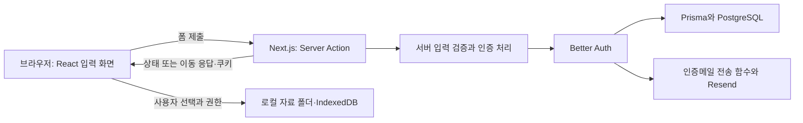
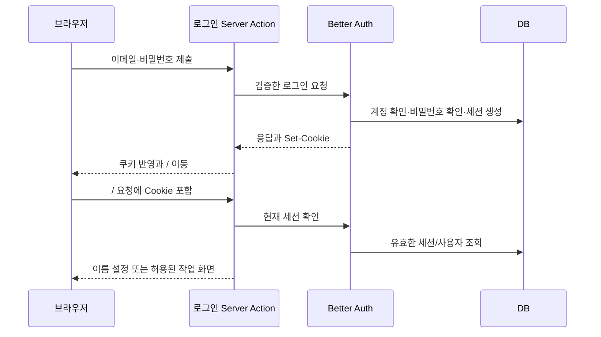

# 처음부터 따라 읽는 모아 코드 설명서

이 문서는 **2026-11-06, 실행 코드 `47e19b8` 기준**이다. JavaScript 문법을 조금 알고 React·Next.js로 실제 서비스를 연결하는 과정은 아직 익숙하지 않은 개발자를 대상으로 한다. 파일 이름 목록을 외우기보다, 한 번의 클릭이 어느 함수로 전달되고 어떤 값이 돌아오는지 설명한다.

현재 이메일 가입 순서는 **이메일 → 비밀번호·확인 → 메일 인증 → 직접 로그인 → 표시 이름 → 작업 공간**이다. Google·네이버·카카오 인증, 계정 연결, 인증된 사용자별 로컬 폴더 연결도 구현되어 있다. 실제 AI 대화·클라우드 검색·여러 자료 폴더 연결은 완료된 기능으로 설명하지 않는다. 이름을 가입 전에 받던 설명과 개발용 사용자로 파일을 연결하던 설명은 현재 구조로 교체했다.

## 읽는 방법

한 번에 끝까지 읽을 필요는 없다. 아래 순서로 코드 편집기와 문서를 번갈아 본다.

| 차례 | 읽을 범위 | 읽은 뒤 설명할 수 있어야 하는 것 |
| --- | --- | --- |
| 첫째 | 1~5절 | TSX·props·주소별 page·서버/브라우저의 차이 |
| 둘째 | 6~9절 | 입력이 화면 상태가 되고 Server Action으로 전달되는 과정 |
| 셋째 | 10~14절 | 가입·인증메일·쿠키·첫 로그인·로그아웃의 연결 |
| 넷째 | 15~16절 | 소셜 로그인, 계정과 작업 공간, Prisma·DB의 역할 |
| 다섯째 | 17~26절 | 같은 로그인 사용자의 로컬 파일 작업이 이어지는 과정 |
| 필요할 때 | 27절 이후 | 수정 위치, 직접 따라 읽는 연습, 실행 명령과 용어 |

코드 블록의 **실제 발췌**는 현재 파일의 일부다. **축약 예시**는 설명을 위해 주변 조건을 생략했으므로 그대로 파일에 덮어쓰지 않는다. 비밀키·DB 비밀번호·실제 인증 토큰은 예제에 싣지 않는다. 코드 경로는 문서 위치에서 여는 상대 링크이고, 호출 이름도 함께 적어 줄 번호가 바뀌어도 찾을 수 있게 했다.

## 1. 코드는 세 장소에서 움직인다

먼저 ‘지금 보고 있는 코드가 어디에서 실행되는가’를 구분한다.

| 장소 | 하는 일 | 이 프로젝트의 예 |
| --- | --- | --- |
| 사용자 브라우저 | 입력, 버튼, 화면 상태, 사용자가 허용한 로컬 파일 접근 | `AuthScreen`, `SignupScreen`, 폴더 controller |
| Next.js 서버 | 세션 확인, 입력 검증, 인증 라이브러리·DB·메일 서비스 호출 | Server Component, `app/actions/auth.ts`, `server/` |
| 외부 서비스 | 서버가 요청한 전문 작업 | Supabase의 PostgreSQL, Resend, 소셜 인증 서비스 |

로컬 개발에서는 브라우저와 Next.js 서버가 같은 PC에 있어도 서로 다른 실행 환경이다. 배포하면 Next.js 서버는 Vercel에서 실행되고, 브라우저는 여전히 사용자의 기기에서 실행된다. Vercel 서버가 사용자의 `E:\자료`를 직접 읽을 수 있는 구조가 아니다.



‘파일을 여러 파일로 나눴다’와 ‘프로그램이 여러 서버에서 돈다’는 다른 말이다. `app/actions/auth.ts`가 `server/auth-forms.ts`를 부르는 것은 보통 같은 Next.js 서버 안의 함수 호출이다. 반면 Resend에 `fetch`하는 것은 외부 네트워크 요청이다.

폴더 지도를 먼저 보고 싶다면 [코드 지도](code-map.md)를 함께 연다. 이 문서는 그 지도에 있는 함수들을 실제 사용자 행동으로 이어 읽는 설명이다.

이 설명서에서 쓰는 주요 위치는 다음과 같다.

```text
apps/web/src/
  app/                    주소별 화면·공통 layout·Server Action·HTTP 진입점
  components/             여러 기능이 쓰는 화면 틀·입력 외 공통 표시
  features/auth/          인증 화면·Hook·브라우저 초안·단계 규칙
  features/local-folders/ 로컬 파일의 화면·controller·session·service
  server/                 서버 인증·계정·DB·메일 처리
  shared/                 브라우저와 서버가 공유하는 타입/허용값/검증 규칙
  prototypes/             합성 데이터의 디자인 시안
packages/domain/          React/Next/DB SDK와 분리된 업무 규칙
```

`components`는 보여 주는 것, `hooks`는 React 수명과 상태를 연결하는 것, `store`의 controller는 진행 상태·사용자 행동, `services`는 실제 외부 처리, `lib`는 규칙을 찾을 때의 첫 단서다. 폴더 이름만으로 순수 함수/서버 전용 여부를 단정하지 말고 import와 함수 내부를 확인한다.

## 2. React 컴포넌트와 TSX를 읽는 법

컴포넌트는 화면의 한 부분을 설명하는 함수다. TSX는 TypeScript 안에 JSX라는 화면 표기법을 쓸 수 있는 파일 형식이다. JSX는 HTML과 비슷하지만 JavaScript 값·함수와 연결된다.

[AuthScreen.tsx](../apps/web/src/features/auth/components/AuthScreen.tsx)의 실제 발췌다.

```tsx
export function AuthScreen(props: AuthScreenProps) {
  return props.operation === "signup" ? <SignupScreen action={props.action} providers={props.providers} socialAction={props.socialAction} /> : <AuthFormScreen {...props} />;
}
```

순서대로 읽으면 다음 뜻이다.

1. `export`는 다른 파일에서 이 함수를 가져다 쓸 수 있게 한다.
2. `AuthScreen`은 컴포넌트 이름이다. JSX에서 사용자 컴포넌트는 대문자로 시작한다.
3. `props`는 부모가 이 화면에 넘겨준 입력값이다. `AuthScreenProps`는 그 값의 TypeScript 형식이다.
4. `props.operation === "signup"`이면 가입 전용 화면을 반환한다.
5. 아니면 공통 인증 폼인 `AuthFormScreen`을 반환한다.
6. `{...props}`는 props 객체의 각 속성을 자식에게 전달한다. 같은 내용을 일일이 다시 쓰지 않기 위한 객체 펼치기다.

`조건 ? A : B`를 **삼항 연산자**라고 한다. 두 화면을 동시에 숨겨 두었다가 고르는 코드가 아니라, 현재 조건에 맞는 쪽의 React 요소를 만든다.

### 2.1 props는 자식에게 주는 입력이다

[로그인 page](../apps/web/src/app/login/page.tsx)는 아래 속성을 넘긴다. 주변 코드를 생략한 축약 예시다.

```tsx
<AuthScreen operation="login" action={loginAction} />
```

`operation`은 어떤 폼인지 고르는 값이다. `action`은 제출 시 사용할 서버 함수다. 화면이 `loginAction`을 직접 하드코딩하지 않고 부모에게 받으므로, 같은 입력·오류·대기 UI를 이메일 확인·재설정·표시 이름 설정에도 사용할 수 있다.

일반 함수는 Server Component에서 Client Component로 마음대로 넘길 수 없다. 여기의 `loginAction`은 Next.js가 인식하는 **Server Function**이어서 서버 함수의 참조를 전달할 수 있다. 서버의 비밀키나 함수 본문 전체를 props로 내려보낸다는 뜻이 아니다. 이 경계는 5·7절에서 다시 설명한다.

### 2.2 children은 감싸진 안쪽 내용이다

[AuthShell.tsx](../apps/web/src/components/layout/AuthShell.tsx)는 헤더·소개·오른쪽 입력면·푸터를 배치한다.

```tsx
<AuthShell guest>
  <AuthScreen operation="login" action={loginAction} />
</AuthShell>
```

위는 축약 예시다. `AuthShell` 안에 적은 `AuthScreen`이 `children`으로 전달된다. Shell은 안쪽이 로그인인지 재설정인지 몰라도 같은 틀에 배치할 수 있다. `<AuthShell guest>`는 `guest={true}`의 짧은 표현이다. 현재 guest 화면의 홈 링크는 `/login`으로 바로 연결해 보호된 `/`를 거치는 왕복을 줄인다.

### 2.3 JSX의 자주 쓰는 표기

| 표기 | 읽는 방법 | 필요한 이유 |
| --- | --- | --- |
| `{config.title}` | JavaScript 값의 내용을 이 자리에 표시 | 설정값으로 화면 문구를 선택한다. |
| `className={styles.form}` | CSS 클래스를 적용 | JSX에서는 HTML의 `class` 대신 `className`을 쓴다. |
| `onChange={handler}` | 입력이 바뀌면 함수를 실행 | 함수의 반환값이 아니라 실행할 함수를 넘긴다. |
| `onClick={() => flow.back()}` | 클릭할 때 `back` 호출 | 렌더 도중 `flow.back()`을 실행하지 않도록 미룬다. |
| `{pending && <PageLoading />}` | pending이 참이면 로딩 표시 | 상태에 따라 표시할 요소를 고른다. |
| `fields.map(field => ...)` | 항목마다 입력 요소 생성 | 비슷한 입력 UI를 반복 복사하지 않는다. |
| `key={field.name}` | 목록에서 이 항목을 식별 | React가 항목의 상태·순서를 비교할 때 쓴다. 서버 권한 키가 아니다. |
| `<>...</>` | 여러 요소를 묶는 Fragment | 불필요한 실제 DOM 태그를 추가하지 않는다. |

CSS Modules의 `import styles from "...module.css"`는 CSS 클래스 이름을 담은 객체를 가져온다. 빌드 때 클래스가 구분되어 다른 파일의 `.form`과 우연히 충돌하는 일을 줄인다. 전역 색상과 기본 문서 스타일은 [globals.css](../apps/web/src/styles/globals.css)에 있다.

## 3. 이 코드에서 자주 만나는 TypeScript·JavaScript 문법

TypeScript는 실행 전에 타입의 일관성을 확인한다. 실제 브라우저 입력·URL·DB 응답이 올바른지 실행 중 검사하는 기능까지 자동으로 생기는 것은 아니다.

| 문법 | 현재 코드에서의 의미 |
| --- | --- |
| `const value = ...` | 이 이름에 다른 값을 재대입하지 않는다. 객체 내부까지 자동으로 불변이 되는 것은 아니다. |
| `let value` | 나중에 다른 값으로 재대입할 수 있다. |
| `import { name } from "..."` | 다른 모듈이 내보낸 이름을 가져온다. `../`는 현재 파일 기준 상위 폴더다. |
| `import type { AuthFormState } ...` | 타입 검사에만 필요한 선언을 가져온다. 실행할 함수가 아니다. |
| `export default function Page(...)` | 모듈의 기본 내보내기다. Next.js가 page/layout의 화면 함수를 이 방식으로 받는다. |
| `type A = ...` | 값의 형식에 이름을 붙인다. DB 테이블을 만드는 명령이 아니다. |
| `"idle" \| "success" \| "error"` | 셋 중 하나인 문자열 타입이다. 아무 문자열이나 허용하는 것보다 실수를 찾기 쉽다. |
| `value?: string` | 없어도 되는 속성이다. 읽으면 `undefined`일 수 있다. |
| `value?.name` | value가 null/undefined라면 접근을 멈추고 undefined를 준다. 권한 검사는 아니다. |
| `a ?? b` | a가 null/undefined이면 b를 쓴다. 빈 문자열·false를 무조건 바꾸지는 않는다. |
| `!value` | 값을 참/거짓으로 보았을 때 거짓인지 검사한다. |
| `value!` | 개발자가 null/undefined가 아니라고 타입 검사에 주장한다. 실행 중 검사를 추가하지 않는다. |
| `===` / `!==` | 값과 타입을 구분해 같음/다름을 비교한다. |
| `{ ...old, stage: next }` | old의 속성을 복사하고 stage를 새 값으로 덮는다. 중첩 객체까지 깊게 복사하지는 않는다. |
| `const { state, update } = result` | 객체 속성을 같은 이름의 변수로 꺼내는 구조 분해다. |
| `async` / `await` | 비동기 함수와 그 결과를 기다리는 지점이다. 브라우저 전체를 멈추지는 않는다. |
| `Promise<AuthFormState>` | 언젠가 AuthFormState로 완료되거나 오류로 거부될 비동기 결과다. |
| `try / catch / finally` | 시도 / 오류 처리 / 성공·실패 뒤 정리다. finally가 오류를 자동으로 해결하지는 않는다. |
| `void controller.open(...)` | 반환된 Promise를 이 자리에서 사용하지 않겠다는 표시다. 실제 실패 처리는 호출한 코드가 담당해야 한다. |
| `readonly` / `Readonly<T>` | 타입 검사에서 변경을 제한한다. 런타임의 깊은 복사나 암호화는 아니다. |
| `as const satisfies ...` | 리터럴 타입을 유지하면서 요구한 구조에 맞는지 검사한다. `signupSteps`에서 볼 수 있다. |
| `JSON.stringify(value)` / `JSON.parse(text)` | 객체를 저장·전송용 JSON 문자열로 바꾸기 / 문자열을 값으로 읽기다. parse 성공만으로 원하는 데이터 모양이 보장되지는 않는다. |

### 3.1 긴 타입 하나를 잘라 읽기

[auth-contract.ts](../apps/web/src/shared/auth-contract.ts)의 실제 선언이다.

```ts
fieldErrors?: Partial<Record<AuthFieldName, string>>;
```

`AuthFieldName`은 `"name"`, `"email"`, `"password"` 같은 허용 이름이다. `Record<AuthFieldName, string>`은 이 이름들을 키로, 문자열을 값으로 갖는 객체 형식이다. `Partial`은 모든 키가 필수는 아니라고 바꾼다. 바깥의 `?`는 `fieldErrors` 자체도 없을 수 있다는 뜻이다.

따라서 `{ email: "이메일을 확인해 주세요." }`처럼 잘못된 입력만 골라 메시지를 반환할 수 있다. 모든 필드에 빈 오류 문자열을 채울 필요가 없다.

### 3.2 async 함수는 호출한 곳과 함께 읽는다

[loginAction](../apps/web/src/app/actions/auth.ts)의 실제 발췌다.

```ts
export async function loginAction(_previous: AuthFormState, data: FormData) {
  const state = await perform("login", data);
  if (state.status === "success") redirect("/");

  return state;
}
```

`data`는 제출된 입력 묶음이다. `perform`이 끝날 때까지 이 함수의 다음 줄을 기다린다. 성공하면 Next.js에 화면 이동을 지시하고, 실패하면 오류 상태를 반환한다. `_previous`는 `useActionState`가 넘겨주는 직전 상태지만 이 함수에서는 사용하지 않음을 이름으로 표시했다.

`redirect()`는 단순한 문자열 반환이 아니다. Next.js가 처리하는 제어 흐름 예외를 던져 현재 렌더/Action을 중단한다. 그래서 인증 작업의 성공 redirect를 넓은 `catch`로 잡아 일반 오류로 바꾸면 안 된다. 이 파일이 서버 처리의 `try/catch` 밖에서 이동하는 이유다.

## 4. Next.js는 주소를 어떤 파일에 연결하는가

이 프로젝트는 **App Router**를 사용한다. [app 폴더](../apps/web/src/app)에 주소별 진입점과 공통 배치가 있다.

| 주소/파일 | 역할 |
| --- | --- |
| [app/layout.tsx](../apps/web/src/app/layout.tsx) | 전체 `<html>`·`<body>`, 언어, 메타데이터, 전역 CSS |
| [login/page.tsx](../apps/web/src/app/login/page.tsx) | `/login`, 방문자 검사 후 로그인 화면 조합 |
| [welcome/page.tsx](../apps/web/src/app/welcome/page.tsx) | `/welcome`, 가입 방법 선택·가입 입력·인증메일 안내 |
| [verify-email/page.tsx](../apps/web/src/app/verify-email/page.tsx) | 메일 링크의 토큰을 받아 확인 화면에 전달 |
| [account/page.tsx](../apps/web/src/app/account/page.tsx) | 로그인 사용자 이름 설정 또는 계정·로그아웃 화면 |
| [(workspace)/layout.tsx](../apps/web/src/app/(workspace)/layout.tsx) | 실제 작업 경로의 인증·workspace·폴더 Provider |
| [(workspace)/page.tsx](../apps/web/src/app/(workspace)/page.tsx) | `/`, 현재 대화 기능 구현 전 안내 |
| [(workspace)/files/page.tsx](../apps/web/src/app/(workspace)/files/page.tsx) | `/files`, 실제 파일 화면 |
| [(workspace)/settings/page.tsx](../apps/web/src/app/(workspace)/settings/page.tsx) | `/settings`, 계정·폴더·편집 설정 |
| [api/auth/[...all]/route.ts](../apps/web/src/app/api/auth/[...all]/route.ts) | 인증 프로토콜의 GET·POST 요청 처리 |

`page.tsx`는 주소의 화면이고, `layout.tsx`는 해당 부분을 감싸는 배치다. 공통 layout 아래의 페이지를 이동할 때 그 layout의 공유 상태를 유지할 수 있다. 새로고침으로 문서 전체를 다시 열면 브라우저 메모리의 컴포넌트 상태는 다시 만들어지며, 필요한 것은 별도 저장소에서 복원한다.

`(workspace)`처럼 괄호 친 폴더는 주소를 추가하지 않는 **route group**이다. 실제 주소는 `/(workspace)/files`가 아니라 `/files`다. `[...all]`은 여러 경로 조각을 받는 catch-all이다. 파일명만으로 모든 인증 API가 허용되는 것은 아니고 `auth-handler.ts`가 실제 허용 목록을 검사한다.

### 4.1 주소 뒤의 값은 search params다

`/welcome?step=password`에서 `/welcome`는 pathname, `step=password`는 query다. 서버 page는 현재 타입에 맞춰 다음처럼 값을 기다린다.

```ts
const step = (await searchParams).step;
```

이 코드의 `searchParams` 타입은 `Promise<Record<string, string | string[] | undefined>>`다. 같은 이름의 query가 반복될 수도 있어 문자열 배열 가능성도 있다. 그러므로 외부 query를 항상 정상 문자열이라고 단정하면 안 된다.

브라우저 컴포넌트는 `useSearchParams().get("step")`로 읽는다. `step=password`는 사용자가 보던 UI 위치일 뿐, 이메일 인증이나 파일 쓰기 권한을 증명하지 않는다.

### 4.2 이동 방식도 역할이 다르다

| 코드 | 역할 | 현재 사용 예 |
| --- | --- | --- |
| `Link` / `ActionLink` | 링크를 통한 Next.js 화면 이동 | 로그인↔가입, 메뉴 |
| `router.push(...)` | 브라우저 코드가 새 이동 기록 추가 | 가입 요청 성공 뒤 인증메일 안내 |
| `router.replace(...)` | 현재 기록을 대체해 이동 | 무효 세션을 로그인으로 돌림 |
| `history.pushState(...)` | 문서를 새로 요청하지 않고 기록과 URL 갱신 | 같은 가입 폼의 단계 진행 |
| `history.replaceState(...)` | 현재 URL 기록 수정 | 잘못된 단계 정규화·주소의 토큰 제거 |
| 서버 `redirect(...)` | 서버에서 현재 처리를 중단하고 이동 지시 | 로그인 성공, 비로그인 작업 경로 차단 |

`{ scroll: false }`는 이동/상태 반영 때 스크롤을 자동으로 위로 보내지 않기 위한 옵션이다. 서버 요청이나 렌더가 절대 일어나지 않는다는 뜻은 아니다.

공식 기준: [Next.js 페이지와 layout](https://nextjs.org/docs/app/getting-started/layouts-and-pages), [page의 searchParams](https://nextjs.org/docs/app/api-reference/file-conventions/page), [redirect](https://nextjs.org/docs/app/api-reference/functions/redirect).

## 5. 서버 코드와 브라우저 코드를 왜 나누는가

App Router의 page/layout은 기본적으로 Server Component다. 서버에서 세션·설정을 읽고 화면을 조합하기 좋다. 입력 이벤트·브라우저 저장소·React 상태가 필요한 부분은 Client Component로 둔다.

| 표시 | 의미 | 의미하지 않는 것 |
| --- | --- | --- |
| `"use client"` | 클라이언트 기능을 쓰는 모듈 경계를 선언 | 처음부터 끝까지 브라우저에서만 렌더된다는 보장은 아니다. |
| `"use server"` | 서버에서 실행할 Server Function을 선언 | 호출자의 인증·권한이 자동으로 검사된다는 뜻은 아니다. |
| `import "server-only"` | Client Component에서 서버 전용 모듈을 가져오는 실수를 빌드 경계에서 막음 | 네트워크 요청의 사용자 권한 검사까지 대신하지 않는다. |

Client Component도 첫 화면의 HTML을 서버에서 미리 만들 수 있다. 그다음 브라우저가 JavaScript를 연결해 상호작용할 수 있게 하는 과정을 **hydration**이라고 한다. 따라서 `"use client"`가 있어도 렌더 본문에서 무조건 `window.localStorage`를 읽는 방식은 안전한 초기 렌더 방법이 아니다. 서버에는 `window`가 없다.

현재 `useAuthDraft`·`useSignupFlow`는 외부 저장소 구독과 서버용 기본 snapshot을 사용한다. 파일 연결의 `useEffect`는 브라우저 지원 여부를 확인한 뒤 I/O를 시작한다. 6절에서 이 연결을 읽는다.

브라우저는 화면에 전달된 값을 볼 수 있다. 비밀키를 props로 넘긴 뒤 화면에서 숨기는 방식으로 보호하지 않는다. [server/auth.ts](../apps/web/src/server/auth.ts), [server/database/client.ts](../apps/web/src/server/database/client.ts)는 서버에 남고, Client Component에는 필요한 폼 상태·제한된 사용자 정보·서버 함수 참조만 전달한다.

공식 기준: [Server/Client Components](https://nextjs.org/docs/app/getting-started/server-and-client-components), [use client](https://nextjs.org/docs/app/api-reference/directives/use-client), [use server](https://nextjs.org/docs/app/api-reference/directives/use-server).

## 6. React가 입력과 화면 변화를 기억하는 방법

**렌더**는 컴포넌트를 실행해 지금 보여 줄 화면을 계산하는 일이다. 그 결과를 실제 DOM에 반영하는 일과 구분한다. 일반 변수 하나를 바꿨다고 React가 모든 변화를 알아서 구독하지 않는다. 화면에 영향을 주는 값은 state나 외부 store 구독으로 연결한다.

### 6.1 useState: 화면에 반영할 값

[AuthInput.tsx](../apps/web/src/features/auth/components/AuthInput.tsx)의 실제 발췌다.

```tsx
const [visible, setVisible] = useState(false);
```

`visible`은 현재 렌더에서 읽는 값, `setVisible`은 다음 화면을 위한 업데이트 요청 함수다. `useState(false)`의 false는 초기값이다. `setVisible(previous => !previous)`는 직전 값을 기준으로 참/거짓을 뒤집는다. 현재 함수 안의 `visible` 변수를 즉시 다시 대입하는 코드가 아니다.

이 입력은 비밀번호 보기 버튼을 누르면 `type`만 password/text로 바꾼다. 값을 바꾸거나 서버에 제출하지 않는다. 화면에서 가리는 일은 암호화와도 다르다. 비밀번호는 입력 중 브라우저 메모리·입력 요소에는 있어야 하지만 앱의 URL·localStorage·sessionStorage 초안에는 쓰지 않는다.

표시 이름 설정은 `profileName`과 `setProfileName`으로 입력을 제어한다. 제출 실패 뒤에도 값을 유지하고, 이 이름 입력 자체를 브라우저 영속 초안에는 저장하지 않는다.

### 6.2 제어 입력과 일반 입력

축약 예시다.

```tsx
<input value={email} onChange={event => setEmail(event.target.value)} />
```

`value`를 state로 주면 React 상태가 입력값의 기준이 된다. `onChange`에서 새 값을 저장해야 계속 입력할 수 있다. 현재 이메일과 표시 이름은 이런 방식으로 연결한다. 비밀번호는 이 컴포넌트가 매 타이핑마다 별도 초안에 저장하지 않도록 `value`를 주지 않고 폼 제출 시 읽는다.

‘제어하지 않는 입력’이 보안상 무조건 더 안전한 것은 아니다. 여기서는 복원해야 하는 이메일과 앱이 영속 보관하지 않을 비밀번호의 책임을 구분한 것이다.

### 6.3 useRef: 다음 렌더에도 갖고 있지만 표시용은 아닌 값

가입 폼의 `composing.current`는 한글 조합 중인지, `pointerStage.current`는 버튼을 누르기 시작했을 때 어떤 단계였는지 기억한다. ref를 바꿔도 그 자체로 렌더를 요청하지 않는다.

이전 단계를 ref에 잡는 이유는 버튼을 누르는 도중 blur와 click이 연달아 발생해 두 단계가 한 번에 진행되는 일을 막기 위해서다. ref는 비밀 저장소나 인증 수단이 아니다.

### 6.4 useEffect: 화면 바깥 대상과 연결하고 정리하기

`SessionBoundary`, 폴더 hook은 window 이벤트·타이머와 연결된다. 아래는 현재 패턴을 줄인 예시다.

```tsx
useEffect(() => {
  window.addEventListener("focus", check);
  return () => window.removeEventListener("focus", check);
}, [check]);
```

effect는 브라우저에서 외부 대상과 연결하고, 반환된 정리 함수는 재연결 전이나 컴포넌트 종료 때 기존 연결을 정리한다. 배열은 effect가 의존하는 값을 React에 알려 준다. 실제 프로젝트에서는 등록한 함수와 동일한 함수로 listener를 제거한다.

정리가 없으면 화면을 오갈 때 이벤트와 타이머가 쌓여 같은 요청이 반복될 수 있다. 반대로 effect가 있다고 ‘매 렌더마다 무조건 서버를 요청한다’는 뜻도 아니다. 의존값·등록된 이벤트·실제 호출 함수를 함께 읽어야 한다.

개발 모드의 Strict Mode는 실수를 찾으려고 일부 초기화와 effect 연결/정리를 추가로 실행할 수 있다. `useState(() => new Controller(...))`도 개발 검사에서는 초기화 함수가 추가 호출될 수 있으므로 생성 도중 파일 쓰기·메일 발송을 시작하면 안 된다. 현재 폴더 hook은 객체 조립과 브라우저 I/O 시작을 구분한다.

### 6.5 useSyncExternalStore: React 밖 상태를 화면에 연결하기

폴더 controller는 React 밖의 클래스다. 그 상태 변경을 React에 알리는 연결이 필요하다.

```tsx
const state = useSyncExternalStore(
  controller.subscribe,
  controller.getSnapshot,
  controller.getServerSnapshot,
);
```

| 함수 | 하는 일 |
| --- | --- |
| `getSnapshot` | 지금의 상태를 읽는다. |
| `subscribe` | 상태가 바뀌었을 때 호출할 listener를 등록하고 해제 방법을 준다. |
| `getServerSnapshot` | 서버 렌더·초기 hydration에 사용할 상태를 준다. |
| controller의 `publish` | 새 상태를 보관하고 listener에게 알린다. |

[inline-editor-controller.ts](../apps/web/src/features/local-folders/store/inline-editor-controller.ts)의 실제 발췌다.

```ts
private publish(value: InlineEditorState) {
  this.state = value;
  this.listeners.forEach(listener => listener());
}
```

여기에서는 상태를 바꾸고 알릴 뿐 파일을 쓰지 않는다. 알림을 받은 React가 snapshot을 읽고 화면 갱신 여부를 판단한다. 변경이 없으면 같은 snapshot 값을 반환해야 한다. 읽을 때마다 내용이 같은 새 객체를 만들어 반환하면 React가 계속 변경으로 볼 수 있다.

`useSignupFlow`는 먼저 localStorage의 문자열 snapshot을 구독하고, 그 밖에서 JSON을 파싱한다. 변하지 않은 문자열을 안정적으로 읽기 위한 구조다. `storage` 이벤트는 다른 문서/탭 변경을 알리는 데 쓰고, 현재 탭 변경은 별도의 앱 이벤트로 알린다. 서버용 snapshot은 서버와 최초 hydration에서 일치해야 초기 화면이 어긋나는 일을 피할 수 있다.

Hook은 컴포넌트나 다른 Hook의 최상위에서 호출한다. 조건문·반복문 안에서 호출 순서를 바꾸면 안 된다. 그래서 `AuthScreen`이 가입/공통 폼 컴포넌트를 나누고 각 컴포넌트 안에서 자기 Hook을 호출한다.

공식 기준: [state](https://react.dev/reference/react/useState), [effect](https://react.dev/reference/react/useEffect), [ref](https://react.dev/reference/react/useRef), [외부 store 구독](https://react.dev/reference/react/useSyncExternalStore).

## 7. 버튼에서 서버로: form·Server Action·HTTP

[AuthScreen.tsx](../apps/web/src/features/auth/components/AuthScreen.tsx)는 다음 세 값을 얻는다. 실제 코드의 callback은 주변 처리를 포함하므로 아래는 축약 예시다.

```tsx
const [state, formAction, pending] = useActionState(
  async (previous, data) => await submitAction(previous, data),
  { status: "idle" },
);

<form action={formAction}>
  {/* 입력과 제출 버튼 */}
</form>
```

| 값 | 의미 |
| --- | --- |
| `state` | action이 반환한 성공/오류/메시지 상태 |
| `formAction` | 폼 제출에 연결할 action 함수 |
| `pending` | action의 처리가 진행 중인지 |
| `previous` | 직전 action 상태. 신뢰할 사용자 신원 자료는 아니다. |
| `data` | 이번에 제출한 `FormData` |

첫 호출 전에는 `{ status: "idle" }`가 state다. 제출 후 함수가 `{ status: "error", fieldErrors: ... }`를 반환하면 React가 그 결과로 오류 메시지를 그린다. 로그인 성공처럼 서버가 redirect하면 페이지 이동이 진행되므로 항상 성공 state가 화면에 돌아와야 하는 것은 아니다.

### 7.1 FormData에는 무엇이 들어가는가

HTML 폼은 입력의 `name`과 값을 묶는다. 아래는 설명용 예시다.

```html
<input name="email" type="email" />
<input name="password" type="password" />
```

`id`는 label·초점 연결에 쓰고, `name`은 제출할 필드를 식별한다. 제출 버튼의 `name="provider" value="google"`도 누른 버튼을 구분하는 값이 된다. `fieldset disabled={pending}`는 처리 중 중복 조작을 줄인다. 이 UI 제한은 서버의 요청 제한·입력 검증을 대신하지 않는다.

브라우저의 `required`, `type="email"`, `minLength`는 빠른 피드백용이다. 개발자 도구나 직접 HTTP 요청으로 우회할 수 있으므로 서버에서 같은 입력을 다시 확인한다.

### 7.2 Server Action은 브라우저 함수 호출처럼 보여도 요청 경계다

[app/actions/auth.ts](../apps/web/src/app/actions/auth.ts)는 `"use server"`로 선언되어 있다. 브라우저가 이 함수를 호출하면 Next.js가 네트워크 요청을 통해 서버에서 실행한다. 따라서 함수 안에서 다시 방문자/세션·Origin·입력 검사를 해야 한다.

HTTP에서 **요청**은 method·URL·headers·body로, **응답**은 status·headers·body로 구성된다. 이 프로젝트의 서버 코드는 표준 `Request`, `Response`, `Headers`, `FormData` 객체를 사용한다.

| 항목 | 현재 쓰임 |
| --- | --- |
| GET | 화면/세션 조회, SDK가 요구하는 메일·OAuth 프로토콜 |
| POST | 폼 제출·로그인·로그아웃·계정 변경 |
| `Content-Type` | body를 어떤 형식으로 읽어야 하는지. 여기서는 JSON 요청을 구성할 때 사용 |
| `Origin` | 요청 출처의 scheme·host·port. 정식 앱 출처인지 검사 |
| `Cookie` | 브라우저가 서버로 보내는 쿠키 |
| `Set-Cookie` | 서버가 브라우저에 쿠키 저장/변경을 요청하는 응답 헤더 |
| 200 / 400 / 401 / 403 / 429 / 5xx | 정상 / 입력 오류 / 인증 필요 / 거부 / 요청 과다 / 서버 측 실패의 대표 분류 |

HTTP 상태와 화면의 성공 여부는 다르다. 화면의 `status: "error"`와 내부 인증 handler 응답의 HTTP 상태도 별개다. Server Action 전송의 상태 코드만으로 가입·메일 발송 성공을 판단하지 않는다. 과거 `/welcome POST 200` 로그만으로 실제 메일 수신까지 성공했다고 단정하지 않은 이유다. 특정 전송 상태 코드를 모든 Server Action의 고정 계약으로 외울 필요는 없다.

공식 기준: [useActionState](https://react.dev/reference/react/useActionState), [Next.js 데이터 변경](https://nextjs.org/docs/app/getting-started/mutating-data), [Server Action 보안](https://nextjs.org/docs/app/guides/data-security).

## 8. 로그인 화면을 처음 열었을 때

다음 네 파일을 옆에 열고 읽는다.

1. [login/page.tsx](../apps/web/src/app/login/page.tsx): 서버에서 방문자 확인과 화면 조합.
2. [AuthShell.tsx](../apps/web/src/components/layout/AuthShell.tsx): 공통 배치.
3. [AuthScreen.tsx](../apps/web/src/features/auth/components/AuthScreen.tsx): 입력·결과·제출 상태.
4. [form-config.ts](../apps/web/src/features/auth/lib/form-config.ts): 제목·필드·버튼·단계 데이터.

페이지에서 가장 먼저 하는 일은 `await requireGuest()`다. 이미 유효한 세션이 있으면 `/`로 보낸다. 로그인한 사용자가 주소창으로 가입 화면에 들어가도 서버가 같은 규칙을 적용한다.

`socialProviderConfiguration()`은 서버 환경에 설정된 공급자를 찾는다. `socialProviders.filter(...)`는 그중 사용 가능한 ID만 화면에 전달한다. 브라우저에는 `"google"`, `"naver"`, `"kakao"` 같은 선택값이 내려가고 공급자 비밀키는 내려가지 않는다.

`params.connection === "updated"`는 계정 연결 변경 후 재로그인 안내 문구를 고르는 값이다. 로그인 성공을 증명하는 query가 아니다. `socialErrorMessage(params.error)`도 알려진 오류 코드만 한국어 안내로 바꾼다.

`AuthScreen`에서 `operation="login"`이면 `authForms.login`을 고른다. 같은 `AuthInput`으로 이메일·비밀번호를 만들고 소셜 버튼을 조합한다. 이 데이터 설정을 바꾸는 것과 실제 서버 정책을 바꾸는 것은 별도다. 예를 들어 신규 비밀번호 최소 길이를 바꾸려면 화면의 `Field`만이 아니라 서버 schema·Better Auth 정책·실패 테스트도 함께 확인해야 한다.

페이지에서 전달한 `loginAction`은 실제로는 아직 실행되지 않았다. 사용자가 폼을 제출할 때 호출할 함수의 참조를 준비한 상태다.

### 8.1 AuthInput 한 개를 처음부터 끝까지 읽기

[AuthInput.tsx](../apps/web/src/features/auth/components/AuthInput.tsx)를 열면 여러 폼이 공유하는 입력 하나를 볼 수 있다.

1. props의 `field`는 입력 이름·종류·label·길이·자동완성 설정이다. `error`는 서버/입력 검증 메시지이고 `value`, 이벤트 함수들은 사용하는 화면이 선택해서 준다.
2. `useState(false)`는 비밀번호 표시 여부다. 이메일 입력에서도 Hook 호출 순서를 조건으로 바꾸지 않는다.
3. `field.type === "password"`는 비밀번호 보기 버튼이 필요한 입력인지 구분한다.
4. `id = auth-입력이름`을 만들어 label의 `htmlFor`와 입력의 `id`를 연결한다. label을 눌렀을 때 올바른 입력을 찾게 한다.
5. `name={field.name}`은 제출할 FormData의 키다. `id`와 다른 역할이다.
6. `autoComplete`는 브라우저/비밀번호 관리자에 입력 용도를 알린다. 앱 초안에 저장하는 기능과는 다르다.
7. `required`, `minLength`, `maxLength`는 브라우저의 빠른 입력 검증이다. 서버 검사는 따로 있다.
8. `aria-invalid`, `aria-describedby`는 오류 상태와 오류 문구를 보조 기술에도 연결한다. 그 속성을 넣었다고 검증이 실행되는 것은 아니다.
9. `value === undefined`이면 제어 props를 생략하고, 값이 있으면 `{ value, onChange }`를 전달한다. 이메일/이름의 제어 입력과 비밀번호 입력을 같은 표시 컴포넌트로 다루기 위해서다.
10. 비밀번호 보기 버튼은 `type="button"`이다. 기본 제출 버튼으로 잘못 동작하지 않고, `aria-pressed`와 label도 보기 상태에 맞춰 바뀐다.

여기서 `AuthInput`은 비밀번호를 해시하거나 계정을 생성하지 않는다. field 설정과 입력 이벤트를 실제 DOM에 연결하는 역할이다. 이 한 파일을 읽은 뒤 폼과 서버로 이동하면 책임의 크기를 나누어 이해하기 쉽다.

## 9. 로그인 버튼을 누르면 어느 파일로 이어지는가

```text
AuthInput에서 이메일·비밀번호 입력
  → AuthFormScreen의 formAction
  → app/actions/auth.ts의 loginAction
  → perform("login", data)
  → server/auth-forms.ts의 submitAuthForm
  → server/auth-handler.ts의 handleAuthRequest
  → server/auth.ts의 getAuth().handler
  → Better Auth가 비밀번호·계정 상태 확인, 세션 생성
  → 응답의 쿠키를 applyAuthCookies로 브라우저에 전달
  → loginAction이 redirect("/")
```

`perform`은 공통 순서를 묶는다. profile은 로그인 사용자만, 다른 방문자 인증 폼은 guest만 진행하게 검사하고, 서버 처리 결과의 쿠키를 반영한다. 모든 업무를 같은 권한으로 허용하는 만능 함수가 아니다.

### 9.1 submitAuthForm은 왜 별도 파일인가

[auth-forms.ts](../apps/web/src/server/auth-forms.ts)의 역할은 화면 입력을 SDK 프로토콜에 맞게 바꾸고, SDK 결과를 안전한 폼 상태로 돌려주는 것이다.

1. `Object.fromEntries(formData)`로 제출값을 객체로 만든다.
2. `schemas[operation].safeParse(...)`로 이번 업무의 입력을 검사한다.
3. 실패한 필드만 `fieldErrors`로 반환한다.
4. 정상 입력을 SDK가 이해하는 body로 만든다.
5. 인증 handler를 호출하고 응답을 폼 상태로 변환한다.

Zod의 `safeParse`는 검사 실패를 결과 객체로 돌려준다. `parse`는 실패하면 예외를 던진다. 서버 응답을 안전한 형태로 확인하거나 사용자 오류를 필드별로 표시할지에 따라 사용 방식을 구분한다. 타입 단언인 `as`와는 다르다.

`email.trim().toLowerCase()`는 불필요한 앞뒤 공백·대소문자 차이를 정규화한다. 비밀번호에 같은 공백 제거를 무조건 적용하지 않는다. 사용자가 입력한 비밀번호의 의미를 임의로 바꾸기 때문이다.

### 9.2 내부 Request를 만드는 이유

이 코드의 `new Request(...) → handleAuthRequest(...)`는 자기 서버로 `fetch`해 왕복하는 코드가 아니다. 같은 서버 프로세스 안에서 요청 객체를 만들어 인증 프로토콜 함수를 호출한다. 소셜 서비스의 callback은 실제 외부 HTTP 요청으로 같은 handler에 들어온다.

`new Headers(headers)`로 현재 요청의 출처·쿠키·배포 플랫폼의 IP 헤더를 이어받는다. body를 JSON으로 새로 만들었으므로 예전 `content-length`를 지우고 `content-type`을 다시 지정한다. 길이가 다른 body에 예전 길이 헤더를 남기지 않기 위해서다.

서버는 `getAuth().options.baseURL`의 정식 origin에서 목적지를 구성한다. 사용자가 제출한 `callbackURL`을 그대로 믿어 임의 사이트로 보내지 않는다. 메일·OAuth의 callback URL과 ‘주소창의 단계’는 역할이 다르다.

### 9.3 SDK 앞의 auth-handler는 무엇을 제한하는가

[auth-handler.ts](../apps/web/src/server/auth-handler.ts)는 구현한 경로·method만 SDK에 전달한다. 추가로 profile의 현재 세션·Origin·이름만 있는 body, 소셜 공급자·고정 callback 등을 검사한다. 응답 JSON에서 bearer token과 불필요한 세션 필드를 제거하고 `no-store` 응답을 만든다.

[api/auth/[...all]/route.ts](../apps/web/src/app/api/auth/[...all]/route.ts)는 이 handler를 GET/POST로 내보낸다. `runtime = "nodejs"`는 인증·DB 코드가 실행할 서버 런타임을 명시한다. Route Handler는 React 화면이 아니라 HTTP 요청에 응답하는 함수다.

## 10. 회원가입 Stepper와 복원을 따라 읽기

진입부터 제출까지 다음 순서다.

```text
/welcome
  → SignupMethods: 소셜 또는 이메일 선택
/welcome?step=email
  → SignupScreen: 이메일 입력
/welcome?step=password
  → 같은 폼 아래에 비밀번호·확인 표시
  → 서버에 가입 요청
/welcome?step=verification
  → AuthScreen의 resend 화면: 인증메일 안내
```

[welcome/page.tsx](../apps/web/src/app/welcome/page.tsx)의 `step === undefined`가 방법 선택과 입력 화면을 나눈다. `signupOperation(step)`은 verification이면 resend, 그 외에는 signup을 고른다. `key={operation}`은 signup과 resend가 바뀔 때 폼의 React 상태를 새로 만들도록 구분한다.

### 10.1 표시와 업무 상태는 다른 책임이다

| 위치 | 담당하는 것 | 담당하지 않는 것 |
| --- | --- | --- |
| [WorkflowStepper.tsx](../apps/web/src/components/ui/WorkflowStepper.tsx) | 번호·라벨·현재 단계·ARIA 표시 | 사용자 인증, DB 쓰기, 다음 단계 결정 |
| [form-config.ts](../apps/web/src/features/auth/lib/form-config.ts) | 가입/재설정 단계 목록과 현재 표시 단계 선택 | 메일 인증 성공 판정 |
| [useSignupFlow.ts](../apps/web/src/features/auth/hooks/useSignupFlow.ts) | 입력 이벤트·초점·URL·브라우저 초안 연결 | SDK 계정 생성 |
| [signup-flow.ts](../apps/web/src/features/auth/lib/signup-flow.ts) | 이메일 검사·단계 정규화·초안 파싱/직렬화 | React 렌더·네트워크 |
| [SignupScreen.tsx](../apps/web/src/features/auth/components/SignupScreen.tsx) | 앞 기능을 폼·버튼에 연결 | 파일 작업의 URL 규칙 |

Stepper에 전달하는 `steps`는 목록, `current`는 현재 단계 ID, `label`은 탐색 영역의 접근 가능한 이름이다. `aria-current="step"`는 보조 기술에도 현재 위치를 알려 준다. 화면의 체크표시를 바꿔도 서버 가입 상태가 바뀌지는 않는다.

현재 입력 단계는 `email`, `password` 두 개다. 표시 단계는 이메일/비밀번호/이메일 확인/완료 네 개다. 이메일 확인과 완료는 브라우저 입력을 진행한 것만으로 확정할 수 없어서 따로 다룬다.

### 10.2 Enter·Tab·blur가 모두 있는데 왜 중복 진행하지 않는가

`advance(expected)`는 이벤트가 기대한 단계와 `current.current`를 비교한다. 이미 다른 이벤트가 진행했다면 같은 처리를 반복하지 않는다. 이메일 유효성 검사에 성공해야 password로 넘어간다.

Enter는 기본 제출을 막고 단계 진행으로 처리한다. Tab으로 입력을 새로 펼칠 때는 원래의 Tab 이동을 막고, 새 입력 DOM이 생긴 뒤 effect에서 `auth-password`에 초점을 준다. 그렇지 않으면 아직 없던 입력을 건너뛰어 다음 버튼으로 가는 불편이 생긴다.

일반 blur는 필요한 단계를 펼치되 `focus=false`로 사용자의 다른 클릭 위치를 무조건 빼앗지 않는다. 이전/다음 버튼으로 이동한 blur는 별도 표시 속성으로 구분한다. 한글 조합 중 Enter는 `composing`·`isComposing` 등의 검사를 통과해야 하므로 글자 확정이 가입 제출로 이어지지 않게 한다.

### 10.3 주소와 초안에는 각각 무엇이 남는가

| 위치 | 현재 보관 내용 | 이유/한계 |
| --- | --- | --- |
| 가입 URL | `?step=email` 또는 `?step=password` 같은 단계 | 이동 기록·새로고침에서 표시 위치를 알기 위함 |
| `moa-signup-draft-v1` localStorage | 이메일·단계·만료 시각 | 같은 브라우저에서 창을 다시 열어 이어가기 |
| `moa-auth-input` sessionStorage | 로그인/메일 안내 등의 입력 초안. 현재 흐름에서는 주로 이메일 | 현재 탭의 인증 폼 사이에 입력 연결 |
| 입력 요소/React 메모리 | 입력 중 비밀번호, 확인·재설정 토큰 등 필요한 일시 값 | 앱이 이를 영속 초안에 쓰지는 않음 |
| 쿠키 | SDK가 설정한 세션 등의 프로토콜 값 | 앱 초안과 다른 인증 수단. 12절 참고 |

이메일도 개인정보다. 비밀번호를 저장하지 않는다고 초안 전체가 비민감한 것은 아니다. localStorage는 비밀 금고가 아니며 같은 origin의 JavaScript가 읽을 수 있다. 이 코드는 용도를 제한하고 `86_400_000`밀리초, 즉 하루의 유효기간을 검사한다. 만료 타이머는 탭이 실행 중일 때 동작하고, 앱을 닫아 두면 다음 읽기에서 만료를 판단한다. 정해진 시각에 브라우저 디스크에서 반드시 즉시 삭제되는 보장은 아니다.

공통 `AuthDraft` 타입에는 과거 name 속성이 남아 있지만, 현재 가입 `serializeSignupDraft`는 이름을 저장하지 않고 `parseSignupDraft`는 빈 이름으로 정규화한다. 이전 `step=name`과 구버전 초안은 이메일 단계로 전환한다.

`normalizeSignupStage`는 이메일이 없는 `?step=password`를 email로 낮춘다. `?step=complete`도 입력만으로 완료를 인정하지 않는다. 이 클라이언트 검사는 사용성을 위한 것이고 서버는 제출된 이메일·비밀번호를 다시 검증한다.

### 10.4 가입 성공 때 초안은 어떻게 정리하는가

`SignupScreen`은 가입 응답 성공 뒤 이메일을 인증 폼용 초안에 연결하고 verification으로 이동한다. `AuthFormScreen`의 resend effect는 완료한 가입 입력 초안을 지운다. 그래서 메일 안내를 새로고침해도 가입 POST를 자동으로 다시 보내지 않는다.

`useSyncExternalStore`가 먼저 문자열 snapshot을 읽고 `parseSignupDraft`가 검사한다. JSON 길이·형식·단계·만료를 확인하며 저장소가 막혀도 메모리 입력을 계속할 수 있게 처리한다. 다른 탭과 같은 탭의 변경 이벤트를 구분해 동기화한다.

`restored`는 서버/최초 hydration에서는 false, 이후 브라우저 snapshot에서는 true가 되도록 한 준비 표시다. URL을 보정하는 effect가 이를 확인하는 것은 브라우저 초안을 읽기 전에 서버의 빈 기본값으로 주소를 성급히 덮지 않기 위해서다. 이 표시 역시 서버 가입 완료나 인증 성공을 의미하지 않는다.

## 11. 가입 요청과 인증메일은 어떻게 이어지는가

서버의 실제 연결은 다음과 같다.

```text
signupAction
  → submitAuthForm("signup", data, headers)
  → 이메일·비밀번호·확인 일치 검사
  → passwordConfirm 제거, name="" 추가
  → /sign-up/email 프로토콜
  → Better Auth가 user·credential 등 저장
  → sendVerificationEmail callback
  → sendAuthenticationEmail
  → Resend에 발송 요청
```

`passwordConfirm`은 오타 확인용이므로 SDK나 DB에 함께 저장할 필요가 없다. 비밀번호는 Better Auth가 처리하고 credential 계정에 해시가 저장된다. 해시는 원문 비밀번호를 그대로 저장하는 것과 다르며, OAuth 토큰의 암호화와도 구분한다.

`name=""`는 현재 앱이 이름을 나중에 받기로 한 상태를 표현한다. 설치된 SDK와 DB는 빈 문자열 이름을 허용하며 기존 String 컬럼을 사용한다. 사용자의 이메일 앞부분을 임의로 표시 이름으로 만들지 않는다. 첫 로그인 뒤 13절의 이름 설정으로 이어진다.

### 11.1 auth.ts의 숫자와 옵션을 읽는 법

[auth.ts](../apps/web/src/server/auth.ts)의 현재 정책이다. 라이브러리 옵션의 시간 단위와 브라우저 타이머의 단위를 혼동하지 않는다.

| 값 | 의미 | 필요한 이유 |
| --- | --- | --- |
| `requireEmailVerification: true` | 이메일/비밀번호는 메일 확인 필요 | 주소 소유 확인 전 해당 방식의 로그인을 허용하지 않음 |
| `autoSignIn: false` | 이메일 가입만으로 자동 로그인하지 않음 | 가입 요청과 로그인 세션 생성을 구분 |
| `autoSignInAfterVerification: false` | 메일 확인 후 직접 로그인 | 확인 링크가 열린 것과 실제 로그인 행동을 구분 |
| 비밀번호 12~128자 | 신규/재설정 비밀번호 길이 정책 | UI·서버·SDK에서 같은 정책을 적용 |
| 이메일 확인 3600초 | 1시간 | 오래된 인증 링크 사용 제한 |
| 재설정 1800초 | 30분 | 비밀번호 변경 링크의 사용 시간 제한 |
| 로그인/가입 `window:60, max:5` | 해당 SDK 요청 제한의 60초 창과 최대 횟수 | 과도한 반복 시도를 줄임. 보안 전체를 보장하는 숫자는 아님 |

`auth.ts`는 인증 라이브러리를 설정하고 callback을 연결한다. 버튼이나 CSS를 그리는 파일이 아니다. `getAuth()`의 `auth ??= createAuth()`는 현재 서버 프로세스에서 설정 객체를 재사용한다. 모든 서버 인스턴스가 하나의 전역 객체를 공유한다는 뜻은 아니다.

### 11.2 메일 보냈다는 말에는 여러 단계가 있다

[auth-mail.ts](../apps/web/src/server/auth-mail.ts)는 서버의 `RESEND_API_KEY`·`EMAIL_FROM`을 읽고 수신자·발신자 형식을 검사한 뒤 Resend로 요청한다. `AbortSignal.timeout(10_000)`은 이 요청을 무한정 기다리지 않게 하는 제한이다.

메일 요청에는 HMAC으로 만든 idempotency key를 붙인다. 같은 요청 내용이 중복 처리되는 것을 줄이기 위한 것이며, 재전송 기능을 영원히 막거나 수신함 표시까지 보장하는 장치는 아니다. 키·본문·수신자를 그대로 운영 로그에 남기지 않고 공급자 응답 상태 같은 제한된 진단을 남긴다.

Better Auth의 background task를 Next.js `after(...)`에 연결했으므로 **화면의 가입 응답 성공**, **Resend 접수**, **수신 서버 전달**, **사용자 메일함 표시**를 같은 시점으로 보면 안 된다. 앱 요청이 성공해도 후속 메일 작업이 실패할 수 있고 스팸 분류·수신자 제한은 별도 운영 확인이 필요하다.

### 11.3 받은 메일 링크를 누르면

```text
/verify-email?token=메일의 값
  → verify-email/page.tsx가 문자열/길이 확인
  → AuthScreen에 initialToken 전달
  → 브라우저 메모리에 보관하고 주소의 token 제거
  → 사용자가 이메일 주소 확인 버튼 제출
  → verifyAction → SDK의 /verify-email 처리
  → 서명·유효기간 등 SDK 검증 성공
  → 완료 문구와 로그인 버튼
```

앱은 링크를 여는 것만으로 메일 주소 확인을 자동 제출하지 않는다. 토큰은 처음에는 메일 링크의 URL에 있어야 전달되지만, 화면이 준비되면 주소에서 제거한다. 제거가 최초 요청·브라우저 기록·외부 인프라의 모든 흔적까지 소급해 없애는 것은 아니다.

`<input type="hidden" name="token">`은 화면에 입력칸을 그리지 않는다는 뜻이지 사용자나 스크립트가 못 보는 비밀 보관법은 아니다. 서버는 이 값을 신뢰하지 않고 SDK로 다시 검증한다. 새로고침하면 메모리의 토큰을 잃으므로 새 메일 링크를 다시 열도록 안내한다.

비밀번호 찾기·재설정도 같은 폼/로딩과 token 전달 구조를 사용한다. [forgot-password page](../apps/web/src/app/forgot-password/page.tsx)와 [reset-password page](../apps/web/src/app/reset-password/page.tsx)에서 각각 `requestResetAction`, `resetAction`을 따라간다. 소셜 전용 계정에 재설정으로 비밀번호 계정을 몰래 추가하지 않도록 별도 검사가 있으며, 재설정 성공 시 기존 세션 폐기 정책도 적용된다.

## 12. 로그인 성공이 다음 화면에도 유지되는 이유: 쿠키와 세션

이메일·비밀번호를 매 페이지마다 다시 보내는 대신, 로그인 성공 후 SDK가 세션을 만든다. **세션**은 서버가 현재 로그인 상태와 만료 시각을 확인할 수 있도록 관리하는 기록이고, 브라우저의 세션 쿠키가 이후 요청을 이 상태와 연결한다.



그림의 `/` 요청은 실제로 작업 layout의 서버 가드로 들어간다. 표기를 단순하게 하려고 서버 요청들을 같은 참여자로 그렸다.

### 12.1 applyAuthCookies를 생략하면 무엇이 끊기는가

[app/actions/auth.ts](../apps/web/src/app/actions/auth.ts)의 실제 발췌다.

```ts
const returnedCookies = response?.headers.get("set-cookie");
if (!returnedCookies) return;
const store = await cookies();
for (const [name, cookie] of parseSetCookieHeader(returnedCookies)) store.set(name, cookie.value, toCookieOptions(cookie));
```

인증 SDK를 내부 함수로 호출해서 받은 `Response`가 사용자의 브라우저 응답에 자동으로 복사되는 것은 아니다. 이 함수가 SDK의 `Set-Cookie`를 Next.js의 응답 쿠키 저장소에 반영한다. SDK가 준 쿠키 옵션도 함께 옮긴다.

DB 세션을 만들었어도 브라우저가 세션 쿠키를 받지 못하면 다음 페이지 요청에서 로그인 상태를 이어갈 수 없다. 그래서 ‘비밀번호가 맞았다’와 ‘브라우저에 세션이 연결되었다’를 구분해 테스트한다.

### 12.2 쿠키 옵션과 JSON 토큰 제거

`HttpOnly` 쿠키는 일반 브라우저 JavaScript가 `document.cookie`로 값을 읽지 못하게 한다. 브라우저가 대상 서버 요청에 쿠키를 첨부하는 일까지 막는 것은 아니다. `Secure`는 HTTPS 전송용이며 로컬 HTTP 환경과 배포 환경은 구분한다. `SameSite`와 Origin/CSRF 검사는 함께 읽어야 하고 어느 하나만으로 모든 공격이 해결되지는 않는다.

앱은 로그인 응답의 bearer token을 브라우저 JSON에 노출하거나 localStorage 인증 토큰으로 저장하지 않는다. `checkAuthSessionAction`도 화면의 사용자 ID·만료 시각 등 최소 snapshot만 반환한다. 클라이언트가 반환한 ID를 다시 서버에 제출했다고 그 ID의 권한을 주지는 않는다.

공식 기준: [Next.js cookies](https://nextjs.org/docs/app/api-reference/functions/cookies), [headers](https://nextjs.org/docs/app/api-reference/functions/headers).

## 13. 첫 로그인에서 이름을 받고 작업 공간을 여는 과정

[session-guards.ts](../apps/web/src/server/session-guards.ts)의 세 함수를 구분한다.

| 함수 | 정상적으로 허용하는 대상 | 이동/실패 |
| --- | --- | --- |
| `requireGuest()` | 유효한 로그인 세션이 없는 방문자 | 유효 세션이 있으면 `/` |
| `requireAccountSession()` | 유효한 로그인 사용자 | 없으면 `/login`. 이름이 비어 있어도 계정 설정에 접근 가능 |
| `requireWorkspace()` | 유효 세션과 표시 이름이 있는 작업 사용자 | 미로그인 `/login`, 이름 없음 `/account`, 이후 workspace 조회 |

서버 세션 조회가 장애인 경우 이를 단순한 정상 방문자로 오인해 보호 화면을 허용하지 않는다. 실패와 미로그인을 구분한다.

새 이메일 계정은 이름이 빈 문자열이므로 `/`에서 `/account`로 이동한다. [account/page.tsx](../apps/web/src/app/account/page.tsx)는 `session.user.name.trim()`이 비어 있으면 `operation="profile"`, 있으면 `operation="signout"`을 조합한다. 설정 페이지와 계정 페이지를 만들기 위해 서로 다른 입력 컴포넌트를 새로 복제하지 않았다.

이름 저장은 다음 순서다.

```text
AuthFormScreen(profile) → profileAction
  → requireAccountSession
  → submitAuthForm(profile): 이름을 trim하고 1~40자 검사
  → handleAuthRequest(/update-user): Origin·현재 인증·이름만 있는 body 검사
  → SDK가 session.user.id의 이름 갱신
  → 쿠키 반영 → /로 이동
```

클라이언트가 제출한 `userId`를 보고 이름을 바꾸지 않는다. 공개 프로토콜에서 name 이외 `userId`, `emailVerified`, `image` 같은 추가 필드는 거부한다. 빈 이름·공백 이름도 허용하지 않으며 분당 요청 제한이 있다. 기존 이름이 있는 이메일 계정과 소셜 공급자 이름은 이 화면에서 다시 입력시키지 않는다.

**이름 입력 완료는 UX 조건이고, 인증·작업 공간 소유권 검사는 별도의 보안 조건**이다. 이름만 입력했다고 로그인이 생기지는 않고, 이름 설정을 주소로 건너뛰려 해도 작업 layout에서 다시 판단한다.

## 14. 세션을 확인하면서 화면을 계속 사용할 수 있게 하는 법

[authenticated-session.ts](../apps/web/src/server/authenticated-session.ts)는 SDK 세션을 읽고 앱이 사용할 수 있는 인증 상태인지 확인한다. 이메일/비밀번호의 미인증 사용자와, 허용된 소셜 공급자에 실제 연결된 사용자를 구분한다. 소셜로 신원을 확인했다는 이유로 연락 이메일의 `emailVerified`를 거짓으로 true로 덮지 않는다.

`cache(...)`는 React의 서버 렌더 안에서 같은 인자로 반복되는 조회를 묶기 위한 것이다. 서로 다른 브라우저 요청 사이에 사용자의 세션을 무기한 캐시하는 기능이 아니다. 이 코드가 넘기는 `disableCookieCache: true`, `disableRefresh: true`도 함께 읽는다. 브라우저 쿠키 snapshot을 그대로 세션 정답으로 쓰거나 조회 때마다 refresh를 요구하는 흐름으로 만들지 않는다.

### 14.1 서버 가드와 SessionBoundary는 왜 둘 다 있는가

서버 가드는 요청이 들어올 때 보호 화면을 내보내도 되는지 판단한다. [SessionBoundary.tsx](../apps/web/src/features/auth/components/SessionBoundary.tsx)는 이미 열린 브라우저 화면에서 만료·다른 탭의 로그아웃·계정 변경을 감지하고 로컬 연결 수명을 정리한다. 프런트엔드에서 화면만 숨기는 것은 서버 권한 검사를 대신하지 못한다.

서버가 확인한 `userId`와 `initialExpiresAt`를 주므로 처음에는 검증된 화면을 바로 표시한다. 창 복귀의 focus/pageshow/visibilitychange에서는 화면을 가리지 않고 조용히 재확인한다. `pending`은 일반 재확인의 중복을 줄인다. 계정 변경·만료의 `force=true` 재검사는 기존 검사와 겹칠 수 있고, 이때도 `sequence`가 늦게 끝난 옛 응답이 최신 상태를 덮지 못하게 한다.

계정 변경처럼 권한이 바뀔 수 있는 신호는 다른 처리다. 화면/폴더 범위를 정리하고 공통 로딩을 보여 주며 재검증한다. 확정 무효이면 로그인으로 이동하고, 조회 실패이면 오류를 표시한다. 불명확한 세션을 정상으로 추정해 파일 접근을 계속 허용하지 않는다.

`AUTH_SCOPE_REVOKED`는 앱 내부에서 현재 범위를 정리하라는 알림이다. 폴더 hook이 이를 받아 controller를 멈추고 `session.switchOwner(null)`로 이전 owner 연결을 해제한다. 브라우저 이벤트 이름 자체가 서버 권한 증명은 아니다.

### 14.2 로딩과 검은 깜빡임을 구분하기

[PageLoading.tsx](../apps/web/src/components/ui/feedback/PageLoading.tsx)는 공통 로딩 표시, [NavigationProgress.tsx](../apps/web/src/components/ui/feedback/NavigationProgress.tsx)는 Link의 이동 대기 알림이다. 뒤의 컴포넌트는 `useLinkStatus`를 읽고 `createPortal(..., document.body)`로 알림을 body 아래에 표시한다. 링크의 hover 필터나 상위 배치가 고정 알림의 위치를 바꾸는 일을 피하기 위해서다.

검은 깜빡임은 로딩 아이콘 유무만으로 해결되지 않았다. 하위 읽기 면은 밝아도 문서 body가 짙은 색이면 화면 교체의 간극에 그 색이 보일 수 있었다. 현재 [RootLayout](../apps/web/src/app/layout.tsx)의 inline HTML 배경과 전역 html/body CSS는 밝은 `#e4e8e6`, light scheme으로 맞춘다. 스타일시트 전에도 문서 바탕이 어두워지지 않도록 한 것이다. guest 홈은 로그인으로 직접 연결하고 `/` 직접 요청의 서버 접근 차단은 유지한다.

`Suspense`는 자식이 준비를 기다리는 동안 fallback을 보여 주는 React 경계다. `/files`의 Suspense는 상태/렌더 경계이지 폴더 권한 허용이나 원본 쓰기 승인이 아니다. 현재 전체 사이트에 새 `app/loading.tsx`를 두어 짧은 이동마다 화면을 교체하지는 않는다. 로딩 표시와 실측 성능·사용자 체감은 별개로 확인한다.

## 15. 소셜 로그인과 계정 연결은 어떻게 다른가

### 15.1 소셜 로그인의 한 번 왕복

```text
SocialProviders의 provider 버튼
  → socialSigninAction → beginSocialSignIn
  → handleAuthRequest가 허용 공급자·가입 의도·callback 고정
  → Better Auth가 공급자 인증 URL 준비
  → 서버가 URL의 HTTPS/host/path/state/redirect_uri 확인
  → 브라우저를 공급자 페이지로 이동
  → 공급자가 /api/auth/callback/공급자로 반환
  → SDK가 state·코드 등의 프로토콜 검증과 계정/세션 처리
  → 앱의 작업 경로로 돌아옴
```

소셜 비밀번호는 이 앱의 폼으로 받지 않는다. [social-providers.ts](../apps/web/src/server/social-providers.ts)는 공급자별 서버 자격증명을 조립하고, [auth-social.ts](../apps/web/src/server/auth-social.ts)는 시작 요청·이동 대상·안전한 오류 문구를 담당한다.

`state`는 시작한 인증 흐름과 돌아온 callback을 연결하기 위한 프로토콜 값이다. 앱의 `useState`와 이름이 같아도 다른 개념이다. 취소·변조·만료·이메일 미제공은 정상 로그인으로 간주하지 않는다.

현재 `SocialProviders`의 기본 `intent`는 signup이다. 첫 방문자도 버튼으로 소셜 가입을 이어갈 수 있게 한 화면 동작이다. 서버 설정의 `disableImplicitSignUp`과 요청의 `requestSignUp`은 ‘기존 계정 로그인만 허용할지, 명시한 신규 가입도 허용할지’를 구분한다.

Google의 PKCE 등 공급자별 지원은 설치된 SDK와 실제 설정에 따라 다르다. 모든 공급자에 같은 기능이 있다고 일반화하지 않는다. access/refresh 토큰은 서버에서 암호화하도록 설정하고, 여기서 사용이 끝난 ID token은 DB hook에서 보관하지 않도록 한다.

### 15.2 연결에는 서로 다른 두 일이 있다

| 사용자가 원하는 일 | 코드 | 실제 의미 |
| --- | --- | --- |
| 지금 모아 계정에 다른 소셜 로그인 수단 추가/해제 | [auth-account.ts](../apps/web/src/server/auth-account.ts), `AccountLoginSettings` | 같은 사용자에게 인증 수단을 명시적으로 연결. 마지막 사용 가능한 수단은 남김 |
| 이미 따로 존재하는 두 모아 계정의 작업 공간 접근 연결 | [auth-account-connection.ts](../apps/web/src/server/auth-account-connection.ts), `AccountConnectionSettings` | 양쪽 소유를 증명하고 관계·기본 공간을 기록. 원래 User/Account/Workspace를 옮기지 않음 |

이메일이 같다는 이유만으로 두 사용자를 자동 병합하지 않는다. 현재 기존 계정 연결은 소셜 전용 현재 계정과 이메일 인증된 기존 비밀번호 계정을 확인하는 범위다. 임의의 모든 계정을 합치는 일반 병합 도구가 아니다.

두 계정 연결에서 비밀번호 검증은 직접 해시를 비교하는 새 로그인 함수를 만들지 않고 SDK의 로그인 handler를 사용한다. 서버 내부의 짧은 증명 세션을 DB 변경 함수가 다시 확인하고, 사용한 증명은 정리한다. DB 관계 테이블의 직접 쓰기는 제한하고 검토된 함수가 변경한다. 연결·기본 공간 선택·해제 후에는 기존 권한이 남지 않도록 양쪽 세션을 폐기하고 재로그인을 요구한다.

해당 화면의 시작점은 [settings/page.tsx](../apps/web/src/app/(workspace)/settings/page.tsx)다. `tab`은 account/folders/editor 중 허용값만 고른다. [SettingsTabs.tsx](../apps/web/src/components/layout/SettingsTabs.tsx)의 밑줄 이동은 표시 책임이고, 실제 계정 변경은 주입된 서버 action의 책임이다.

## 16. DB·Prisma·작업 공간과 로컬 폴더가 만나는 지점

### 16.1 도구 이름보다 맡은 일을 구분한다

| 도구 | 현재 맡은 일 | 대신하지 않는 일 |
| --- | --- | --- |
| React | 상태에 맞는 UI와 입력 상호작용 | DB 권한 검사 |
| Next.js | 주소·서버 렌더·Server Action·HTTP 진입 | 자동으로 올바른 서비스 권한 설계 |
| Better Auth | 계정·비밀번호·OAuth·세션·메일 토큰 프로토콜 | 로컬 자료의 업무 소유권/파일 쓰기 승인 |
| Prisma | 스키마·생성 타입·DB 질의와 adapter 연결 | 실제 DB 서버, SQL 권한/RLS 전체 자동 생성 |
| PostgreSQL/Supabase | 인증·workspace 등 서버 운영 데이터와 제약 | 브라우저 로컬 파일 핸들 보관 |
| Resend | 인증메일 전송 요청 처리 | 가입자 세션 생성·스팸함 분류 보장 |
| Docker | 격리된 PostgreSQL 검증 환경 | 현재 Vercel 앱이 반드시 Docker에서 실행된다는 의미 |

이 프로젝트는 이 도구들을 이미 선택해 연결했다. Next.js를 썼다는 이유만으로 항상 더 빠르다거나 Prisma를 썼다는 이유만으로 모든 쿼리가 안전해진다고 설명하지 않는다. 실제 배치·쿼리·검증 코드를 함께 보아야 한다.

### 16.2 Prisma schema에서 읽을 대상

[schema.prisma](../apps/web/prisma/schema.prisma)는 DB 모델과 매핑을 정의한다.

| 모델 | 초보자가 먼저 기억할 역할 |
| --- | --- |
| `User` | 모아 사용자 한 명. 이름·이메일·검증 상태 |
| `Account` | 그 사용자의 로그인 수단. credential 또는 소셜 공급자 계정 |
| `Session` | 로그인 세션·만료·사용자 연결 |
| `Verification` | SDK 인증/검증 절차의 저장 자료. 모든 메일 링크가 그대로 이 테이블에 저장된다고 단정하지 않음 |
| `Workspace` | 개인 작업 공간과 원래 소유자 |
| `RateLimit` | 서버 요청 횟수/시간 상태 |
| `LoginConnection` / `LoginConnectionMember` | 따로 있던 계정의 명시적 연결 관계·선택한 기본 공간 |

`@id`는 행 식별자, `@unique`는 중복 불허, `String?`는 null 허용이다. `@@map("user")`는 코드 모델 이름과 실제 테이블 이름을 연결하고 `@@schema("moa_auth")`는 DB 안의 namespace를 지정한다. namespace는 서로 다른 외부 DB 서버라는 뜻이 아니다. `@relation`은 테이블 사이의 관계를 표현한다.

일반 코드는 다음 방향이다.

```text
server/auth.ts → prismaAdapter(getDatabase(), ...)
server/database/client.ts → PrismaClient + PrismaPg
  → 제한된 DATABASE_URL과 CA/TLS 설정
  → PostgreSQL
```

[client.ts](../apps/web/src/server/database/client.ts)의 전역 client 재사용은 현재 서버 인스턴스에서 연결 pool이 불필요하게 늘어나는 일을 줄인다. [config.ts](../apps/web/src/server/database/config.ts)의 `max: 5`는 해당 pool의 최대 연결 수이지 서비스의 최대 사용자 수가 아니다. 연결 대기 제한·유휴 정리 시간도 따로 있다.

CA 파일은 서버 인증서를 확인할 때 쓰는 공개 인증기관 자료다. 비밀 개인키와 다르다. 이 코드는 제한된 runtime 역할과 인증서 검증을 요구한다. 클라이언트→pooler의 TLS 검증과 공급자 내부 pooler→DB의 강제 설정 확인은 구분한다.

### 16.3 generate와 migrate를 혼동하지 않는다

`prisma generate`는 schema를 바탕으로 TypeScript에서 사용할 Prisma Client를 만든다. `migrate deploy`는 검토된 migration SQL을 DB에 적용한다. Client 생성만으로 새 컬럼이나 RLS 정책이 실제 DB에 생기지는 않는다.

생성 위치는 `apps/web/generated/prisma`이고 Git에서 제외한다. `schema.prisma`, 검토한 migration SQL, 설정 코드는 Git에 넣고 생성물은 dev/typecheck/build 전에 다시 만든다. 그래서 Vercel에서 직접 `next build`만 실행해 생성 Client를 찾지 못했던 문제를 build script의 `prisma generate && next build`로 해결했다.

`DATABASE_URL`은 실행용 제한 역할이다. `MIGRATION_DATABASE_URL`은 DB 구조를 바꿀 별도 도구용 값이며 앱 runtime에 같은 관리자 권한을 주기 위해 만든 것이 아니다. [prisma.config.ts](../apps/web/prisma.config.ts)는 migration URL을 명시적으로 읽고 검사한다. 생성·형식 검사가 된다고 운영 DB 변경까지 실행해도 된다는 뜻은 아니다.

### 16.4 사용자 ID가 세 종류처럼 보이는 이유

[workspace.ts](../apps/web/src/server/workspace.ts)의 실제 반환이다.

```ts
return { userId: workspace.ownerUserId, workspaceId: workspace.id, sessionUserId: userId };
```

| 값 | 질문에 대한 답 |
| --- | --- |
| `sessionUserId` | 지금 실제로 로그인한 사람은 누구인가? |
| 반환된 `userId` | 지금 선택한 Workspace의 원래 소유자는 누구인가? |
| `workspaceId` | 그 작업 공간 자체는 어느 것인가? |

계정 연결이 없으면 두 사용자 ID는 보통 같다. 명시 연결 후 다른 쪽 공간을 선택하면 서로 다를 수 있다. 그래서 실제 세션 확인에는 `sessionUserId`, 브라우저 폴더 저장 키에는 원래 owner와 workspace를 쓴다. 이름이 비슷하다고 하나로 합치면 세션을 잘못 판정하거나 다른 로컬 저장 키를 열 수 있다.

작업 layout은 다음 코드로 값을 분리한다. 실제 발췌다.

```ts
const { sessionExpiresAt, sessionUserId, ...owner } = await requireWorkspace();
```

여기서 `...owner`는 나머지 `{ userId, workspaceId }`를 모은다. `SessionBoundary`에는 실제 세션 사용자와 만료를 주고, `SourceFolderProvider`에는 owner를 준다. Provider의 `key`가 owner/workspace 조합인 것은 공간이 바뀔 때 이전 연결 상태를 그대로 재사용하지 않기 위해서다.

### 16.5 트랜잭션과 RLS는 왜 함께 쓰는가

`getDatabase().$transaction(...)`은 묶은 DB 작업을 하나의 트랜잭션으로 실행한다. `SELECT set_config('moa.user_id', 사용자ID, true)`는 그 트랜잭션에 로그인 사용자의 문맥을 설정한다. SQL의 RLS(Row Level Security, 행별 접근 정책)가 이 문맥과 계정 관계를 바탕으로 읽을 수 있는 Workspace 행을 제한한다.

마지막 `true`는 설정 수명을 현재 트랜잭션으로 제한하기 위한 것이다. 연결 pool은 나중에 다른 사용자의 요청에도 같은 DB 연결을 쓸 수 있으므로 이전 사용자의 값이 남지 않아야 한다. `${userId}`를 사용하는 Prisma tagged template는 값을 매개변수로 넘기며 SQL 문자열을 직접 이어 붙이는 방식과 구분한다.

인증 전 계정을 찾아야 하는 인증 테이블 모두에 같은 사용자 RLS가 있다고 설명하면 안 된다. 현재 Workspace·계정 관계 정책과 인증 테이블의 서버 역할 권한은 다르게 설계되어 있다. 자세한 SQL·제약·함수는 [인증 DB 설계](specs/auth-database-design.md), [계정 연결 계약](specs/auth-account-connection.md)을 따른다. 앱에 runtime DB 자격증명이 유출되면 클라이언트 격리 설명만으로 보호된다고 볼 수도 없다.

### 16.6 로컬 폴더는 서버 DB가 아니라 브라우저에서 연결한다

[SourceFolderProvider.tsx](../apps/web/src/features/local-folders/providers/SourceFolderProvider.tsx)가 `useSourceFolderConnection(owner)`을 호출한다. 이 Hook은 repository·session·controller를 조립한다. `IndexedDbHandleRepository("moa-source-connections-v1")`는 인증 사용자 연결을 위한 브라우저 저장소를 열고, 과거 개발용 연결을 새 계정으로 자동 이관하지 않는다.

이때의 `FolderConnectionSession`은 **로컬 폴더 연결/작업 수명을 관리하는 객체**다. 서버의 로그인 Session 테이블과 같은 물건이 아니다. 둘의 관계는 ‘로그인 범위가 무효가 되면 폴더 연결 session도 정리한다’이다.

이제부터 17~26절에서는 로그인 후 `/files`에서 일어나는 일을 읽는다. 다음 순서로 사용자 행동을 따라가면 된다.

```text
SourceFolderBrowser의 버튼
  → hook이 제공한 controller
  → FolderConnectionSession의 현재 owner·권한·작업 근거
  → 파일/IndexedDB service
  → 결과 상태 publish
  → 구독 중인 React 화면 갱신
```

### 16.7 /files의 화면은 어디서 조립하는가

[files/page.tsx](../apps/web/src/app/(workspace)/files/page.tsx)는 테마·Suspense 안에 [SourceFolderBrowser.tsx](../apps/web/src/features/local-folders/components/listing/SourceFolderBrowser.tsx)를 배치한다. `SourceFolderBrowser`는 파일 쓰기 알고리즘을 직접 구현하는 대신 화면과 사용자 이벤트를 연결한다.

| 보이는 부분 | 조립되는 컴포넌트 |
| --- | --- |
| 파일 작업면의 열·경로·목록 자리 | `FolderWorkspaceFrame`, `FolderListingView` |
| 자료·보관함 연결 관리 | `SourceFolderSettingsDialog` |
| 새 폴더·빈 MD/TXT | `NewEntryForm` |
| 문서 읽기 자리 | `FilePreviewPane`, `SourceDocumentPreview` |
| 같은 자리의 편집 화면 | `InlineDocumentEditor` |
| 파일 복사/충돌/덮어쓰기 | `SourcePlanDialog` |
| 이동·폴더 작업·휴지통 | `ManagedFilesDialog` |
| 복구 보관함·이전 기록 | `RecoveryArchiveDialog`, `FolderHistoryDialog` |

`editorState.open ? 편집기 : 미리보기`라는 분기가 현재 문서 자리를 고른다. 읽기와 편집 안쪽의 [DocumentWorkspace.tsx](../apps/web/src/features/local-folders/components/preview/DocumentWorkspace.tsx)는 제목·상태·본문·행동 자리를 공유하고, 본문에는 읽기 article 또는 편집 textarea를 넣는다. 같은 지면을 재사용해도 읽는 controller와 저장하는 controller의 책임은 유지한다.

편집 이벤트에서 `preview.getSnapshot().path`를 읽고 경로가 있으면 `editor.open(path)`로 넘어간다. 따라서 ‘현재 문서’는 화면에 적힌 파일명 문자열을 다시 추측해서 찾는 것이 아니라 현재 미리보기 상태와 연결된다.

## 17. ‘폴더 연결’ 버튼을 누르면

읽을 순서는 다음과 같다.

1. [SourceFolderSettings.tsx](../apps/web/src/features/local-folders/components/connection/SourceFolderSettings.tsx): 설정 페이지의 연결 화면 조합. `/files`의 작은 연결 창은 [SourceFolderSettingsDialog.tsx](../apps/web/src/features/local-folders/components/connection/SourceFolderSettingsDialog.tsx)에서 같은 연결 기능을 사용한다.
2. [use-source-folder-connection.ts](../apps/web/src/features/local-folders/hooks/use-source-folder-connection.ts): 객체 생성과 브라우저 수명 연결.
3. [source-connection-controller.ts](../apps/web/src/features/local-folders/store/source-connection-controller.ts): 연결 중·성공·실패 표시.
4. [connection-session.ts](../apps/web/src/features/local-folders/services/connection-session.ts): 실제 연결 소유권, 핸들, 권한 확인.
5. [handle-repository.ts](../apps/web/src/features/local-folders/services/handle-repository.ts): IndexedDB에 핸들 저장·읽기.

hook은 아래 객체들을 한 번 구성한다.

```ts
const [session] = useState(() => new FolderConnectionSession(...));
const [controller] = useState(() => new SourceConnectionController(session, picker));
```

`useState(() => ...)`는 유지할 객체를 초기화하는 패턴이다. 일반 재렌더마다 연결 session을 다시 만들지 않기 위한 것이다. 개발 Strict Mode의 추가 초기화 검사와 effect의 연결/정리는 6절 설명을 함께 본다.

폴더 선택창의 결과는 경로 문자열만이 아니라 `FileSystemDirectoryHandle`이라는 객체다. 이를 ‘브라우저가 해당 폴더를 다시 찾아갈 때 쓰는 참조’라고 생각하면 된다.

```text
연결 버튼
  → controller.connect
  → 사용자 클릭 안에서 showDirectoryPicker
  → session이 현재 사용자·작업 공간과 폴더 확인
  → repository가 핸들을 IndexedDB에 저장
  → 목록·미리보기 상태 초기화
  → 연결됨 화면
```

핸들을 저장했다고 언제나 접근할 수 있는 것은 아니다. 브라우저 권한이 바뀌거나 실제 폴더가 없어질 수 있다.

- `queryPermission`: 지금 허용되어 있는지 조회한다.
- `requestPermission`: 사용자에게 허용을 요청할 수 있다.
- `getDirectoryHandle(name, { create: false })`: 기존 폴더를 찾는다.
- `getDirectoryHandle(name, { create: true })`: 없으면 생성할 수 있다.

이 차이가 중요하다. 보관함 존재 확인에 `create: true`를 사용하면 삭제된 보관함을 확인하는 과정에서 다시 만들 수 있다. 현재 존재 확인은 읽기로 판단하며 자동 재생성을 하지 않는다.

자료 연결 후에는 같은 설정 화면에서 복구 보관함 설정으로 이어진다. ‘만들 위치 선택’은 부모 위치를 고르는 과정이고 ‘이 위치에 보관함 생성’이 실제 생성이다. 보관함에 식별 파일을 기록하고 다시 확인한 뒤 연결한다. 자료 루트 바로 아래 전용 보관함도 허용하되, 일반 자료 작업 대상으로는 보호한다.

## 18. 폴더를 열고 문서를 미리 보는 과정

목록 항목을 누르면 [SourceFolderBrowser.tsx](../apps/web/src/features/local-folders/components/listing/SourceFolderBrowser.tsx)의 `onOpen`, `onOpenFile` 연결을 따라간다.

```text
폴더 클릭 → navigation.openFolder → listing의 폴더 읽기
파일 클릭 → navigation.openFile → preview의 문서 읽기
```

주요 상태 파일은 [source-navigation-controller.ts](../apps/web/src/features/local-folders/store/source-navigation-controller.ts), [source-listing-controller.ts](../apps/web/src/features/local-folders/store/source-listing-controller.ts), [source-preview-controller.ts](../apps/web/src/features/local-folders/store/source-preview-controller.ts)다.

navigation은 ‘어디를 보고 있는가’와 방문 이동을, listing은 목록 읽기·선택을, preview는 한 문서 읽기의 진행을 맡는다. 실제 목록 읽기는 [source-folder-listing.ts](../apps/web/src/features/local-folders/services/source-folder-listing.ts)에서 확인할 수 있다.

경로는 보통 `string[]`다. 연결 루트가 `note`일 때 아래처럼 읽는다.

```ts
[]                       // note 자체
["회의"]                 // note/회의
["회의", "기록.md"]       // note/회의/기록.md
```

브라우저가 선택한 루트 밖으로 임의 접근하기 위한 절대 경로가 아니다. `..` 같은 입력을 거부하는 경로 검사가 별도로 존재한다.

문서 미리보기는 MD/TXT, UTF-8, 크기 등의 조건을 확인한다. 선택 상태는 문서 내용과 별개다. 선택에 들어가는 긴 누르기·Space 동작을 고치려면 목록의 선택 상호작용을 찾고, 읽기 내용을 고치려면 preview 흐름을 찾아야 한다.

## 19. 복사·이동 버튼이 두 작업 경로로 나뉘는 이유

`SourceFolderBrowser`의 `onReviewPlan`을 보면 다음 판단이 있다.

```tsx
if (operation === "move" || folders) {
  void managed.open(...);
} else {
  plan.open(operation);
}
```

`folders`는 선택 항목에 폴더가 포함되었는지다. 현재 파일만 선택한 복사는 기존의 계획·충돌·덮어쓰기 흐름을 사용하고, 이동 및 폴더가 포함된 작업은 트리 단위 검증이 가능한 managed 흐름을 사용한다. 복사여도 폴더를 선택했다면 managed로 들어간다. 버튼 이름만으로 분기하는 것이 아니며, 파일만 여러 개 선택한 경우도 plan의 선택 목록으로 다룬다.

| 작업 | 화면·상태의 중심 | 실제 처리의 중심 |
| --- | --- | --- |
| 파일 복사·충돌 처리 | `SourcePlanDialog`, `source-plan-controller` | `copy-execution`, `recovery-backup`, `recovery-overwrite` 관련 service |
| 이동·폴더 복사·휴지통 | `ManagedFilesDialog`, `managed-files-controller` | `managed-inspection`, `managed-tree`, `managed-archive`, `managed-execution` |

공통 목적지 UI는 양쪽에서 재사용한다. 업무 규칙이 다른 모든 작업을 하나의 거대한 함수로 합친 것은 아니다.

사용자 후속 지적에 따라 계획 화면도 공유한다. [FileOperationHeader.tsx](../apps/web/src/features/local-folders/components/plan/FileOperationHeader.tsx)는 제목·출발 위치·선택 수·닫기·Stepper를, [DestinationPlanStep.tsx](../apps/web/src/features/local-folders/components/plan/DestinationPlanStep.tsx)는 작업 선택·목적지 버튼·계획 확인을 표시한다. 파일 쪽 `PlanDestinationInput`은 기존 controller를 이 공통 입력에 연결하는 작은 어댑터다. 폴더 쪽 `ManagedOperationView`도 같은 입력에 자기 controller의 함수를 연결한다.

```text
파일/폴더/혼합 선택 → 복사 또는 이동
  → 공통 목적지 계획 화면
  → 목적지 선택 버튼 → 공통 폴더 탐색 → 이 폴더 선택
  → 계획 화면에서 목적지 확인 → 계획 만들기
  → 실제 자료 검사 → 명시적 최종 실행
```

파일-only의 기존 이름 충돌·보존·덮어쓰기와 폴더 트리의 항목 수·빈 폴더·관리 영역 검사는 다른 처리 계약이다. 현재는 그 검증 코드를 유지하며 사용자가 조작하는 화면을 합쳤다. 따라서 폴더를 골랐다는 이유로 목적지 계획을 건너뛰는 차이가 생기지 않는다.

## 20. 목적지 선택과 ‘새 폴더 만들기’의 재사용

핵심 화면은 [DestinationFolderPicker.tsx](../apps/web/src/features/local-folders/components/plan/DestinationFolderPicker.tsx)다. 다음 기능을 함께 제공한다.

- 현재 위치와 상위 폴더 이동.
- [DestinationPathForm.tsx](../apps/web/src/features/local-folders/components/plan/DestinationPathForm.tsx)의 경로 입력.
- 하위 폴더 탐색과 ‘이 폴더 선택’.
- [NewEntryForm.tsx](../apps/web/src/features/local-folders/components/listing/NewEntryForm.tsx)의 새 항목 생성.

복사·이동·복원마다 새 폼을 따로 복제하지 않는다. `NewEntryForm`은 현재 `path`, `folderName`, 생성 후 실행할 `onCreated`를 전달받는다.

```tsx
<NewEntryForm
  path={path}
  folderName={folderName}
  disabled={state.phase !== "ready"}
  onCreated={() => void controller.retry()}
/>
```

같은 폼이지만 `path`가 다르면 생성 위치가 달라진다. 생성이 끝나면 picker가 목록을 다시 읽는다. 이처럼 입력과 완료 후 행동을 전달하는 것이 UI 재사용의 실제 예다.

`ManagedFilesState.destinationConfirmed`는 목적지를 사용자가 확정했는지다. 처음에는 false라 계획 버튼을 누를 수 없다. `choose()`는 목적지만 확정하고 계획 화면으로 돌아간다. `review()`는 별도로 ‘계획 만들기’를 눌렀을 때 실행한다. 복원 업무는 기존의 선택 후 복원 검토 계약을 유지한다.

경로 입력의 처음 값은 연결 루트 이름을 포함한다. 예를 들어 `검증 자료 A` 또는 `검증 자료 A/새 목적지`다. 내부 서비스에 전달할 때는 [pasted-folder-path.ts](../apps/web/src/features/local-folders/lib/pasted-folder-path.ts)가 루트 표시를 제거해 상대 경로 배열로 변환한다. Windows 절대 경로 붙여넣기는 연결 루트 아래의 상대 후보를 확인하는 절차를 거친다. 문자열만 보고 OS의 동일한 위치라고 확정하지 않는다.

복원은 연결 루트 `[]`에서 시작한다. 과거 원본 폴더가 이미 없어졌더라도 처음부터 오류 화면이 되지 않고 사용자가 다른 위치를 고를 수 있다.

## 21. 검사와 실행을 분리해서 읽기

[managed-files-controller.ts](../apps/web/src/features/local-folders/store/managed-files-controller.ts)의 `review`와 `start`를 비교하면 이해하기 쉽다.

```text
목적지 선택
  → review: 현재 파일·트리를 읽고 계획을 검사
  → ready: 검토 결과와 실행 버튼 표시
  → 사용자가 실행 클릭
  → start: 승인된 계획으로 쓰기 요청
  → completed / cancelled / error
```

`review`는 `prepare`를 호출하고, `start`는 준비된 `preview`가 있어야 `run`을 호출한다. session은 화면에 보여 준 요약과 별개로 실제 핸들·해시 등의 근거를 내부에 보관한다. 주소에 `?step=execute`를 직접 적는 것만으로 실행 가능한 이유가 되지 않는다.

실제 실행은 [managed-execution.ts](../apps/web/src/features/local-folders/services/managed-execution.ts)에서 읽는다. 이동·휴지통은 원본을 없애는 동작이 포함되므로 대체로 다음 원칙을 따른다.

```text
현재 원본·목적지·보관함 재확인
  → 원본의 복구 사본 생성·검증
  → 목적지 생성·내용 검증(이동일 때)
  → 제거할 원본을 다시 확인
  → 파일 및 빈 폴더를 개별적으로 제거
  → 결과·양쪽 기록 확인
```

중간에 실패하면 이미 일어난 모든 일을 자동으로 되돌렸다고 표시하지 않는다. 일부 결과가 남을 수 있으므로 `uncertain` 같은 상태로 확인 필요를 표시한다. 대량 재귀 삭제 한 번으로 원본 트리를 없애는 방식은 사용하지 않는다.

`managed-tree.ts`는 검사할 트리와 한도를, `managed-inspection.ts`는 검사와 계획을, `managed-archive.ts`는 보존 기록과 사본을 맡는다. 구현을 수정할 때는 이 책임을 기준으로 읽으면 된다.

## 22. 같은 이름의 파일을 덮어쓸 때

기존 파일 복사에서 이름 충돌이 있으면 바로 쓰지 않는다.

```text
위치 선택 → 충돌 검사 → 기존 목적지 파일 보존
  → 보존 사본과 기록 검증 → 별도 덮어쓰기 확인
  → 현재 파일 다시 대조 → 덮어쓰기 → 결과 검증
```

[SourcePlanDialog.tsx](../apps/web/src/features/local-folders/components/plan/SourcePlanDialog.tsx)에서 `backup` 상태를 읽어 [RecoveryBackupView.tsx](../apps/web/src/features/local-folders/components/plan/RecoveryBackupView.tsx)를 표시한다. 화면 진행은 [recovery-backup-controller.ts](../apps/web/src/features/local-folders/store/recovery-backup-controller.ts)가 관리하고, session의 `inspectSourceBackup`, `executeSourceBackup`, `executeSourceOverwrite`가 파일 처리와 연결된다.

해시는 파일 내용을 비교하기 위한 값이다. 이름·용량·수정 시각이 같아도 다른 파일일 수 있어 실제 핸들의 동일성도 함께 확인한다. 보관 사본이 있다고 무조건 덮어쓰기를 허용하는 것이 아니라, 현재 목적지가 보존 당시 그 파일인지 다시 확인한다.

단계 표시는 공통 [WorkflowStepper.tsx](../apps/web/src/components/ui/WorkflowStepper.tsx)와 [workflow-steps.ts](../apps/web/src/features/local-folders/lib/workflow-steps.ts)를 사용한다. 단계가 늘어나도 매번 별도 번호 UI를 새로 만들지 않도록 `steps`, `current`, `label`을 전달한다. 로그인·가입에서도 같은 표시 컴포넌트를 실제 재사용한다. 파일 작업의 workflow URL 규칙과 가입의 단계/초안 규칙은 각 기능에 남겨 둔다.

## 23. 문서 편집: 입력과 저장은 다른 일이다

읽을 순서는 아래 다섯 파일이다.

1. [InlineDocumentEditor.tsx](../apps/web/src/features/local-folders/components/preview/InlineDocumentEditor.tsx): 버튼·입력·상태 표시·자동저장 타이머.
2. [use-inline-editor.ts](../apps/web/src/features/local-folders/hooks/use-inline-editor.ts): controller 생성, 페이지 이탈 시 초안 보호.
3. [inline-editor-controller.ts](../apps/web/src/features/local-folders/store/inline-editor-controller.ts): 편집 내용·저장한 내용·진행 상태.
4. [inline-editor-session.ts](../apps/web/src/features/local-folders/services/inline-editor-session.ts): 첫 보존과 반복 저장의 근거·권한·잠금.
5. [verified-text-writer.ts](../apps/web/src/features/local-folders/services/verified-text-writer.ts): 실제 안전한 텍스트 쓰기와 재검증.

편집 controller의 주요 값은 다음과 같다.

| 값 | 의미 |
| --- | --- |
| `text` | 지금 입력창에 있는 내용. |
| `savedText` | 마지막으로 저장 성공을 확인한 내용. |
| `text !== savedText` | 아직 저장하지 않은 변경이 있음. |
| `hasBackup` | 현재 편집 세션의 첫 원본 보존이 만들어졌음. |
| `composing` | 한글 등의 글자를 조합 중임. |
| `closeRequested` | 저장하지 않은 내용을 닫으려 해서 확인을 표시 중임. |

입력할 때는 다음 코드가 실행된다.

```tsx
onChange={event => controller.setText(event.target.value)}
```

이 시점에는 원본 파일을 쓰지 않는다. controller의 `text`를 바꾸고 로컬 초안을 보관한다. 원본 저장은 직접 저장 버튼 또는 주기적 타이머가 `save`를 호출할 때 이루어진다.

### 23.1 첫 저장

첫 버튼 이름은 ‘원본 보존하고 저장’이다.

```text
클릭 → controller.save(true)
  → session.saveInlineEditor
  → InlineEditorSession.save
  → 현재 문서 버전·권한·보관함 검사
  → 기존 managed 보존/쓰기 기능으로 원본 한 번 보존
  → 편집한 내용 저장·재읽기 검증
  → hasBackup와 savedText 갱신
```

`InlineEditorSession`의 `proof`는 편집을 시작한 실제 파일 핸들, 용량·시각·해시와 연결 수명을 담는다. ‘어느 파일의 어떤 버전을 보고 저장하는가’에 대한 내부 근거다. 이 객체를 화면에서 임의로 만들어 실행에 사용하는 구조는 아니다.

### 23.2 두 번째 이후 저장

`proof.backupId`가 있으면 새 보존 폴더를 만들지 않고 기존 보존본을 확인한다. 최초 원본 사본은 그대로 두며, 반복 저장의 시작·검증 기록은 추가한다.

```text
저장 요청 → 기존 원본 보존 사본 검증
  → 현재 파일이 직전 저장 버전과 같은지 검사
  → 새 내용 저장 → 재읽기·해시 비교
  → 이번 저장 기록 추가 → 다음 저장의 기준 갱신
```

‘백업을 한 번만 한다’는 것은 현재 편집 세션의 최초 원본 사본을 재사용한다는 뜻이다. 편집을 끝내고 새로 시작하면 새 편집 세션이다. 각각의 자동저장 내용을 모두 별도 복구 사본으로 쌓는 버전 관리 기능은 아니다.

실제 쓰기는 `writeVerifiedText`를 공유한다. 처음 저장과 반복 저장이 서로 다른 검증 알고리즘을 갖지 않도록 했다. 이 함수는 파일 동일성·크기·시각·해시를 확인하고, 64KiB 단위로 쓰고, 완료 후 파일을 다시 읽어 내용이 맞는지 확인한다. `encodeEditedText`는 UTF-8 바이트 한도와 기존 BOM·줄바꿈 형식도 처리한다.

### 23.3 자동저장 설정

[EditorSettings.tsx](../apps/web/src/features/local-folders/components/connection/EditorSettings.tsx)가 `/settings`에 표시된다. [editor-preferences.ts](../apps/web/src/features/local-folders/store/editor-preferences.ts)의 허용값은 다음과 같다.

```ts
export const editorIntervals = [0, 15, 30, 60, 120] as const;
```

`0`은 끄기이며 기본은 30초다. 설정은 이 브라우저의 localStorage에 저장한다. 사용자 계정 서버 설정은 아직 아니다.

편집기의 타이머는 `controller.save(false)`를 호출한다. `false`는 자동저장 요청을 뜻한다. 자동저장은 첫 직접 저장 뒤에만 동작하고, 현재 쓰기 권한을 조회한다. 권한창을 주기적으로 띄우지 않는다. 탭이 보이는 동안 실행하며 조합 중·저장 중·변경 없음이면 건너뛴다.

### 23.4 저장하는 동안 다시 입력하면

controller의 `save`는 시작할 때 `const text = this.state.text`로 이번 저장 내용을 잡아 둔다. 저장 중 사용자가 새 글자를 입력해도 이번 저장의 `savedText`는 시작 당시 내용으로 갱신한다.

예를 들어 ‘가’를 저장하는 동안 ‘나’를 더 입력해 ‘가나’가 되었다면:

```text
파일 저장 결과: 가
입력창: 가나
savedText: 가
text: 가나
따라서 여전히 저장하지 않은 변경 있음
```

이후 직접 저장이나 다음 자동저장에서 ‘가나’를 저장한다. 완료 콜백이 입력창 전체를 이전 내용으로 덮는 방식이 아니다.

### 23.5 외부 변경·닫기·한글 입력

다른 프로그램이 문서를 바꾸면 이전 기준과 다르므로 저장을 중지한다. 로컬 초안을 유지하고 사용자가 원문을 다시 읽을지 선택하게 한다. 원문 재읽기는 현재 초안을 버리는 명시적 행동이다.

변경이 있는 상태에서 닫으면 ‘계속 편집’ 또는 ‘편집 내용 버리고 닫기’를 표시한다. 저장 중에는 즉시 닫아 결과를 잃지 않도록 제한한다.

한글 입력은 한 글자가 여러 입력 사건으로 조합된다. `onCompositionStart`·`onCompositionEnd`로 `composing`을 관리하며, 조합 중 저장과 Ctrl/Cmd+S 처리를 막는다. 실제 물리 키보드의 모든 입력기 조합까지 자동 시험으로 보장하는 것은 아니다.

## 24. 새로고침하면 무엇을 어떻게 복원하는가

세 가지 저장 위치를 구분해야 한다.

| 위치 | 저장 내용 | 이유 |
| --- | --- | --- |
| URL query | `flow`, `step`, 불투명한 `draft` ID | 현재 작업과 표시 단계 연결. |
| IndexedDB | 선택·경로·문서 초안·연결 핸들·편집 체크포인트 | 이 브라우저에서 실제 작업 상태 복원. |
| localStorage | 자동저장 간격 | 간단한 기기 설정. |

예시 주소는 `/files?flow=managed&step=review&draft=UUID`다. `UUID` 자리에는 실제 임의 식별자가 들어간다. 문서 본문이나 파일명을 URL에 넣지 않는다.

### 24.1 단계의 기준은 URL

[use-workflow-url.ts](../apps/web/src/features/local-folders/hooks/use-workflow-url.ts)는 Next의 `useSearchParams`로 읽고 `useRouter`의 `replace`로 주소를 바꾼다.

```ts
const raw = query.get("step");
router.replace(url, { scroll: false });
```

Stepper가 표시하는 현재 단계는 이 URL 값에서 결정한다. 반면 실제 읽기·쓰기 진행과 실행 가능 여부는 controller와 session이 검증한다. 진행 상태가 바뀌면 주소를 갱신하지만, 주소만 고쳐서 과거 승인이나 파일 쓰기를 되살리지는 않는다.

Next 공식 문서: [useRouter](https://nextjs.org/docs/app/api-reference/functions/use-router), [useSearchParams](https://nextjs.org/docs/app/api-reference/functions/use-search-params).

### 24.2 F5 후 순서

연결 복원은 `FolderConnectionSession.resumeGrantedConnections`에서 시작한다. 저장된 자료 핸들의 현재 읽기 권한이 이미 허용이면 연결을 재개한다. 보관함도 식별·위치를 다시 확인한다. 권한이 없으면 사용자가 다시 연결해야 한다.

[use-workspace-workflow.ts](../apps/web/src/features/local-folders/hooks/use-workspace-workflow.ts)는 연결이 준비되면 처음 주소의 초안 ID로 [workflow-drafts.ts](../apps/web/src/features/local-folders/services/workflow-drafts.ts)를 읽는다.

```text
페이지 재생성
  → 저장 핸들 읽기·현재 허용 상태 조회
  → URL의 draft에 해당하는 로컬 초안 읽기
  → 사용자·작업 공간·연결 루트 동일성 확인
  → 폴더/선택/편집 또는 검토 화면 복원
  → 현재 파일을 다시 검사
```

이전 쓰기를 자동 재실행하지 않는다. 실행 중 F5였다면 중단 상태로 안내한다. 완료 결과는 로컬 기록으로 표시할 수 있지만 현재 파일이 지금도 존재한다는 보증으로 바꾸지 않는다. 실제 현재 내용 확인은 별도 조회가 필요하다.

편집은 저장한 체크포인트의 파일 핸들·해시·용량·시각을 현재 파일과 대조한다. 맞지 않으면 초안을 보여 주되 쓰기를 차단한다. 페이지 이탈 직전의 텍스트는 sessionStorage의 보조 사본도 사용한다. 모든 브라우저 강제 종료 순간의 마지막 키 입력까지 영구 저장한다고 보장할 수는 없다. 저장소 오류는 화면에 표시한다.

복구 사본의 새 파일 복원에는 [use-recovery-workflow.tsx](../apps/web/src/features/local-folders/hooks/use-recovery-workflow.tsx)가 동일한 방식으로 연결된다.

탐색 중 `pickerPath`와 확정한 `destination`도 따로 보관한다. 예를 들어 목적지를 A로 확정한 다음 B를 둘러보다 F5를 누르면, B는 탐색 위치이고 A는 확정 위치다. 복원한 탐색창을 취소했다고 B를 확정한 것으로 바꾸지 않는다.

복원 완료 같은 일시 안내는 [DismissibleNotice.tsx](../apps/web/src/components/ui/feedback/DismissibleNotice.tsx)로 표시한다. 기존 `StatusNotice`의 모양에 닫기 버튼과 기본5초 수명을 덧붙인다. 마우스가 올라가 있거나 키보드 초점이 안에 있으면 타이머를 멈춘다. 중요한 오류·실행 확인·진행 상태에는 자동 닫기를 적용하지 않는다. 이 알림을 닫아도 파일 처리 상태는 바뀌지 않는다.

이미지에서 본 ‘변경사항 저장’ 권한창은 브라우저가 그리는 UI다. 웹앱이 DOM/CSS로 만든 화면이 아니어서 이 공통 알림으로 교체하거나 자동으로 닫을 수 없다. 앱은 사용자의 직접 저장에서 쓰기 권한을 요청하고 그 결과에 대응한다. [Chrome 공식 설명](https://developer.chrome.com/docs/capabilities/web-apis/file-system-access).

### 24.3 링크를 다른 사람에게 보내면

URL의 단계는 공유할 수 있지만, 로컬 폴더 핸들과 본문은 상대방 기기에 없다. 링크가 파일 접근 권한이나 문서 본문을 전송하지 않는다. 해당 초안이 없는 기기에서는 로컬 연결·초안이 필요하다는 안내를 표시한다. 실제 다중 기기 이어 하기는 로그인·동기화 등 별도 설계가 필요하다.

## 25. 복구 보관함·휴지통·작업 기록의 차이

| 화면 | 보고 있는 대상 | 시작점 |
| --- | --- | --- |
| 복구 보관함 보기 | 기존 목적지 파일의 보존 사본·복원 | `RecoveryArchiveDialog`와 `RecoveryRestoreView` |
| 휴지통·보존 기록 | managed 작업에서 보존한 트리·문서 | `ManagedFilesDialog`의 archives 모드 |
| 작업 기록 | 자료 위치의 생성·복사·보존·복원 기록 | `FolderHistoryDialog` |

앱 휴지통은 OS 휴지통과 별개의 복구 사본 관리다. 영구 삭제나 자동 보관 기간 정리는 현재 기능이 아니다.

복원도 ‘옛 파일에 무조건 덮기’가 아니라 기존 폴더에 새 항목으로 복원하는 흐름이다. 위치·이름 충돌·보관본을 검사한 후 별도 실행을 받는다. 원래 파일명이 이미 있으면 충돌하지 않는 새 이름을 제안한다.

기록과 실제 파일은 다를 수 있다. 어제 복원 성공 기록이 있어도 오늘 사용자가 파일을 지웠을 수 있다. 현재 파일 확인은 읽기 검사이며, 과거 성공 기록을 바꾸거나 파일을 자동 복구하는 행동이 아니다.

## 26. 코드에 검사가 반복되는 이유

### `await` 뒤에는 상황이 바뀔 수 있다

`await`는 파일 읽기나 저장이 끝날 때까지 해당 함수의 다음 줄을 기다리는 문법이다. 브라우저 전체를 멈추는 것은 아니다. 기다리는 사이 사용자가 연결을 바꾸거나 작업을 취소할 수 있다.

따라서 controller에는 `sequence`, session에는 `generation` 같은 번호가 있다. 시작할 때 번호를 기억하고 완료 후 현재 번호와 다르면 결과를 적용하지 않는다. ‘옛 폴더 읽기가 늦게 끝나 새 폴더 화면을 덮는 문제’를 막는다.

### 취소 요청과 완료는 다르다

`AbortController`의 `abort()`는 중단 요청이다. 이미 실행한 파일 쓰기를 시간을 되돌려 없애지는 않는다. service가 `signal.aborted`를 확인하면서 안전한 위치에서 멈추고, 남은 부분 결과를 기록해야 한다.

### 잠금과 파일 검사는 서로 다른 일이다

`navigator.locks`는 이 앱의 같은 origin 작업끼리 충돌하지 않도록 조정한다. 외부 편집기까지 잠그는 OS 전체 잠금은 아니다. 그래서 실제 파일의 동일성과 내용도 다시 검사한다.

### JSON에도 검사가 필요하다

TypeScript 타입은 실행 전에 코드를 검사한다. 사용자가 수정한 JSON이나 IndexedDB의 오래된 데이터까지 자동 보장하지 않는다. Zod의 `safeParse`/`parse`는 실행 중 받은 데이터 모양을 검사한다. 모양이 맞더라도 파일 권한·실제 위치·해시까지 맞는 것은 아니므로 별도 검사가 있다.

### 양쪽 기록은 왜 쓰는가

보관함 사본과 자료 폴더의 `.moa-history`에 작업 기록을 연결해, 무엇을 어디서 처리했는지 추적한다. 양쪽 기록이나 실제 파일 확인이 끝나지 않으면 단순히 성공으로 뭉개지 않는다. 기록은 실패 원인을 추적하는 근거이며 완전한 OS 트랜잭션을 대신하지는 않는다.

## 27. 바꾸고 싶은 화면에서 어느 파일부터 읽을까

처음부터 모든 파일을 열 필요는 없다. **화면 → 연결한 함수 → 그 함수가 호출하는 다음 책임 → 반환값 → 화면**으로 한 행동을 왕복한다. 표의 경로에서 `local-folders`는 `apps/web/src/features/local-folders`를 가리킨다.

| 바꾸거나 이해하려는 것 | 먼저 읽을 곳 | 이어서 확인할 곳 |
| --- | --- | --- |
| 로그인/가입 배치·폭·여백 | `components/layout/AuthShell.tsx`, `auth-shell.module.css` | 실제/시안 모두 사용하는 스타일인지 |
| 입력 필드·버튼 문구 | `features/auth/lib/form-config.ts`, `AuthInput.tsx` | 서버 schema와 SDK 정책도 바뀌어야 하는지 |
| 로그인 제출 | `features/auth/components/AuthScreen.tsx` | `app/actions/auth.ts` → `server/auth-forms.ts` → `auth-handler.ts` |
| 가입 입력 단계·복원 | `SignupScreen.tsx` → `useSignupFlow.ts` | `signup-flow.ts`, `WorkflowStepper.tsx`와 표시 데이터 |
| 인증메일 | `server/auth.ts`의 callback | `server/auth-mail.ts`, 공급자 접수와 수신함 표시 구분 |
| 표시 이름 | `app/account/page.tsx`, `profileAction` | `shared/auth-profile.ts`, `/update-user` 제한 |
| 로그인 여부·잘못된 접근 | `server/session-guards.ts` | `authenticated-session.ts`, 서버가 실제 읽는 세션 |
| 창 복귀·만료·로딩 | `SessionBoundary.tsx` | `auth-session-events.ts`, `PageLoading`, `NavigationProgress` |
| 소셜 버튼/시작 | `SocialProviders.tsx`, `socialSigninAction` | `auth-social.ts`, `auth-handler.ts`, `social-providers.ts` |
| 계정 연결/작업 공간 선택 | `AccountConnectionSettings.tsx` | `auth-account-connection.ts`, `workspace.ts`, DB 함수/정책 |
| DB 모델·쿼리 | `prisma/schema.prisma`, `server/database/client.ts` | migration SQL·runtime 역할·RLS·격리 DB 검사 |
| 파일 화면 배치 | `local-folders/components/listing/SourceFolderBrowser.tsx` | `FolderWorkspaceFrame`, `FilePreviewPane` |
| 문서의 읽기/편집 지면 | `local-folders/components/preview/DocumentWorkspace.tsx` | 읽기 `SourceDocumentPreview`, 편집 `InlineDocumentEditor` |
| 자동저장 간격 | `local-folders/store/editor-preferences.ts` | `EditorSettings`, `InlineDocumentEditor` 타이머 |
| 원본 저장 조건 | `local-folders/store/inline-editor-controller.ts` | `inline-editor-session.ts`, `verified-text-writer.ts` |
| 목적지 탐색·새 폴더 | `DestinationFolderPicker`, `NewEntryForm` | 파일·managed·복원에서 같이 쓰는 호출자 |
| 경로 문자열 해석 | `local-folders/lib/pasted-folder-path.ts` | 루트·상대 경로·Windows 입력 실패 사례 |
| 파일 작업 F5 복원 | `use-workflow-url.ts`, `use-workspace-workflow.ts` | `workflow-drafts.ts`, owner/루트 재검증, 자동 쓰기 금지 |

공유 CSS를 수정하면 로그인만이 아니라 가입·이름 설정·계정·시안까지 바뀔 수 있다. 공유 입력을 수정하면 비밀번호 찾기·확인 입력도 영향을 받는다. 이것이 재사용의 장점인 동시에 수정 전에 호출자를 찾아야 하는 이유다.

## 28. 코드를 읽는 연습: 따라갈 함수와 예상 결과

설명서를 읽은 다음 아래 네 경로를 편집기에서 직접 찾아본다. 비밀값·실제 토큰·쿠키를 출력하지 않고 함수 이름과 조건을 따라간다.

### 연습 A. 이메일 로그인 성공과 실패

1. `login/page.tsx`에서 `action={loginAction}`을 찾는다.
2. `AuthScreen.tsx`에서 props의 `action`이 `submitAction`으로 이름을 바꿔 전달되는 것을 찾는다.
3. `useActionState`의 callback이 `submitAction(previous, data)`를 부르는 곳을 찾는다.
4. `loginAction`에서 `perform("login", data)`를 연다.
5. `submitAuthForm`의 `schemas.login`을 읽고 signup schema와 차이를 찾는다.
6. `paths.login`이 `/sign-in/email`을 선택하는 것을 확인한다.
7. `handleAuthRequest`가 SDK를 호출하는 지점과 실패 응답을 처리하는 부분을 찾는다.
8. 성공 응답의 `Set-Cookie`가 `applyAuthCookies`에 도착하는 것을 확인한다.
9. 그 뒤 `redirect("/")`와 작업 layout의 `requireWorkspace()`를 잇는다.
10. 반대로 비밀번호가 틀리면 redirect하지 않고 어떤 한국어 오류 상태가 폼에 돌아오는지 확인한다.

스스로 답할 질문: **입력 state가 success인 것, DB Session이 있는 것, 브라우저가 쿠키를 가진 것은 왜 서로 다른 확인인가?**

### 연습 B. 이메일을 입력하다 새로고침

1. `SignupScreen`의 이메일 `onChange`가 `flow.update`를 부르는 것을 찾는다.
2. `useSignupFlow`의 `persist`에서 메모리와 localStorage를 나누어 확인한다.
3. `serializeSignupDraft`가 실제로 반환하는 필드를 읽는다. 타입에 있는 모든 필드를 저장하지 않는 점을 확인한다.
4. 새로고침 뒤 `parseSignupDraft`와 `normalizeSignupStage`가 어떤 값을 만드는지 찾는다.
5. 이메일이 없는데 `?step=password`로 들어온 경우를 종이에 한 번 계산한다.
6. URL/저장소에 비밀번호를 넣지 않으면서도 어떤 부분을 이어갈 수 있는지 설명해 본다.

스스로 답할 질문: **Stepper를 ‘완료’로 그리는 것과 메일 인증을 완료하는 것은 왜 다른가?**

### 연습 C. 첫 로그인에서 표시 이름

1. `requireWorkspace`의 `session.user.name.trim()` 분기를 찾는다.
2. `/account`가 왜 `requireWorkspace` 대신 `requireAccountSession`을 쓰는지 생각한다. 이름이 없는 사람도 이름 폼에는 들어갈 수 있어야 한다.
3. `AuthScreen`의 profile 설정과 `profileName` state를 읽는다.
4. `profileAction` → `submitAuthForm` → `/update-user` 순서로 추적한다.
5. 서버가 어떤 사용자 ID로 이름을 바꾸는지 찾는다. 입력 본문의 임의 `userId`가 기준이 아니라는 점을 확인한다.
6. 이름 저장 성공 후 `/`에 다시 들어갈 때 어떤 조건이 달라졌는지 설명한다.

### 연습 D. ‘원본 보존하고 저장’ 한 번

1. `InlineDocumentEditor.tsx`에서 버튼 문구와 `onClick={save}`를 찾는다.
2. `save`가 `controller.save(true)`를 부르는 것을 확인한다.
3. `inline-editor-controller.ts`에서 이번 저장 `text`를 잡고 `phase: "saving"`으로 바꾸는 부분을 읽는다.
4. 생성자에 들어간 저장 함수가 어디서 오는지 `use-inline-editor.ts`를 읽는다.
5. `connection.saveInlineEditor` → `connection-session.ts` → `inline-editor-session.ts`의 `save`를 잇는다.
6. `backupId` 유무로 첫 저장과 반복 저장이 갈리는 부분을 읽는다.
7. 실제 쓰기와 재검증은 `verified-text-writer.ts`에서 찾는다.
8. 다시 controller로 돌아와 `savedText`, `hasBackup`, 저장 중 추가 입력을 어떻게 처리하는지 확인한다.
9. 화면으로 돌아와 ‘저장됨’과 ‘수정됨’ 문구의 조건을 읽는다.

정상 경로를 설명할 수 있으면 권한 거부·외부 편집·취소·만료를 하나씩 끼워 넣어 본다. 처음부터 모든 실패 분기를 외우려 하면 읽기 범위가 너무 커진다.

## 29. 실행 명령·배포 설정·검증 기록을 읽는 법

### 29.1 폴더와 실행 명령

[루트 package.json](../package.json)과 [웹 package.json](../apps/web/package.json)을 함께 읽는다. pnpm workspace는 관련 패키지를 한 저장소에서 관리하는 설정이다. `apps/web`는 웹 앱, `packages/domain`은 React/Next/DB SDK에 의존하지 않는 업무 규칙 패키지다. `pnpm --filter @personal-ai/web ...`는 웹 패키지를 골라 실행한다.

아래 명령은 저장소 루트에서 실행한다. 개발·빌드·검증 명령과 운영 DB 구조 변경 명령을 구분한다.

| 명령 | 실제 하는 일 |
| --- | --- |
| `pnpm dev` | 웹의 Prisma Client 생성 후 로컬 Next 개발 서버 시작 |
| `pnpm typecheck` | Client 생성과 패키지 TypeScript 검사 |
| `pnpm lint` | ESLint 규칙 검사 |
| `pnpm test` | Vitest 단위/일반 검사. 실제 공급자 OAuth 전체를 자동 확인하지 않음 |
| `pnpm build` | Client 생성 후 production Next 빌드 |
| `pnpm check` | schema 검증 → 타입 → 린트 → 단위 → 서버/기능 경계 → build |
| `pnpm test:database` | Docker의 격리 PostgreSQL에 migration·권한·SDK 통합 검사 |
| `node tests/database/auth-schema-check.mjs --ui` | 위 격리 DB와 별도 production 앱 복사본·합성 메일·Chromium으로 브라우저까지 확인 |

DB 브라우저 검사는 먼저 production build와 Docker 엔진 등 준비가 필요하다. 이 명령들은 실제 운영 계정 테스트와 구분된 검증 도구다. 별도의 live 검사나 migration 명령을 일반 코드 읽기 연습으로 실행하지 않는다.

### 29.2 환경 변수는 코드에 넣는 값과 다르다

| 이름 | 맡은 일 | 읽는 위치 |
| --- | --- | --- |
| `BETTER_AUTH_URL` | 정식 앱 origin·callback 기준 | `server/auth.ts` |
| `BETTER_AUTH_SECRET` | 인증 라이브러리 등의 비밀 재료 | 서버 설정·요청 제한 |
| `RESEND_API_KEY`, `EMAIL_FROM` | 메일 API 자격증명·발신자 | `server/auth-mail.ts` |
| `DATABASE_URL` | 제한된 실행용 DB 접속 | `server/database/client.ts` |
| `MIGRATION_DATABASE_URL` | 별도 DB 구조 변경 도구 접속 | `prisma.config.ts` |
| `GOOGLE/NAVER/KAKAO_CLIENT_ID`, `_CLIENT_SECRET` | 공급자별 앱 인증 설정 | `server/social-providers.ts` |

실제 값은 Git·문서·채팅에 붙이지 않는다. 브라우저로 노출할 수 있는 변수라는 뜻의 `NEXT_PUBLIC_` 접두어를 비밀키에 붙이면 안 된다. 공개 CA 파일과 migration 구조 자체는 비밀키와 다른 자료다.

로컬 env 파일의 문법상 따옴표와 관리 화면에 literal 문자로 입력한 따옴표도 다를 수 있다. 키 문제를 조사할 때 실제 값을 출력하지 않고 ‘어느 도구가 어떤 문자열을 읽는가’를 확인해야 한다. 값이 저장되었다고 이미 만들어진 배포가 새 환경으로 자동 재빌드된 것으로 보면 안 된다.

현재 Vercel Root Directory는 `apps/web`이고 [해당 vercel.json](../apps/web/vercel.json)은 `pnpm run build`, `regions: ["syd1"]`를 지정한다. 지역은 DB와의 네트워크 거리를 고려해 설정했으며, 프레임워크 이름만으로 빠르다고 설명하지 않는다. 환경 설정·Build Logs·Runtime Logs는 각각 구성·빌드·실행 문제를 보는 자료다.

### 29.3 테스트 코드를 읽는 순서

| 위치 | 무엇을 확인하는가 |
| --- | --- |
| [가입 순수 규칙 테스트](../apps/web/tests/auth/signup-flow.test.ts) | 잘못된 URL·구버전 초안·만료·비밀번호 비보관 |
| [폼 서버 테스트](../apps/web/tests/server/auth-forms.test.ts) | 비밀번호 확인·정규화·SDK 요청 body·안전한 오류 |
| [인증 handler 테스트](../apps/web/tests/server/auth-handler.test.ts) | 허용 endpoint·토큰 제거·profile/소셜 입력 경계 |
| [세션 가드 테스트](../apps/web/tests/server/session-guards.test.ts) | 미로그인·미입력 이름·세션 장애의 이동/거부 |
| [실제 이메일 SDK/SQL 검사](../apps/web/tests/server/auth-email.checks.ts) | 합성 메일로 가입·인증·세션·이름 저장과 실패 |
| [브라우저 검사](../tests/browser/check-auth-ui.mjs) | 실제 DOM·키보드·복원·계정/폴더 연결·로딩 |
| `apps/web/tests/local-folders/` | 경로·controller·파일 처리·부분 실패 |
| `tests/architecture/` | 서버/클라이언트·기능·domain import 경계 |
| `tests/s0/` | 독립 로컬 기록·복구 검사. 모두 제품 UI에 통합되었다는 뜻은 아님 |

일반 `.test.ts`와 격리 DB 설정으로 실행하는 `.checks.ts`는 실행 조건이 다르다. 테스트 안에서 어떤 대상을 가짜로 바꿨는지도 읽는다. 예를 들어 메일 HTTP를 합성 수신기로 바꿨다면 SDK/SQL 동작을 확인해도 Gmail의 실제 스팸 분류까지 검증한 것은 아니다.

기준 실행 코드의 최근 인증 검증은 [가입 후 이름·깜빡임 기록](verification/signup-profile-and-loading/README.md)에 있다. **단위698개·SQL 상위25개/SDK 통합50개·브라우저168개는 그 변경의 과거 실행 결과**다. 이 설명서를 수정하면서 모든 검사를 새로 실행했다는 뜻이 아니다. 현재 단계에서는 문서의 링크·발췌·코드 관계를 따로 점검한다.

## 30. 지금 구현된 것과 앞으로 구현할 것을 구분한다

| 범위 | 현재 읽을 수 있는 구현/상태 |
| --- | --- |
| 이메일 인증·로그인 | 실제 Server Actions·SDK·DB·메일 연결, 인증 후 이름 설정 |
| 소셜·계정 설정 | 공급자 시작/callback, 명시적 수단 연결·기존 계정 관계·기본 공간 선택 |
| 로컬 파일 관리 | 연결·탐색·MD/TXT 읽기/편집·복사/이동·보존/복구·기록·작업 복원 |
| 여러 자료 폴더 동시 관리 | 현재 자료 연결은 한 루트를 중심으로 공유. 복구 보관함은 다른 역할의 별도 연결 |
| 실제 AI 대화·검색 | 아직 구현 전. 홈의 비활성 입력/안내는 완성된 채팅 기능이 아님 |
| `prototypes/`, `/preview` | 합성 데이터로 디자인을 보는 영역. 실제 개인 자료 기능과 구분 |
| [health route](../apps/web/src/app/api/health/route.ts) | 웹 프로세스 응답. DB·메일·AI 전체 준비 완료 증명은 아님 |

브라우저 저장소 삭제·다른 기기·다른 origin·권한 철회 시 로컬 핸들/초안 복원은 제한된다. 로컬 IndexedDB의 계정별 키 분리는 앱의 자료 구분이며, 같은 PC·origin의 JavaScript나 기기 소유자로부터 파일을 암호화해 숨기는 기능은 아니다. 파일 시스템의 모든 작업을 OS 전체 트랜잭션으로 묶거나 외부 편집기를 완전히 잠그는 기능도 없다.

실제 공급자 로그인 전체·메일 발신 도메인/수신자 제한·Supabase 내부 구간 TLS 강제·사용자 기기의 물리 IME/권한창/GPU·실사용 INP는 소스와 격리 테스트만으로 완료됐다고 표시하지 않는다. 이런 운영/실기기 확인은 별도 검증 기록을 따른다.

공식 문서도 현재 코드 대신 실행을 증명해 주지는 않는다. 이 설명서는 로컬 Next.js16.4.3/React19.3.1/TypeScript5.9.3의 실제 사용을 기준으로 썼고, 웹의 Next/React 문서는 이후 업데이트될 수 있다. 설치 타입·구현과 프로젝트의 명세/실행 기록이 어긋나면 차이를 먼저 확인한다. 문서 학습 중 패키지를 임의로 업그레이드할 필요는 없다.

### 다시 찾기 위한 작은 용어표

| 용어 | 이 문서에서의 뜻 |
| --- | --- |
| 컴포넌트 | 화면 부분을 설명하는 React 함수 |
| props / children | 부모가 준 입력 / 감싼 안쪽 화면 |
| state / render | 화면이 기억할 상태 / 그 상태로 화면을 계산 |
| hook | React 상태·수명 등의 기능을 연결하는 함수 |
| hydration | 서버 HTML에 브라우저 상호작용을 연결 |
| action | 폼/상호작용의 처리 함수. Server Action이면 서버 요청 경계 |
| controller / store | 사용자의 행동과 진행 상태를 관리하는 코드 |
| service | 실제 파일·DB·네트워크 등 외부 처리를 맡는 코드 |
| schema | 값/DB 구조의 규칙. Zod schema와 Prisma schema는 목적이 다름 |
| session | 로그인 세션 또는 폴더 연결 수명. 어떤 코드의 session인지 확인 |
| snapshot / subscribe | 현재 상태 읽기 / 변경 알림 구독 |
| origin | scheme·host·port로 구분되는 웹 출처 |
| token | 인증/검증 프로토콜의 값. 목적·저장 장소·유효기간을 함께 확인 |
| owner / workspace | 원래 소유자 / 작업 공간 |
| generation / sequence | 오래된 비동기 결과를 구분하는 수명/요청 번호 |
| transaction / RLS | DB 작업 묶음 / 행별 접근 정책 |
| hash / encryption | 내용 비교·비밀번호 검증 등에 쓰는 해시 / 키로 보호하는 암호화. 같은 기능이 아님 |

이후 코드를 읽을 때는 `이 값은 누가 만들었나 → 어디에 보관하나 → 누가 바꾸나 → 실패하면 무엇이 남나 → 누가 최종 허용하나`를 한 줄씩 따라간다. 로그인·파일 저장 모두 이 질문으로 책임의 경계를 확인할 수 있다.
