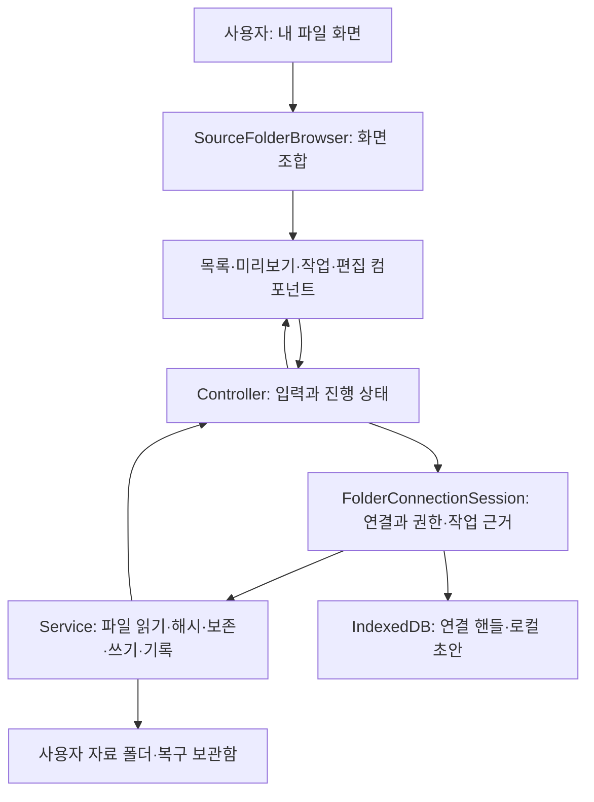

# 화면에서 시작하는 코드 설명서

2026-11-06 소셜/설정 후속: `server/authenticated-session.ts`가 이메일 소유 확인과 소셜 신원/바인딩을 구분한다. `server/auth-account.ts`는 연결된 수단 조회와 명시적 연결·마지막 수단을 남기는 해제를 담당한다. `features/auth/components/AccountLoginSettings.tsx`는 app action을 주입받아 표시하며, 폴더/편집 설정은 기존 기능 컴포넌트를 공유한다. `SessionBoundary.tsx`는 서버의 초기 검증을 표시 지연으로 반복하지 않고 창 복귀를 조용히 재확인한다. [최신 검증과 읽기 순서](verification/auth-social-settings/README.md).

2026-11-06 인증 후속: 가입 입력은 `features/auth/components/SignupScreen.tsx` → `hooks/useSignupFlow.ts` → `lib/signup-flow.ts`를 따라간다. 공통 Stepper는 표시만 공유한다. app actions가 서버 처리를 주입하며 `server/session-guards.ts`와 `SessionBoundary.tsx`가 서버 접근/브라우저 연결 수명을 나눈다. 작업 layout은 서버가 검증한 user/workspace를 폴더 Provider에 전달한다. 소셜과 안전한 요청 제한의 읽기 순서·검증은 [최신 인증 검증](verification/auth-access-and-signup/README.md)에 있다.

이 문서는 2026년 11월 4일의 실제 소스를 기준으로 작성했다. 파일 이름을 외우기보다, 화면에서 한 행동이 어떤 코드를 거쳐 파일에 반영되는지 따라가는 것이 목적이다. 처음에는 1~5절을 읽고, 관심 있는 기능 절을 골라 읽으면 된다.

설명에 나오는 `features/local-folders`의 전체 위치는 `apps/web/src/features/local-folders`다. 아래의 상대 링크는 저장소에서 바로 해당 파일을 열기 위한 것이다. 앞으로 코드가 바뀌면 줄 번호가 달라질 수 있어 함수 이름을 함께 적었다.

2026-11-04 화면 일관성 후속: 미리보기·편집은 `DocumentWorkspace`, 파일/폴더 작업은 `FileOperationHeader`와 `DestinationPlanStep`을 함께 사용한다. 아래 흐름은 유지하면서 실제 표시 코드를 더 공유하도록 고쳤다. 폴더도 처음부터 탐색창을 열지 않고 목적지 계획 화면에서 시작한다. 관련 계약은 [작업 화면 일관성 명세](specs/workspace-consistency.md)다.

사용자 후속73~76: 문서 지면은 CSS210mm(약794px) 폭까지 넓히고 짧은 문서의 최소 높이는 A4 비율로 맞췄다. 작은 화면에서는 줄어들고 긴 내용은 늘어난다. 기존 보관함 연결 버튼 하나로 선택·재연결을 처리하고 연결 상태에서는 ‘다른 보관함 선택’으로 표시한다. 일시 안내는 우측 하단 고정 알림으로 옮겨 문서 지면을 밀지 않는다. 저장 여부 확인은 문서 폭 안에서 경고와 버튼에12px 간격을 두고 표시한다. [해당 명세](specs/document-a4-vault-actions.md).

## 1. 먼저 알아야 할 전체 흐름

사용자가 ‘저장’을 누르면 화면 코드가 파일에 바로 글을 쓰는 구조가 아니다. 다음 순서를 거친다.

```text
화면의 버튼
  → 화면 상태를 관리하는 controller
  → 연결·권한·작업 수명을 관리하는 session
  → 실제 파일을 읽고 쓰는 service
  → 처리 결과를 controller에 전달
  → 바뀐 상태를 구독하는 React가 화면을 다시 표시
```

예를 들어 ‘저장 중…’이라는 문구는 파일에서 읽어 오는 내용이 아니다. controller가 자신의 상태를 `saving`으로 바꾸면 React가 그 상태에 맞는 문구를 그린다. 실제 저장 성공 여부는 service가 파일을 다시 읽어 검증한 결과로 결정한다.

코드가 여러 파일로 나뉜 이유도 여기에 있다. 버튼의 모양을 고칠 때 파일 쓰기 규칙을 건드리지 않고, 파일 검증을 고칠 때 화면 배치를 다시 작성하지 않기 위해서다. 다만 이 구분이 모든 파일을 한 줄씩 순서대로 읽어야 한다는 뜻은 아니다. 아래처럼 화면에서 출발해서 호출되는 함수만 따라가면 된다.



이 그림은 브라우저의 파일 관리 기능을 설명한다. 현재 실제 로그인·AI 응답·클라우드 검색까지 이 흐름에 구현된 것은 아니다. 서버가 사용자의 `E:\...` 경로에 직접 접근하는 구조도 아니다.

## 2. 사이트를 열면 어디서 시작하는가

Next.js의 `app` 폴더는 주소와 화면의 연결표다.

| 주소 | 시작 파일 | 역할 |
| --- | --- | --- |
| `/files` | [files/page.tsx](../apps/web/src/app/(workspace)/files/page.tsx) | 내 파일 화면을 연다. |
| `/settings` | [settings/page.tsx](../apps/web/src/app/(workspace)/settings/page.tsx) | 연결 관리와 편집 설정을 보여 준다. |
| 위 작업 영역 공통 | [(workspace)/layout.tsx](../apps/web/src/app/(workspace)/layout.tsx) | 화면들이 같은 폴더 연결을 사용하게 한다. |
| 사이트 전체 공통 | [app/layout.tsx](../apps/web/src/app/layout.tsx) | 전체 문서의 기본 구성이다. |

`(workspace)`는 주소에 나타나지 않는 묶음 이름이다. 그래서 실제 주소는 `/(workspace)/files`가 아니라 `/files`다.

작업 영역 layout의 핵심은 다음 코드다.

```tsx
return <SourceFolderProvider>{children}</SourceFolderProvider>;
```

`children`은 그 자리에 들어올 파일·설정 등의 화면이다. `SourceFolderProvider`는 이 화면들이 함께 쓰는 연결 정보를 한 번 생성해 제공한다. 설정에서 연결한 폴더를 파일 화면이 다시 연결하지 않고 사용하는 이유다.

관련 파일은 [SourceFolderProvider.tsx](../apps/web/src/features/local-folders/providers/SourceFolderProvider.tsx)다. 여기의 `developmentOwner`는 현재 개발용 사용자·작업 공간 식별자다. 실제 로그인 사용자 구현이 끝났다는 의미가 아니다.

파일 페이지에는 `Suspense`도 있다. 현재 단계 표시가 `useSearchParams`로 주소의 query를 읽기 때문에, 정적 페이지와 브라우저에서 결정되는 부분 사이에 로딩 경계를 둔다. 파일 읽기 권한을 주는 기능은 아니다.

## 3. 폴더 이름별로 무엇을 찾으면 되는가

```text
apps/web/src/
  app/                         주소별 진입점
  components/ui/               여러 기능에서 쓰는 버튼·상태·단계 표시
  features/local-folders/
    components/                실제 표시와 입력
      connection/              자료·보관함 연결, 편집 설정
      listing/                 목록, 선택, 새 항목 만들기, 화면 조합
      preview/                 읽기 미리보기, 인라인 편집
      plan/                    복사 계획, 목적지 선택, 충돌 처리
      managed/                 이동·폴더 작업·앱 휴지통
      recovery/                보관함 조회와 복원
      history/                 작업 기록과 현재 파일 확인
    hooks/                     React와 controller·주소·브라우저 수명 연결
    providers/                 여러 화면이 공유할 연결 제공
    store/                     진행 상태와 사용자 행동을 관리하는 controller
    services/                  IndexedDB 및 파일 접근·보존·검증
    lib/                       경로, 이름, 한도, 결과 형식 등의 규칙
    types.ts                   공통 데이터 형식
```

이 프로젝트에서 `store`는 상태를 보관하는 코드의 위치다. 모든 store가 별도 상태 관리 라이브러리를 쓰는 것은 아니다. `class`, 상태 객체, 구독 함수로 만든 controller가 많다.

`lib`와 `services`를 구별하는 쉬운 기준은 외부 상태를 읽는지다. ‘이 이름에 `.txt`를 붙일지’는 규칙이고, ‘그 이름의 파일이 실제로 존재하는지’는 파일 접근이다. 이름만 보고 모든 함수가 순수하다고 단정하지 말고 해당 함수의 입력과 내부 호출을 확인하면 된다.

## 4. 내 파일 화면의 실제 조립 위치

가장 먼저 읽을 화면 파일은 [SourceFolderBrowser.tsx](../apps/web/src/features/local-folders/components/listing/SourceFolderBrowser.tsx)다.

이 파일은 파일을 직접 쓰기보다 이미 준비된 기능을 묶는다.

| 화면에서 보이는 부분 | 연결된 코드 |
| --- | --- |
| 경로와 작업 화면 배치 | `FolderWorkspaceFrame` |
| 파일·폴더 목록과 선택 | `FolderListingView` |
| 자료·보관함 연결 관리 | `SourceFolderSettingsDialog` |
| 새 폴더·빈 MD/TXT 만들기 | `NewEntryForm` |
| 문서 미리보기 자리 | `FilePreviewPane` |
| 읽기 상태의 문서 | `SourceDocumentPreview` |
| 편집 상태의 문서 | `InlineDocumentEditor` |
| 단일 파일 복사·덮어쓰기 | `SourcePlanDialog` |
| 이동·폴더 작업·휴지통 | `ManagedFilesDialog` |
| 복구 보관함 목록·복원 | `RecoveryArchiveDialog` |
| 이전 작업 조회 | `FolderHistoryDialog` |

현재 미리보기 부분에는 다음 분기가 있다.

```tsx
editorState.open
  ? <InlineDocumentEditor ... />
  : <SourceDocumentPreview ... />
```

위 코드는 실제 JSX의 구조를 줄인 것이다. `조건 ? 참일 때 : 거짓일 때`라는 문법이다. 편집이 열려 있으면 같은 미리보기 자리에 편집기를 표시한다. 데스크톱에서 별도 편집 팝업이 생기지 않는 이유가 이 분기다. 좁은 화면에서는 기존 미리보기 자체의 표시 방식이 적용된다.

`onEdit` 부분을 검색하면 ‘문서 편집’에서 시작하는 호출도 찾을 수 있다.

읽기와 편집 안쪽에는 [DocumentWorkspace.tsx](../apps/web/src/features/local-folders/components/preview/DocumentWorkspace.tsx)가 공통으로 들어간다. `back`, `actions`, `status`, `info`, `children`, `footer`를 전달받아 같은 자리에 배치한다. 미리보기는 본문 자리에 `article`, 편집은 `textarea`를 전달한다. 본문에는 같은 CSS를 사용해 폭·글자·줄 간격이 달라지지 않게 한다. 화면 구조를 재사용하면서 ‘파일을 읽는가, 편집문을 저장하는가’라는 업무 책임은 각 controller에 남겨 둔다.

```tsx
const path = preview.getSnapshot().path;
if (path) void editor.open(path);
```

현재 보고 있는 문서 경로를 읽고, 경로가 있으면 편집 controller를 연다. `void`는 비동기 작업의 반환값을 이 자리에서 사용하지 않는다는 뜻이다. 파일 열기 실패는 controller가 자신의 오류 상태에 반영한다.

## 5. React와 controller가 화면을 바꾸는 방법

다음 형태가 여러 컴포넌트에 반복된다.

```tsx
const state = useSyncExternalStore(
  controller.subscribe,
  controller.getSnapshot,
  controller.getServerSnapshot,
);
```

이를 ‘controller가 상태를 바꾸면 화면도 다시 그려 달라’는 연결이라고 읽으면 된다.

| 함수 | 쉬운 의미 |
| --- | --- |
| `getSnapshot()` | 현재 상태 객체를 가져온다. |
| `subscribe(listener)` | 상태가 바뀌면 실행할 알림 함수를 등록한다. |
| `getServerSnapshot()` | 서버에서 처음 그릴 때 사용할 기본 상태를 준다. |
| controller 내부 `publish(...)` | 새 상태를 보관하고 등록된 알림을 호출한다. |

[inline-editor-controller.ts](../apps/web/src/features/local-folders/store/inline-editor-controller.ts)의 실제 핵심도 이 구조다.

```ts
private publish(value: InlineEditorState) {
  this.state = value;
  this.listeners.forEach(listener => listener());
}
```

첫 줄은 새 상태 보관, 둘째 줄은 화면에 변경 알림이다. 여기서 파일 저장을 하는 것은 아니다.

`{ ...this.state, phase: "saving" }`은 기존 상태를 복사하되 `phase`만 바꾼다는 뜻이다. `phase`는 ‘지금 어떤 상태인가’를 나타내는 이름이다. 편집기는 `loading`, `ready`, `saving`, `error` 등의 상태를 사용한다. 컴포넌트는 이 값으로 버튼 사용 가능 여부와 문구를 결정한다.

## 6. ‘폴더 연결’ 버튼을 누르면

읽을 순서는 다음과 같다.

1. [SourceFolderSettings.tsx](../apps/web/src/features/local-folders/components/connection/SourceFolderSettings.tsx): 연결 화면 조합.
2. [use-source-folder-connection.ts](../apps/web/src/features/local-folders/hooks/use-source-folder-connection.ts): 객체 생성과 브라우저 수명 연결.
3. [source-connection-controller.ts](../apps/web/src/features/local-folders/store/source-connection-controller.ts): 연결 중·성공·실패 표시.
4. [connection-session.ts](../apps/web/src/features/local-folders/services/connection-session.ts): 실제 연결 소유권, 핸들, 권한 확인.
5. [handle-repository.ts](../apps/web/src/features/local-folders/services/handle-repository.ts): IndexedDB에 핸들 저장·읽기.

hook은 아래 객체들을 한 번 구성한다.

```ts
const [session] = useState(() => new FolderConnectionSession(...));
const [controller] = useState(() => new SourceConnectionController(session, picker));
```

`useState(() => ...)`의 함수는 이 컴포넌트가 살아 있는 동안 사용할 객체를 처음 만들 때 사용된다. 화면이 다시 그려질 때마다 연결 session을 새로 만들지 않기 위한 것이다.

폴더 선택창의 결과는 경로 문자열만이 아니라 `FileSystemDirectoryHandle`이라는 객체다. 이를 ‘브라우저가 해당 폴더를 다시 찾아갈 때 쓰는 참조’라고 생각하면 된다.

```text
연결 버튼
  → controller.connect
  → 사용자 클릭 안에서 showDirectoryPicker
  → session이 현재 사용자·작업 공간과 폴더 확인
  → repository가 핸들을 IndexedDB에 저장
  → 목록·미리보기 상태 초기화
  → 연결됨 화면
```

핸들을 저장했다고 언제나 접근할 수 있는 것은 아니다. 브라우저 권한이 바뀌거나 실제 폴더가 없어질 수 있다.

- `queryPermission`: 지금 허용되어 있는지 조회한다.
- `requestPermission`: 사용자에게 허용을 요청할 수 있다.
- `getDirectoryHandle(name, { create: false })`: 기존 폴더를 찾는다.
- `getDirectoryHandle(name, { create: true })`: 없으면 생성할 수 있다.

이 차이가 중요하다. 보관함 존재 확인에 `create: true`를 사용하면 삭제된 보관함을 확인하는 과정에서 다시 만들 수 있다. 현재 존재 확인은 읽기로 판단하며 자동 재생성을 하지 않는다.

자료 연결 후에는 같은 설정 화면에서 복구 보관함 설정으로 이어진다. ‘만들 위치 선택’은 부모 위치를 고르는 과정이고 ‘이 위치에 보관함 생성’이 실제 생성이다. 보관함에 식별 파일을 기록하고 다시 확인한 뒤 연결한다. 자료 루트 바로 아래 전용 보관함도 허용하되, 일반 자료 작업 대상으로는 보호한다.

## 7. 폴더를 열고 문서를 미리 보는 과정

목록 항목을 누르면 [SourceFolderBrowser.tsx](../apps/web/src/features/local-folders/components/listing/SourceFolderBrowser.tsx)의 `onOpen`, `onOpenFile` 연결을 따라간다.

```text
폴더 클릭 → navigation.openFolder → listing의 폴더 읽기
파일 클릭 → navigation.openFile → preview의 문서 읽기
```

주요 상태 파일은 [source-navigation-controller.ts](../apps/web/src/features/local-folders/store/source-navigation-controller.ts), [source-listing-controller.ts](../apps/web/src/features/local-folders/store/source-listing-controller.ts), [source-preview-controller.ts](../apps/web/src/features/local-folders/store/source-preview-controller.ts)다.

navigation은 ‘어디를 보고 있는가’와 방문 이동을, listing은 목록 읽기·선택을, preview는 한 문서 읽기의 진행을 맡는다. 실제 목록 읽기는 [source-folder-listing.ts](../apps/web/src/features/local-folders/services/source-folder-listing.ts)에서 확인할 수 있다.

경로는 보통 `string[]`다. 연결 루트가 `note`일 때 아래처럼 읽는다.

```ts
[]                       // note 자체
["회의"]                 // note/회의
["회의", "기록.md"]       // note/회의/기록.md
```

브라우저가 선택한 루트 밖으로 임의 접근하기 위한 절대 경로가 아니다. `..` 같은 입력을 거부하는 경로 검사가 별도로 존재한다.

문서 미리보기는 MD/TXT, UTF-8, 크기 등의 조건을 확인한다. 선택 상태는 문서 내용과 별개다. 선택에 들어가는 긴 누르기·Space 동작을 고치려면 목록의 선택 상호작용을 찾고, 읽기 내용을 고치려면 preview 흐름을 찾아야 한다.

## 8. 복사·이동 버튼이 두 작업 경로로 나뉘는 이유

`SourceFolderBrowser`의 `onReviewPlan`을 보면 다음 판단이 있다.

```tsx
if (operation === "move" || folders) {
  void managed.open(...);
} else {
  plan.open(operation);
}
```

`folders`는 선택 항목에 폴더가 포함되었는지다. 현재 단일 파일 복사는 기존의 계획·충돌·덮어쓰기 흐름을 사용하고, 이동 및 폴더 작업은 트리 단위 검증이 가능한 managed 흐름을 사용한다. 화면에 복사 버튼이 두 개 있다는 뜻은 아니다.

| 작업 | 화면·상태의 중심 | 실제 처리의 중심 |
| --- | --- | --- |
| 파일 복사·충돌 처리 | `SourcePlanDialog`, `source-plan-controller` | `source-copy-execution`, `recovery-backup`, `recovery-overwrite` 관련 service |
| 이동·폴더 복사·휴지통 | `ManagedFilesDialog`, `managed-files-controller` | `managed-inspection`, `managed-tree`, `managed-archive`, `managed-execution` |

공통 목적지 UI는 양쪽에서 재사용한다. 업무 규칙이 다른 모든 작업을 하나의 거대한 함수로 합친 것은 아니다.

사용자 후속 지적에 따라 계획 화면도 공유한다. [FileOperationHeader.tsx](../apps/web/src/features/local-folders/components/plan/FileOperationHeader.tsx)는 제목·출발 위치·선택 수·닫기·Stepper를, [DestinationPlanStep.tsx](../apps/web/src/features/local-folders/components/plan/DestinationPlanStep.tsx)는 작업 선택·목적지 버튼·계획 확인을 표시한다. 파일 쪽 `PlanDestinationInput`은 기존 controller를 이 공통 입력에 연결하는 작은 어댑터다. 폴더 쪽 `ManagedOperationView`도 같은 입력에 자기 controller의 함수를 연결한다.

```text
파일/폴더/혼합 선택 → 복사 또는 이동
  → 공통 목적지 계획 화면
  → 목적지 선택 버튼 → 공통 폴더 탐색 → 이 폴더 선택
  → 계획 화면에서 목적지 확인 → 계획 만들기
  → 실제 자료 검사 → 명시적 최종 실행
```

파일-only의 기존 이름 충돌·보존·덮어쓰기와 폴더 트리의 항목 수·빈 폴더·관리 영역 검사는 다른 처리 계약이다. 현재는 그 검증 코드를 유지하며 사용자가 조작하는 화면을 합쳤다. 따라서 폴더를 골랐다는 이유로 목적지 계획을 건너뛰는 차이가 생기지 않는다.

## 9. 목적지 선택과 ‘새 폴더 만들기’의 재사용

핵심 화면은 [DestinationFolderPicker.tsx](../apps/web/src/features/local-folders/components/plan/DestinationFolderPicker.tsx)다. 다음 기능을 함께 제공한다.

- 현재 위치와 상위 폴더 이동.
- [DestinationPathForm.tsx](../apps/web/src/features/local-folders/components/plan/DestinationPathForm.tsx)의 경로 입력.
- 하위 폴더 탐색과 ‘이 폴더 선택’.
- [NewEntryForm.tsx](../apps/web/src/features/local-folders/components/listing/NewEntryForm.tsx)의 새 항목 생성.

복사·이동·복원마다 새 폼을 따로 복제하지 않는다. `NewEntryForm`은 현재 `path`, `folderName`, 생성 후 실행할 `onCreated`를 전달받는다.

```tsx
<NewEntryForm
  path={path}
  folderName={folderName}
  disabled={state.phase !== "ready"}
  onCreated={() => void controller.retry()}
/>
```

같은 폼이지만 `path`가 다르면 생성 위치가 달라진다. 생성이 끝나면 picker가 목록을 다시 읽는다. 이처럼 입력과 완료 후 행동을 전달하는 것이 UI 재사용의 실제 예다.

`ManagedFilesState.destinationConfirmed`는 목적지를 사용자가 확정했는지다. 처음에는 false라 계획 버튼을 누를 수 없다. `choose()`는 목적지만 확정하고 계획 화면으로 돌아간다. `review()`는 별도로 ‘계획 만들기’를 눌렀을 때 실행한다. 복원 업무는 기존의 선택 후 복원 검토 계약을 유지한다.

경로 입력의 처음 값은 연결 루트 이름을 포함한다. 예를 들어 `검증 자료 A` 또는 `검증 자료 A/새 목적지`다. 내부 서비스에 전달할 때는 [pasted-folder-path.ts](../apps/web/src/features/local-folders/lib/pasted-folder-path.ts)가 루트 표시를 제거해 상대 경로 배열로 변환한다. Windows 절대 경로 붙여넣기는 연결 루트 아래의 상대 후보를 확인하는 절차를 거친다. 문자열만 보고 OS의 동일한 위치라고 확정하지 않는다.

복원은 연결 루트 `[]`에서 시작한다. 과거 원본 폴더가 이미 없어졌더라도 처음부터 오류 화면이 되지 않고 사용자가 다른 위치를 고를 수 있다.

## 10. 검사와 실행을 분리해서 읽기

[managed-files-controller.ts](../apps/web/src/features/local-folders/store/managed-files-controller.ts)의 `review`와 `start`를 비교하면 이해하기 쉽다.

```text
목적지 선택
  → review: 현재 파일·트리를 읽고 계획을 검사
  → ready: 검토 결과와 실행 버튼 표시
  → 사용자가 실행 클릭
  → start: 승인된 계획으로 쓰기 요청
  → completed / cancelled / error
```

`review`는 `prepare`를 호출하고, `start`는 준비된 `preview`가 있어야 `run`을 호출한다. session은 화면에 보여 준 요약과 별개로 실제 핸들·해시 등의 근거를 내부에 보관한다. 주소에 `?step=execute`를 직접 적는 것만으로 실행 가능한 이유가 되지 않는다.

실제 실행은 [managed-execution.ts](../apps/web/src/features/local-folders/services/managed-execution.ts)에서 읽는다. 이동·휴지통은 원본을 없애는 동작이 포함되므로 대체로 다음 원칙을 따른다.

```text
현재 원본·목적지·보관함 재확인
  → 원본의 복구 사본 생성·검증
  → 목적지 생성·내용 검증(이동일 때)
  → 제거할 원본을 다시 확인
  → 파일 및 빈 폴더를 개별적으로 제거
  → 결과·양쪽 기록 확인
```

중간에 실패하면 이미 일어난 모든 일을 자동으로 되돌렸다고 표시하지 않는다. 일부 결과가 남을 수 있으므로 `uncertain` 같은 상태로 확인 필요를 표시한다. 대량 재귀 삭제 한 번으로 원본 트리를 없애는 방식은 사용하지 않는다.

`managed-tree.ts`는 검사할 트리와 한도를, `managed-inspection.ts`는 검사와 계획을, `managed-archive.ts`는 보존 기록과 사본을 맡는다. 구현을 수정할 때는 이 책임을 기준으로 읽으면 된다.

## 11. 같은 이름의 파일을 덮어쓸 때

기존 파일 복사에서 이름 충돌이 있으면 바로 쓰지 않는다.

```text
위치 선택 → 충돌 검사 → 기존 목적지 파일 보존
  → 보존 사본과 기록 검증 → 별도 덮어쓰기 확인
  → 현재 파일 다시 대조 → 덮어쓰기 → 결과 검증
```

[SourcePlanDialog.tsx](../apps/web/src/features/local-folders/components/plan/SourcePlanDialog.tsx)에서 `backup` 상태를 읽어 [RecoveryBackupView.tsx](../apps/web/src/features/local-folders/components/plan/RecoveryBackupView.tsx)를 표시한다. 화면 진행은 [recovery-backup-controller.ts](../apps/web/src/features/local-folders/store/recovery-backup-controller.ts)가 관리하고, session의 `inspectSourceBackup`, `executeSourceBackup`, `executeSourceOverwrite`가 파일 처리와 연결된다.

해시는 파일 내용을 비교하기 위한 값이다. 이름·용량·수정 시각이 같아도 다른 파일일 수 있어 실제 핸들의 동일성도 함께 확인한다. 보관 사본이 있다고 무조건 덮어쓰기를 허용하는 것이 아니라, 현재 목적지가 보존 당시 그 파일인지 다시 확인한다.

단계 표시는 공통 [WorkflowStepper.tsx](../apps/web/src/components/ui/WorkflowStepper.tsx)와 [workflow-steps.ts](../apps/web/src/features/local-folders/lib/workflow-steps.ts)를 사용한다. 단계가 늘어나도 매번 별도 번호 UI를 새로 만들지 않도록 `steps`, `current`, `label`을 전달한다. 로그인·가입에서도 이 표시 컴포넌트를 재사용할 수 있지만, 현재 로그인 업무 흐름이 구현된 것은 아니다.

## 12. 문서 편집: 입력과 저장은 다른 일이다

읽을 순서는 아래 다섯 파일이다.

1. [InlineDocumentEditor.tsx](../apps/web/src/features/local-folders/components/preview/InlineDocumentEditor.tsx): 버튼·입력·상태 표시·자동저장 타이머.
2. [use-inline-editor.ts](../apps/web/src/features/local-folders/hooks/use-inline-editor.ts): controller 생성, 페이지 이탈 시 초안 보호.
3. [inline-editor-controller.ts](../apps/web/src/features/local-folders/store/inline-editor-controller.ts): 편집 내용·저장한 내용·진행 상태.
4. [inline-editor-session.ts](../apps/web/src/features/local-folders/services/inline-editor-session.ts): 첫 보존과 반복 저장의 근거·권한·잠금.
5. [verified-text-writer.ts](../apps/web/src/features/local-folders/services/verified-text-writer.ts): 실제 안전한 텍스트 쓰기와 재검증.

편집 controller의 주요 값은 다음과 같다.

| 값 | 의미 |
| --- | --- |
| `text` | 지금 입력창에 있는 내용. |
| `savedText` | 마지막으로 저장 성공을 확인한 내용. |
| `text !== savedText` | 아직 저장하지 않은 변경이 있음. |
| `hasBackup` | 현재 편집 세션의 첫 원본 보존이 만들어졌음. |
| `composing` | 한글 등의 글자를 조합 중임. |
| `closeRequested` | 저장하지 않은 내용을 닫으려 해서 확인을 표시 중임. |

입력할 때는 다음 코드가 실행된다.

```tsx
onChange={event => controller.setText(event.target.value)}
```

이 시점에는 원본 파일을 쓰지 않는다. controller의 `text`를 바꾸고 로컬 초안을 보관한다. 원본 저장은 직접 저장 버튼 또는 주기적 타이머가 `save`를 호출할 때 이루어진다.

### 12.1 첫 저장

첫 버튼 이름은 ‘원본 보존하고 저장’이다.

```text
클릭 → controller.save(true)
  → session.saveInlineEditor
  → InlineEditorSession.save
  → 현재 문서 버전·권한·보관함 검사
  → 기존 managed 보존/쓰기 기능으로 원본 한 번 보존
  → 편집한 내용 저장·재읽기 검증
  → hasBackup와 savedText 갱신
```

`InlineEditorSession`의 `proof`는 편집을 시작한 실제 파일 핸들, 용량·시각·해시와 연결 수명을 담는다. ‘어느 파일의 어떤 버전을 보고 저장하는가’에 대한 내부 근거다. 이 객체를 화면에서 임의로 만들어 실행에 사용하는 구조는 아니다.

### 12.2 두 번째 이후 저장

`proof.backupId`가 있으면 새 보존 폴더를 만들지 않고 기존 보존본을 확인한다. 최초 원본 사본은 그대로 두며, 반복 저장의 시작·검증 기록은 추가한다.

```text
저장 요청 → 기존 원본 보존 사본 검증
  → 현재 파일이 직전 저장 버전과 같은지 검사
  → 새 내용 저장 → 재읽기·해시 비교
  → 이번 저장 기록 추가 → 다음 저장의 기준 갱신
```

‘백업을 한 번만 한다’는 것은 현재 편집 세션의 최초 원본 사본을 재사용한다는 뜻이다. 편집을 끝내고 새로 시작하면 새 편집 세션이다. 각각의 자동저장 내용을 모두 별도 복구 사본으로 쌓는 버전 관리 기능은 아니다.

실제 쓰기는 `writeVerifiedText`를 공유한다. 처음 저장과 반복 저장이 서로 다른 검증 알고리즘을 갖지 않도록 했다. 이 함수는 파일 동일성·크기·시각·해시를 확인하고, 64KiB 단위로 쓰고, 완료 후 파일을 다시 읽어 내용이 맞는지 확인한다. `encodeEditedText`는 UTF-8 바이트 한도와 기존 BOM·줄바꿈 형식도 처리한다.

### 12.3 자동저장 설정

[EditorSettings.tsx](../apps/web/src/features/local-folders/components/connection/EditorSettings.tsx)가 `/settings`에 표시된다. [editor-preferences.ts](../apps/web/src/features/local-folders/store/editor-preferences.ts)의 허용값은 다음과 같다.

```ts
export const editorIntervals = [0, 15, 30, 60, 120] as const;
```

`0`은 끄기이며 기본은 30초다. 설정은 이 브라우저의 localStorage에 저장한다. 사용자 계정 서버 설정은 아직 아니다.

편집기의 타이머는 `controller.save(false)`를 호출한다. `false`는 자동저장 요청을 뜻한다. 자동저장은 첫 직접 저장 뒤에만 동작하고, 현재 쓰기 권한을 조회한다. 권한창을 주기적으로 띄우지 않는다. 탭이 보이는 동안 실행하며 조합 중·저장 중·변경 없음이면 건너뛴다.

### 12.4 저장하는 동안 다시 입력하면

controller의 `save`는 시작할 때 `const text = this.state.text`로 이번 저장 내용을 잡아 둔다. 저장 중 사용자가 새 글자를 입력해도 이번 저장의 `savedText`는 시작 당시 내용으로 갱신한다.

예를 들어 ‘가’를 저장하는 동안 ‘나’를 더 입력해 ‘가나’가 되었다면:

```text
파일 저장 결과: 가
입력창: 가나
savedText: 가
text: 가나
따라서 여전히 저장하지 않은 변경 있음
```

이후 직접 저장이나 다음 자동저장에서 ‘가나’를 저장한다. 완료 콜백이 입력창 전체를 이전 내용으로 덮는 방식이 아니다.

### 12.5 외부 변경·닫기·한글 입력

다른 프로그램이 문서를 바꾸면 이전 기준과 다르므로 저장을 중지한다. 로컬 초안을 유지하고 사용자가 원문을 다시 읽을지 선택하게 한다. 원문 재읽기는 현재 초안을 버리는 명시적 행동이다.

변경이 있는 상태에서 닫으면 ‘계속 편집’ 또는 ‘편집 내용 버리고 닫기’를 표시한다. 저장 중에는 즉시 닫아 결과를 잃지 않도록 제한한다.

한글 입력은 한 글자가 여러 입력 사건으로 조합된다. `onCompositionStart`·`onCompositionEnd`로 `composing`을 관리하며, 조합 중 저장과 Ctrl/Cmd+S 처리를 막는다. 실제 물리 키보드의 모든 입력기 조합까지 자동 시험으로 보장하는 것은 아니다.

## 13. 새로고침하면 무엇을 어떻게 복원하는가

세 가지 저장 위치를 구분해야 한다.

| 위치 | 저장 내용 | 이유 |
| --- | --- | --- |
| URL query | `flow`, `step`, 불투명한 `draft` ID | 현재 작업과 표시 단계 연결. |
| IndexedDB | 선택·경로·문서 초안·연결 핸들·편집 체크포인트 | 이 브라우저에서 실제 작업 상태 복원. |
| localStorage | 자동저장 간격 | 간단한 기기 설정. |

예시 주소는 `/files?flow=managed&step=review&draft=UUID`다. `UUID` 자리에는 실제 임의 식별자가 들어간다. 문서 본문이나 파일명을 URL에 넣지 않는다.

### 13.1 단계의 기준은 URL

[use-workflow-url.ts](../apps/web/src/features/local-folders/hooks/use-workflow-url.ts)는 Next의 `useSearchParams`로 읽고 `useRouter`의 `replace`로 주소를 바꾼다.

```ts
const raw = query.get("step");
router.replace(url, { scroll: false });
```

Stepper가 표시하는 현재 단계는 이 URL 값에서 결정한다. 반면 실제 읽기·쓰기 진행과 실행 가능 여부는 controller와 session이 검증한다. 진행 상태가 바뀌면 주소를 갱신하지만, 주소만 고쳐서 과거 승인이나 파일 쓰기를 되살리지는 않는다.

Next 공식 문서: [useRouter](https://nextjs.org/docs/app/api-reference/functions/use-router), [useSearchParams](https://nextjs.org/docs/app/api-reference/functions/use-search-params).

### 13.2 F5 후 순서

연결 복원은 `FolderConnectionSession.resumeGrantedConnections`에서 시작한다. 저장된 자료 핸들의 현재 읽기 권한이 이미 허용이면 연결을 재개한다. 보관함도 식별·위치를 다시 확인한다. 권한이 없으면 사용자가 다시 연결해야 한다.

[use-workspace-workflow.ts](../apps/web/src/features/local-folders/hooks/use-workspace-workflow.ts)는 연결이 준비되면 처음 주소의 초안 ID로 [workflow-drafts.ts](../apps/web/src/features/local-folders/services/workflow-drafts.ts)를 읽는다.

```text
페이지 재생성
  → 저장 핸들 읽기·현재 허용 상태 조회
  → URL의 draft에 해당하는 로컬 초안 읽기
  → 사용자·작업 공간·연결 루트 동일성 확인
  → 폴더/선택/편집 또는 검토 화면 복원
  → 현재 파일을 다시 검사
```

이전 쓰기를 자동 재실행하지 않는다. 실행 중 F5였다면 중단 상태로 안내한다. 완료 결과는 로컬 기록으로 표시할 수 있지만 현재 파일이 지금도 존재한다는 보증으로 바꾸지 않는다. 실제 현재 내용 확인은 별도 조회가 필요하다.

편집은 저장한 체크포인트의 파일 핸들·해시·용량·시각을 현재 파일과 대조한다. 맞지 않으면 초안을 보여 주되 쓰기를 차단한다. 페이지 이탈 직전의 텍스트는 sessionStorage의 보조 사본도 사용한다. 모든 브라우저 강제 종료 순간의 마지막 키 입력까지 영구 저장한다고 보장할 수는 없다. 저장소 오류는 화면에 표시한다.

복구 사본의 새 파일 복원에는 [use-recovery-workflow.tsx](../apps/web/src/features/local-folders/hooks/use-recovery-workflow.tsx)가 동일한 방식으로 연결된다.

탐색 중 `pickerPath`와 확정한 `destination`도 따로 보관한다. 예를 들어 목적지를 A로 확정한 다음 B를 둘러보다 F5를 누르면, B는 탐색 위치이고 A는 확정 위치다. 복원한 탐색창을 취소했다고 B를 확정한 것으로 바꾸지 않는다.

복원 완료 같은 일시 안내는 [DismissibleNotice.tsx](../apps/web/src/components/ui/feedback/DismissibleNotice.tsx)로 표시한다. 기존 `StatusNotice`의 모양에 닫기 버튼과 기본5초 수명을 덧붙인다. 마우스가 올라가 있거나 키보드 초점이 안에 있으면 타이머를 멈춘다. 중요한 오류·실행 확인·진행 상태에는 자동 닫기를 적용하지 않는다. 이 알림을 닫아도 파일 처리 상태는 바뀌지 않는다.

이미지에서 본 ‘변경사항 저장’ 권한창은 브라우저가 그리는 UI다. 웹앱이 DOM/CSS로 만든 화면이 아니어서 이 공통 알림으로 교체하거나 자동으로 닫을 수 없다. 앱은 사용자의 직접 저장에서 쓰기 권한을 요청하고 그 결과에 대응한다. [Chrome 공식 설명](https://developer.chrome.com/docs/capabilities/web-apis/file-system-access).

### 13.3 링크를 다른 사람에게 보내면

URL의 단계는 공유할 수 있지만, 로컬 폴더 핸들과 본문은 상대방 기기에 없다. 링크가 파일 접근 권한이나 문서 본문을 전송하지 않는다. 해당 초안이 없는 기기에서는 로컬 연결·초안이 필요하다는 안내를 표시한다. 실제 다중 기기 이어 하기는 로그인·동기화 등 별도 설계가 필요하다.

## 14. 복구 보관함·휴지통·작업 기록의 차이

| 화면 | 보고 있는 대상 | 시작점 |
| --- | --- | --- |
| 복구 보관함 보기 | 기존 목적지 파일의 보존 사본·복원 | `RecoveryArchiveDialog`와 `RecoveryRestoreView` |
| 휴지통·보존 기록 | managed 작업에서 보존한 트리·문서 | `ManagedFilesDialog`의 archives 모드 |
| 작업 기록 | 자료 위치의 생성·복사·보존·복원 기록 | `FolderHistoryDialog` |

앱 휴지통은 OS 휴지통과 별개의 복구 사본 관리다. 영구 삭제나 자동 보관 기간 정리는 현재 기능이 아니다.

복원도 ‘옛 파일에 무조건 덮기’가 아니라 기존 폴더에 새 항목으로 복원하는 흐름이다. 위치·이름 충돌·보관본을 검사한 후 별도 실행을 받는다. 원래 파일명이 이미 있으면 충돌하지 않는 새 이름을 제안한다.

기록과 실제 파일은 다를 수 있다. 어제 복원 성공 기록이 있어도 오늘 사용자가 파일을 지웠을 수 있다. 현재 파일 확인은 읽기 검사이며, 과거 성공 기록을 바꾸거나 파일을 자동 복구하는 행동이 아니다.

## 15. 코드에 검사가 반복되는 이유

### `await` 뒤에는 상황이 바뀔 수 있다

`await`는 파일 읽기나 저장이 끝날 때까지 해당 함수의 다음 줄을 기다리는 문법이다. 브라우저 전체를 멈추는 것은 아니다. 기다리는 사이 사용자가 연결을 바꾸거나 작업을 취소할 수 있다.

따라서 controller에는 `sequence`, session에는 `generation` 같은 번호가 있다. 시작할 때 번호를 기억하고 완료 후 현재 번호와 다르면 결과를 적용하지 않는다. ‘옛 폴더 읽기가 늦게 끝나 새 폴더 화면을 덮는 문제’를 막는다.

### 취소 요청과 완료는 다르다

`AbortController`의 `abort()`는 중단 요청이다. 이미 실행한 파일 쓰기를 시간을 되돌려 없애지는 않는다. service가 `signal.aborted`를 확인하면서 안전한 위치에서 멈추고, 남은 부분 결과를 기록해야 한다.

### 잠금과 파일 검사는 서로 다른 일이다

`navigator.locks`는 이 앱의 같은 origin 작업끼리 충돌하지 않도록 조정한다. 외부 편집기까지 잠그는 OS 전체 잠금은 아니다. 그래서 실제 파일의 동일성과 내용도 다시 검사한다.

### JSON에도 검사가 필요하다

TypeScript 타입은 실행 전에 코드를 검사한다. 사용자가 수정한 JSON이나 IndexedDB의 오래된 데이터까지 자동 보장하지 않는다. Zod의 `safeParse`/`parse`는 실행 중 받은 데이터 모양을 검사한다. 모양이 맞더라도 파일 권한·실제 위치·해시까지 맞는 것은 아니므로 별도 검사가 있다.

### 양쪽 기록은 왜 쓰는가

보관함 사본과 자료 폴더의 `.moa-history`에 작업 기록을 연결해, 무엇을 어디서 처리했는지 추적한다. 양쪽 기록이나 실제 파일 확인이 끝나지 않으면 단순히 성공으로 뭉개지 않는다. 기록은 실패 원인을 추적하는 근거이며 완전한 OS 트랜잭션을 대신하지는 않는다.

## 16. 내가 수정하려는 내용에 따라 읽을 곳

| 바꾸려는 것 | 먼저 볼 파일 | 함께 확인할 것 |
| --- | --- | --- |
| 파일 화면 배치 | `components/listing/SourceFolderBrowser.tsx`, `FolderWorkspaceFrame.tsx` | 좁은 화면의 `FilePreviewPane` |
| 버튼 문구·편집 표시 | `components/preview/InlineDocumentEditor.tsx` | controller의 phase 의미 |
| 자동저장 선택값 | `store/editor-preferences.ts`, `connection/EditorSettings.tsx` | 타이머와 기존 설정값 호환 |
| 저장 가능 시점 | `store/inline-editor-controller.ts` | session의 실제 권한·검증 |
| 저장 검증 | `services/inline-editor-session.ts`, `verified-text-writer.ts` | 첫 저장과 반복 저장 모두 |
| 새 폴더 만들기 폼 | `components/listing/NewEntryForm.tsx` | 목록과 모든 목적지 picker |
| 경로 입력 해석 | `lib/pasted-folder-path.ts` | Windows 경로·루트 표시·상대 경로 시험 |
| 공통 단계 디자인 | `components/ui/WorkflowStepper.tsx`와 CSS | 줄바꿈·aria-current·모션 설정 |
| 단계와 F5 복원 | `hooks/use-workflow-url.ts`, `use-workspace-workflow.ts` | 읽기 복원과 쓰기 재실행 구분 |
| 이동·폴더 처리 | `store/managed-files-controller.ts`, `services/managed-execution.ts` | 보존·충돌·부분 실패 |
| 복구 보관함 연결 | `store/recovery-connection-controller.ts`, `services/connection-session.ts` | 위치 보호·식별 파일·삭제된 폴더 |

화면 문구 하나를 바꿀 때 위 표의 모든 파일을 수정할 필요는 없다. 먼저 한 파일에서 입력과 호출 함수를 확인하고, 동작을 바꿔야 할 때만 다음 책임으로 내려가면 된다.

## 17. 코드를 읽는 연습: ‘저장’을 직접 따라가기

1. `InlineDocumentEditor.tsx`에서 ‘원본 보존하고 저장’을 검색한다.
2. 그 버튼의 `onClick={save}`를 찾는다.
3. 같은 파일의 `save`가 `controller.save(true)`를 부르는 것을 확인한다.
4. `inline-editor-controller.ts`의 `save`에서 입력을 잡아 두고 `phase: "saving"`으로 바꾸는 부분을 읽는다.
5. 생성자의 `write`가 어디서 오는지 `use-inline-editor.ts`를 읽는다.
6. `connection.saveInlineEditor`를 따라 `connection-session.ts`의 `saveInlineEditor`를 찾는다.
7. `inline-editor-session.ts`의 `save`에서 `backupId` 유무로 첫 저장과 반복 저장이 갈라지는 것을 읽는다.
8. 실제 파일 쓰기는 `verified-text-writer.ts`에서 확인한다.
9. 다시 controller로 돌아와 `savedText`와 `hasBackup` 갱신을 읽는다.
10. 화면으로 돌아와 ‘저장됨’ 문구가 어떤 상태에서 표시되는지 확인한다.

이렇게 한 행동을 왕복해서 읽으면 파일 수가 많아도 따라갈 범위를 좁힐 수 있다. 처음부터 모든 service의 실패 분기를 외우려 하기보다 정상 경로를 한 번 이해한 다음 외부 변경·권한 거부·취소를 하나씩 추가해 읽는 편이 좋다.

## 18. 확인과 현재 한계

자동 시험 코드는 제품 코드와 분리되어 있다.

- `apps/web/tests/local-folders/`: 경로 규칙·controller·파일 처리 실패 조건 시험.
- `tests/browser/`: 실제 Chromium 화면과 브라우저 파일 API를 사용하는 흐름 검사.
- `tests/fixtures/`: 시험용 폴더·권한·실패를 만드는 합성 자료.
- `tests/architecture/`: 서버·기능·domain import 경계 검사.
- `docs/verification/workflow-ux/`: 이번 사용자 수정의 실행 근거.

`pnpm check`는 타입 → 린트 → 단위 시험 → 경계 검사 → production 빌드를 실행한다. 이 명령만 통과했다고 Windows의 실제 폴더 선택창이나 모든 화면 조작이 검증된 것은 아니다.

현재 연결은 localhost 개발용 소유자 기반이다. 브라우저 저장소 삭제·다른 기기·권한 철회 시 복원이 제한된다. MD/TXT 편집은 UTF-8 2MiB 한도이며 폴더 작업도 크기·항목 수·깊이 한도가 있다. 파일 시스템에 대한 OS 전체 원자적 트랜잭션이나 외부 프로그램의 동시 수정을 완전히 잠그는 기능은 없다.

구현 규칙은 [managed-files 명세](specs/managed-files.md), [이번 UX 명세](specs/workflow-ux.md), [개발 지침](guidelines.md)을 함께 확인하면 된다. 이 설명서는 코드 읽기를 돕는 문서이며 최신 실행 결과는 검증 문서와 실제 소스를 우선한다.

## 19. 파일 기능 밖의 코드는 어떻게 연결되는가

파일 관리에 많은 분량을 쓴 이유는 현재 실제 동작 대부분이 이 기능에 있기 때문이다. 나머지 코드를 볼 때는 다음 범위를 구분하면 된다.

| 위치 | 현재 역할 | 읽을 때 주의할 점 |
| --- | --- | --- |
| `app/(workspace)/page.tsx` | 대화 진입 화면 | AI 응답·대화 저장이 아직 연결되지 않았다고 명시하고 입력을 비활성화한다. |
| `components/layout/WorkspaceShell.tsx` | 공통 메뉴·페이지 틀 | 파일 시스템 업무 규칙을 구현하는 곳이 아니다. |
| `app/login`, `app/welcome` | 로그인·시작 경로 | 실제 인증이 완료됐다는 의미가 아니다. |
| `app/preview`, `prototypes/` | 합성 자료로 디자인을 검토하는 화면 | 시안의 버튼·내용을 실제 데이터 처리와 혼동하지 않는다. |
| `packages/domain/src/index.ts` | 문서 후보의 확장자·용량 제한 | React·Next·DB SDK 없이 검사할 수 있는 규칙이다. 실제 파일 디코딩·권한 검사는 별도다. |
| `packages/domain/src/local-record.ts` | 독립 기록 형식과 규칙 | UI에서 쓰는 실제 파일 핸들과 구분한다. |
| `tests/s0` | 독립 기록 저장·복구를 시험하는 도구 | 제품 화면에 모두 통합됐다는 의미가 아니다. |
| `app/api/health/route.ts` | 웹 프로세스 상태 응답 | AI·DB·로그인 준비 완료 확인은 아니다. |

전체 구조는 ‘주소를 여는 app → 공통 작업면 → 실제 기능 모듈’이다. 그 바깥에 순수 업무 규칙과 검증 도구를 둔다. 앞으로 AI나 인증을 구현할 때도 현재 파일 화면 한 파일에 통신과 상태를 모두 추가하기보다 해당 기능의 책임과 연결 지점을 따로 정해야 한다.

파일 작업을 이해한 다음 범위를 넓히려면 `WorkspaceShell`로 공통 틀을 확인하고, domain의 공개 타입과 규칙을 읽은 뒤, 명세에서 아직 구현하지 않은 업무 경계를 확인하면 된다. 시안 전체를 기능 완료 코드로 읽지 않는 것이 전체 구조를 이해하는 데 도움이 된다.
